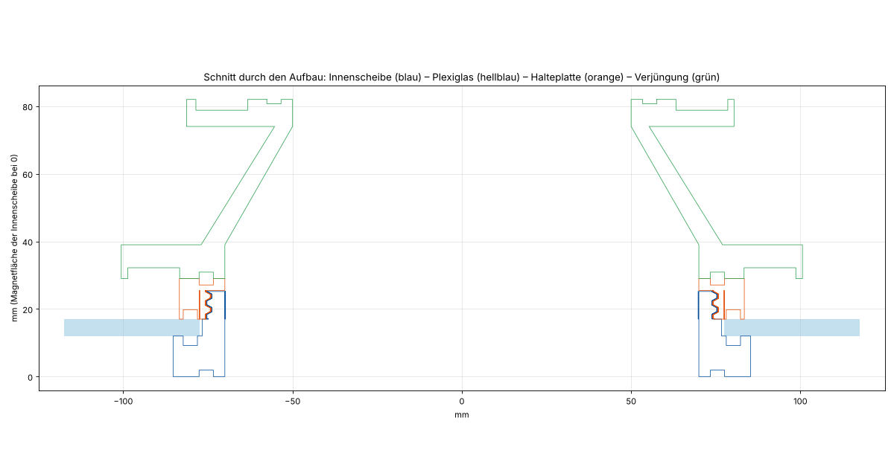
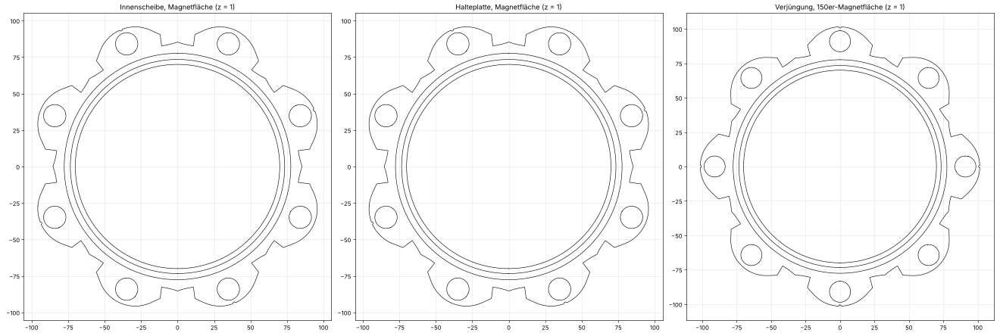
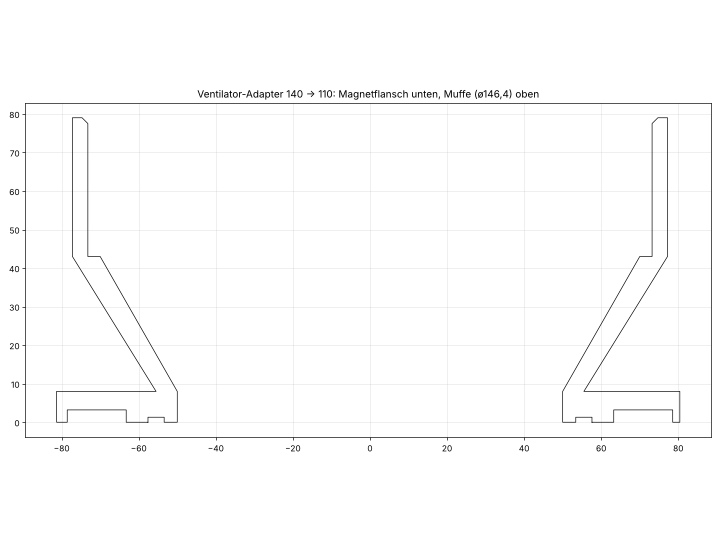

# Abluft – magnetischer Schlauchanschluss für ein Dachfenster (150 mm → 110 mm)

Abluft-Anschluss für einen Laser-Cutter: Eine 5 mm dicke Plexiglasscheibe hängt in einem Dachfenster und hat einen runden Ausschnitt mit **155 mm Durchmesser** (für 150-mm-Schläuche). Auf der Innenseite hängt ein 110-mm-Abluftschlauch daran, auf der Außenseite lassen sich später z. B. Umlenker ansetzen. Alles wird aus PETG gedruckt, die Dichtungen aus TPU. Das System ist an die magnetischen Schlauchadapter von MakerWorld angelehnt (siehe [Vorlagen](#vorlagen-und-lizenz)); neue Teile sollen sich **nahtlos** an dieselben Magnetflächen anschließen.

## Prinzip

- **Durchführung durch das Plexiglas (zwei Teile):**
  - **Innenscheibe** (Raumseite): flache Scheibe mit Magnetlappen, aus ihr wächst ein **Rohr** (Luftkanal ø140 mm) durch den Ausschnitt. Das Rohr hat einen glatten **Zentrierbund** im Bereich der Plexiglasdicke und darüber ein feines Außengewinde.
  - **Halteplatte** (Dachseite): flache Scheibe mit Magnetlappen und Innengewinde. Sie wird von oben auf das Rohr geschraubt und klemmt das Plexiglas zwischen beiden Scheiben.
  - Auf **beiden Außenflächen** sitzen 8 Magnete (15 × 3 mm) und eine Dichtungsnut, und auf der **Plexiglasseite** jeder Scheibe sitzt eine zweite Nut für eine TPU-Dichtung.
- **Verjüngung 150 → 110:** Magnetflansch (150) → Trichter (35 mm, ca. 30° Halbwinkel) → am 110er-Ende ein Magnetflansch im Muster der 110er-Referenz. Darauf passt der Schlauchanschluss mit 110-mm-Stutzen. Als Varianten gibt es statt des Flanschs einen festen Schlauchstutzen mit Wulsten oder einen glatten Rohrstumpf (ø109 × 36 mm, zum Überstülpen der Muffe eines 110er-KG-Rohrs), wahlweise gerade oder gewinkelt.
- **Lastpfad (Dachfenster, Schlauch hängt innen):** Schlauch und Kupplung hängen über die **Magnete** an der Innenscheibe. Die Innenscheibe hängt über das **Gewinde** an der Halteplatte. Die Halteplatte liegt auf dem Plexiglas. Das Gewinde steht also dauerhaft unter Zug; Seitenkräfte gehen über den Zentrierbund ins Plexiglas.
- **Abdichtung:** TPU-Rundschnüre (Ø 4 mm) in Nuten. Auf den Magnetflächen liegt jeweils **ein** Ring in den beiden gegenüberliegenden Nuten. Die Plexiglas-Ringe dichten Scheibe gegen Plexiglas. Gewinde und Zwischenräume liegen im abgeschlossenen Totraum innerhalb der Plexiglas-Ringe, die Dichtung hängt nicht am Gewinde.
- **Magnetlappen sind um 22,5° gedreht** (`lobe_offset150`): Das Plexiglas hat in der Ecke nur etwa 20 mm Rand ab der Ausschnittkante. Die Scheiben reichen nur 95,7 mm vom Mittelpunkt (frei sind 97,5 mm). Anschlussteile mit 8 Magneten werden deshalb **um 22,5° gedreht** aufgesetzt, damit die Magnete übereinanderliegen.

## Dateien

| Datei | Inhalt |
|---|---|
| `abluft_system.scad` | Quelle, alles parametrisch, Customizer auf Deutsch (OpenSCAD 2021.01 oder neuer). `part` wählt das Teil. |
| `durchfuehrung_innen.stl` | Innenscheibe mit Zentrierbund und Gewinderohr (Raumseite) |
| `durchfuehrung_aussen.stl` | Halteplatte mit Innengewinde (Dachseite), mit Bohrungen für zwei M4-Sicherungsschrauben |
| `verjuengung_150_110_magnet.stl` | Verjüngung mit 110er-Magnetflansch (Standard) |
| `verjuengung_150_110_stutzen.stl` | Variante: fester Schlauchstutzen mit 5 Wulsten statt 110er-Flansch |
| `verjuengung_150_110_rohr.stl` | Variante: glatter Rohrstumpf ø109 (innen ø100), 36 mm lang, gerade; 150er-Seite mit Magneten wie gehabt |
| `verjuengung_150_110_rohr_45grad.stl` | wie oben, Stumpf um 45° gewinkelt (Biegeradius 80 mm); Stützen nötig, bei Winkeln über ca. 45° besonders |
| `adapter_ventilator_140_110.stl` | Ventilator-Adapter: Muffe für den 140-mm-Ventilatoranschluss → Trichter → 110er-Magnetflansch, mit 4 Schraublöchern |
| `dichtung_150_plexiglas_tpu.stl` | TPU-Ring zwischen Scheibe und Plexiglas (ID 156,4 / AD 164,4 mm) – 2 Stück |
| `dichtung_150_anschluss_tpu.stl` | TPU-Ring für 150er-Anschlussflächen (ID 147 / AD 155 mm) |
| `dichtung_110_anschluss_tpu.stl` | TPU-Ring für alle 110er-Magnetflächen (ID 107 / AD 115 mm, Schnur 4 mm): Flansch der Verjüngung, Ventilator-Adapter und der 110er-Schlauchanschluss, alle haben dieselbe Nut (r 53,4–57,6 mm) |
| `dichtung_ventilator_muffe_tpu.stl` | TPU-O-Ring für die Nut in der Muffenwand des Ventilator-Adapters (Schnur 3 mm, ID 143,6 / AD 149,6 mm) |
| `bilder/` | Vorschaubilder, erzeugt mit `werkzeuge/bilder.py` |
| `werkzeuge/` | `export_alle.sh` (alle STL aus der SCAD erzeugen), `pruefung.py` (Passungs- und Gewindeprüfung), `bilder.py` |
| `agent.md` | Arbeitsstand, Entscheidungen und Arbeitsweise für KI-Agenten |

Alle Dateien sind eingecheckt. Der Stand steht in der Git-Historie. Neu erzeugen: `werkzeuge/export_alle.sh` (ca. 6 Minuten mit OpenSCAD 2021.01) oder in OpenSCAD `part` wählen, F6, STL exportieren.

## Ventilator-Adapter 140 → 110

Übergang vom Ventilatoranschluss auf den 110er-Magnetanschluss (Magnetflansch im Muster der 110er-Referenz, darauf passt der vorhandene Schlauchanschluss).

- **Muffe:** Innendurchmesser **146,4 mm**, **36 mm tief** (`socket_depth`), Wand 4 mm. Sie wird über den Ventilatoranschluss geschoben und liegt auf einer 3,2 mm breiten **Schulter** an; dahinter bleibt eine lichte Weite von **140 mm** (`fan_bore_d`, Annahme für den Innendurchmesser des Ventilatoranschlusses). Am Rand ist innen eine 1,5-mm-Einführfase.
- **Trichter:** 35 mm lang (`ad_cone_len`, ca. 30° Halbwinkel) von ø140 auf ø100, am 110er-Ende Magnetflansch (6 Magnete, Nut r 55,5 mm).
- **Dichtung:** Zwei Stellen. (1) **Muffe:** O-Ring-Nut in der Muffenwand (`fan_groove`, 3-mm-TPU-Schnur, Nuttiefe 1,6 mm, Mitte 24 mm vom Rand, Dach unter 45° ohne Stützen); der Ring dichtet radial gegen den Außendurchmesser des Ventilatoranschlusses und ragt 1,4 mm nach innen (Restwand 2,4 mm). (2) **110er-Magnetflansch:** Dichtungsnut wie die Referenz, optional (`fan_flange_groove`, Standard an).
- **Fixierung (offen):** Standardmäßig **4 radiale Schraublöcher** ø4,5 mm im Abstand von 12 mm vom Muffenrand (`fan_screw_n`, `fan_screw_d`, `fan_screw_from_mouth`, `fan_screw_angle0`; `fan_screw_n = 0` entfernt sie). Gedacht für Blechschrauben 4,2 mm mit Unterlegscheibe in den Ventilatoranschluss, alternativ Muffe mit Duct Tape abkleben. Die Fixierung ist noch nicht erprobt.
- Gedruckt wird mit dem Magnetflansch auf dem Bett, ohne Stützen (Trichter ca. 30° Überhang).
- Magnetbedarf: 6 (zusammen mit dem restlichen System 36 von 40).
- Parameter der Dichtung: `fan_groove`, `fan_oring_d`, `fan_groove_depth`, `fan_groove_from_mouth`, `fan_flange_groove`. Den passenden Ring erzeugt `part = "oring_fan"`.

## Fensterkanal (`abluft_fensterkanal.scad`)

Ein durchgehender Luftkanal für eine flache Fensterdurchführung: 150er-Magnetflansch (wie bei Verjüngung und Adapter) → Rundrohr `fk_L1` → Bogen `fk_angle` (Radius `fk_bend_r`) → Rundrohr → Übergang rund → flach (`fk_trans`) → Flachkanal (`fk_flat_len`, Höhe `fk_H`, links `fk_WL` und rechts `fk_WR` der Rohrachse, abgerundete Ecken, Stützstege). `fk_after_total` ist die Gesamtstrecke vom Bogenende bis zum Ende des Auslasses. Das Rundrohr hat den Innendurchmesser `bore_d` (140) aus der Hauptdatei, die Wand `fk_wall` (2,8 mm).

- **Warnung:** Ist der Querschnitt des Flachkanals (innen, ohne Stege) kleiner als der des Rundkanals, gibt OpenSCAD in der Konsole `WARNUNG` aus. Ebenso bei zu steilem Übergang, zu kleinem Biegeradius oder negativem Rohrstück.
- **Teilung nur wenn nötig:** Der Druckraum `fk_bed` (Standard 260×260×260) wird gegen die Maße geprüft. Passt alles hinein, entstehen so wenige Teile wie möglich (Standard: 2 Teile, ohne Seitenteile). Sonst teilt das Programm automatisch: längs mit Steckverbindung (Spigot/Muffe, `fk_joint_len`, Klebespalt `fk_joint_gap`), und ist der Flachkanal breiter als der Druckraum, zusätzlich in Spalten mit Falz (Halbwand-Überlappung) in der Teilungsebene. Stege werden an den Falzen ausgespart.
- **Druckrichtung:** Teile stehen auf der Stoßfläche. Nur Flachkanal-Teile, die so nicht passen oder in Spalten geteilt sind, liegen flach; die Stege stützen dann die Decke.
- **Ausgabe:** `ausgabe="info"` listet Querschnitt, Warnungen und die Teile; `"teil"` mit `teil_nr` ist ein Druckteil; `"gesamt"` und `"montage"` sind Vorschauen; `"montiert"` ein Teil in Einbaulage.
- **Werkzeuge:** `werkzeuge/export_fensterkanal.sh [ordner] [-D name=wert ...]` exportiert alle Teile (Dateien `fensterkanal/fensterkanal_teil_N.stl`, Reihenfolge vom 150er-Flansch zum Auslass), `werkzeuge/pruefung_fensterkanal.py [-D ...]` prüft wasserdicht, Druckraum und Überlappung in Einbaulage.
- Beispiele: `-D fk_angle=45`, `-D fk_flat_in_plane=true` (Breite in der Bogenebene), `-D 'fk_bed=[220,220,250]'`, `-D fk_WL=177 -D fk_WR=163 -D fk_H=60` (breiter Kanal, 6 Teile).
- Nicht gedruckt getestet: Passung der Steckverbindungen (Spiel 0,25 mm), Dichtheit der Klebestellen, Steifigkeit der 2,8-mm-Wand im breiten Flachkanal.

## Ausmesshilfe (`abluft_ausmesshilfe.scad`)

Dünne Platte (Magnetdicke + 1,2 mm), die mit eingeklebten Magneten auf eine Kupplungsstelle gelegt wird und in der Mitte einen senkrechten Stift trägt (Standard ø5 mm, Länge `pin_len` 150 mm). Zum Anpeilen der Kupplungsmitte, z. B. gegen einen Fensterausschnitt oder ein Rohr.

- Voreinstellungen `preset="150"` (8 Magnete, Teilkreisradius 91) und `"110"` (6 Magnete, Radius 70,9), außerdem `"frei"` mit `n_mag` und `R_mag`. Magnet rund oder Quader (`mag_shape`), Durchmesser/Länge, Breite, Höhe, Spiel und Quetschrippen frei wählbar.
- Öffnungen zwischen den Speichen (`openings`, `spoke_w`), Nabe `hub_r`, optional fester Plattendurchmesser `plate_d`. Kerbe an jedem zweiten Magneten markiert die abwechselnde Polung.
- Stift: `pin_mode="gedruckt"` (Kegelfuß, PETG; bei Länge über 12 × Durchmesser empfindlich) oder `"loch"` (Bohrung ø5,2 mm mit Führungsnabe für einen Metallstift).
- `werkzeuge/export_ausmesshilfe.sh [ordner] [-D ...]` erzeugt `ausmesshilfe_150.stl` und `ausmesshilfe_110.stl`. Nicht gedruckt getestet; die Winkellage der Magnete der Referenzteile (`mag_angle0`) ist nicht verifiziert.

## Maße

| | |
|---|---|
| Ausschnitt Plexiglas | ø155 mm, Plattendicke 5 mm |
| Luftkanal | ø140 mm innen (150-mm-Seite), ø100 mm am 110er-Ende (Referenz) |
| Gewinde | ø151 mm außen, Steigung 4 mm, Tiefe 1,5 mm, Wand am Gewindegrund 4 mm; Gewindelänge = Dicke Halteplatte − 3,5 mm Steg (Standard 8,5 mm = 2,1 Gänge) |
| Plattendicken | Innenscheibe 12 mm, Halteplatte 12 mm, Flansch der Verjüngung 10 mm (alle einstellbar: `disc_t`, `nut_t`, `adapter_t`) |
| Zentrierbund | ø153,4 mm (0,8 mm Spiel zum Ausschnitt), liegt im Bereich der Plexiglasdicke |
| Magnete | 15 × 3 mm, 8 je 150er-Fläche (Teilkreisradius 91,0 mm), 6 je 110er-Fläche (Teilkreisradius 70,9 mm) |
| Magnettasche | ø15,3 × 3,2 mm mit 3 feinen Klemmnasen, Magnet plan eingelassen, mit Sekundenkleber |
| Dichtungsnut | 4,2 mm breit; Anschlussflächen 150: Radius 75,5 mm, 1,9 mm tief; 110: Radius 55,5 mm, 1,3 mm tief; Plexiglasseite: Radius 80,2 mm, 2,8 mm tief |
| Trichter | 35 mm lang, innen ø140 → ø100, Wand ≥ 5 mm |
| Ausdehnung | Scheiben ø ca. 191 mm, Flansch der Verjüngung ø ca. 203 mm; größtes Teil (Variante Stutzen) 203 × 203 × 95 mm |

**Magnetbedarf:** Innenscheibe 8 + Halteplatte 8 + Verjüngung 8 + 6 (Flansch 110) = **30 von 40** vorhandenen Magneten.

## Magnete und Polung

- Alternierende Polung. In der SCAD kennzeichnet eine **kleine Kerbe am Lappenrand** jeden zweiten Magnet (`polarity_marks`). Alle gekerbten Lappen bekommen denselben Pol nach außen, die ungekerbten den entgegengesetzten.
- Regel für die Teile dieses Systems: **Kerbe auf Kerbe stößt ab, Kerbe auf glatt zieht an.** Eine Gegenfläche wird deshalb in Schritten von einem Lappen gedreht aufgesetzt (45° bei 8 Magneten, 60° bei 6), bis sie anzieht; bei den um 22,5° gedrehten Scheiben liegt die Anziehungslage 22,5° + n · 45° gegenüber dem Adapter. Ob die Referenzteile aus MakerWorld nach derselben Regel gepolt sind, ist **nicht** aus der Geometrie ablesbar: vor dem Verkleben aller Magnete probeweise auflegen.
- Die Klemmnasen sind sehr fein (0,25 mm). Mit 0,4-mm-Düse bleiben sie eher eine leichte Erhöhung. Mit `mag_clear` und `crush_rib_h` anpassen.

## Druckhinweise

- Alle Teile liegen mit der **Magnetfläche auf dem Druckbett**, ohne Stützen. Die Taschen werden überbrückt.
- Innenscheibe und Halteplatte mit **100 % Füllung oder mindestens 5 Wänden** drucken, damit Gewinde und Rohr unter Dauerzug nicht kriechen. Bei dauerhaft warmer Abluft (PETG erweicht ab etwa 70 °C) sind ASA oder ABS sicherer.
- Dichtungen aus TPU (Shore 95A oder weicher) liegend drucken. Das Profil hat wie die mitgelieferten O-Ring-Vorlagen kleine Abflachungen oben und unten.
- Das Gewinde ist feiner als die erste Fassung: Radialspiel 0,35 mm, Flankenspiel 0,03 Steigung je Seite (`thread_clear`, `thread_widen`). Im Rechenmodell bleibt ein freier Drehwinkel von etwa 50° (0,56 mm axial). Wenn die Teile nach dem Druck zu streng laufen, `thread_clear` vergrößern.

## Montage

1. Magnete in die Taschen kleben (Polung beachten), Dichtungsringe in die Nuten legen.
2. TPU-Ring in die Plexiglasnut der Innenscheibe, Rohr von unten durch den Ausschnitt stecken.
3. TPU-Ring in die Plexiglasnut der Halteplatte, Halteplatte von oben auf das Rohr schrauben, bis sie plan aufliegt.
4. Optional: M4-Madenschrauben (Kunststoff- oder Nylonspitze, ca. 8–10 mm) durch die radialen Bohrungen der Halteplatte eindrehen; sie drücken auf die Gewindespitzen des Rohrs. Bei hängender Last ist das nur eine Reserve gegen Vibration (`lock_screw_n = 0` entfernt die Bohrungen).
5. Verjüngung (um 22,5° gedreht) mit einem 150er-Anschlussring an die Innenscheibe setzen, 110er-Anschluss mit dem 110er-Ring auf den Flansch der Verjüngung.
6. Schlauch zusätzlich an einem Dachbalken abfangen: Magnete halten seitlich nur über Reibung.

## Wichtige Parameter (`abluft_system.scad`)

| Parameter | Bedeutung |
|---|---|
| `part` | Teil: `inner`, `nut`, `funnel`, `adapter140`, `oring150_plexi`, `oring150_face`, `oring110`, `assembly` |
| `end110` | `"magnet"` (Standard), `"stub"` (Schlauchstutzen) oder `"pipe"` (Rohrstumpf) für das 110er-Ende der Verjüngung |
| `pipe_od`, `pipe_bore_d`, `pipe_len` | Rohrstumpf: Außen-ø (109), Innen-ø (100), Länge (36 mm) |
| `pipe_straight` | „Bend distance“: ungebogene Strecke zwischen Trichter und Beginn des Bogens (Standard 0, nur bei `pipe_angle` > 0) |
| `pipe_angle`, `pipe_bend_r`, `pipe_dir` | Rohrstumpf gewinkelt: Winkel in Grad (0 = gerade), Biegeradius der Mittellinie (80), Richtung um die Achse (0 = +X) |
| `pipe_chamfer` | Einführfase außen am Rohrende (1 mm) |
| `mag_d`, `mag_h`, `mag_clear`, `crush_ribs` | Magnetmaße, Spiel, Klemmnasen |
| `n_mag_150`, `n_mag_110` | Magnetzahl je Fläche (die Referenzumrisse gelten nur für 8 bzw. 6; sonst runder Fallback-Umriss) |
| `hole_d`, `plate_t` | Ausschnitt und Plattendicke |
| `disc_t`, `nut_t`, `adapter_t` | Dicken von Innenscheibe, Halteplatte, Flansch der Verjüngung (Gewindelänge wächst mit `nut_t`) |
| `thread_pitch`, `thread_depth`, `thread_clear`, `thread_widen` | Gewinde |
| `collar`, `collar_clear` | Zentrierbund |
| `lock_screw_n`, `lock_screw_d` | Bohrungen für Sicherungsschrauben |
| `cone_len`, `stub_len`, `bead_n` | Trichterlänge, Stutzenlänge und Wulste |
| `fan_socket_d`, `fan_bore_d`, `socket_depth`, `socket_wall`, `ad_cone_len` | Ventilator-Adapter: Muffe, lichte Weite, Tiefe, Wand, Trichterlänge |
| `fan_screw_n`, `fan_screw_d`, `fan_screw_from_mouth` | Schraublöcher in der Muffe |
| `oring_d`, `groove_depth_*` | Dichtschnurdurchmesser und Nuttiefen |

Beim Rendern gibt die SCAD eine Kontrollausgabe (Konsole): Ausdehnung der Scheiben über der Ausschnittkante, Gewindedaten (Wand, Gänge) und O-Ring-Maße.

## Geprüft und nicht geprüft

Mit `werkzeuge/pruefung.py` im Rechenmodell geprüft (Boolesche Überlappung mit `manifold3d`):

- alle STL wasserdicht,
- Innenscheibe, Plexiglas (mit Ausschnitt) und Halteplatte überlappen sich nicht, Gewinde passt (Drehspiel ca. 50°),
- Verjüngung sowie die Referenz-Adapter 150 (Halteplatte und Innenscheibe) und 110 überlappen sich nicht,
- Ventilator-Adapter: der 110er-Anschluss passt unter den Flansch; ein angenommener Ventilatoranschluss (AD 146,0 / ID 140 mm) sitzt ohne Überlappung in der Muffe,
- Magnettaschen und Dichtungsnuten liegen deckungsgleich zu den Referenzteilen (Radius der Ringe und Taschen).

**Nicht** am echten Druck geprüft: Gewindesitz, Haltekraft der Magnete (Überschlag: 8 × 15×3 mm ca. 7–10 kg Zug im Stoß), Dichtheit, Verhalten unter Wärme und Dauerlast, Madenschrauben in PETG, Druckbarkeit der Klemmnasen. Auch die Polungsregel der Referenzteile ist offen.

## Vorlagen und Lizenz

Die Magnetflächen orientieren sich an diesen MakerWorld-Modellen (nicht im Repository, bitte die dortigen Lizenzen beachten):

- [Dust hose tank connector magnetic 100 mm](https://makerworld.com/de/models/445028-dust-hose-tank-connector-magnetic-100mm)
- [Dust extraction hose magnetic coupling 100 mm](https://makerworld.com/de/models/252336-dust-extraction-hose-magnetic-coupling-100mm)
- [Sammlung: compatible dust collection](https://makerworld.com/de/collections/16020952-compatible-dust-collection)

Verwendete Vorlagendateien (liegen bei der Nutzerin; `4inchto6inchDuct_v5.stl` war Vorbild für den Ventilator-Adapter: Muffe 35 mm tief, Trichter 35 mm, Stutzen): `Magnetic_Hose_Adapter_Parametric.stl` (110er-Adapter), `Magnetic_Hose_Adapter_150.stl` (150er-Adapter), `Anschluss_110mm_Schlauch.stl`, `Enclosure_Port*.step`, `Hose_Adapter_Model.step`, `Attachment_Holder1.step`, zwei O-Ring-STL.
Der Umriss der 150er-Magnetflansche (`ref150_pts` in der SCAD) wurde aus `Magnetic_Hose_Adapter_150.stl` übernommen. Vor einer Veröffentlichung des Repositorys die Lizenz dieser Vorlage prüfen.
