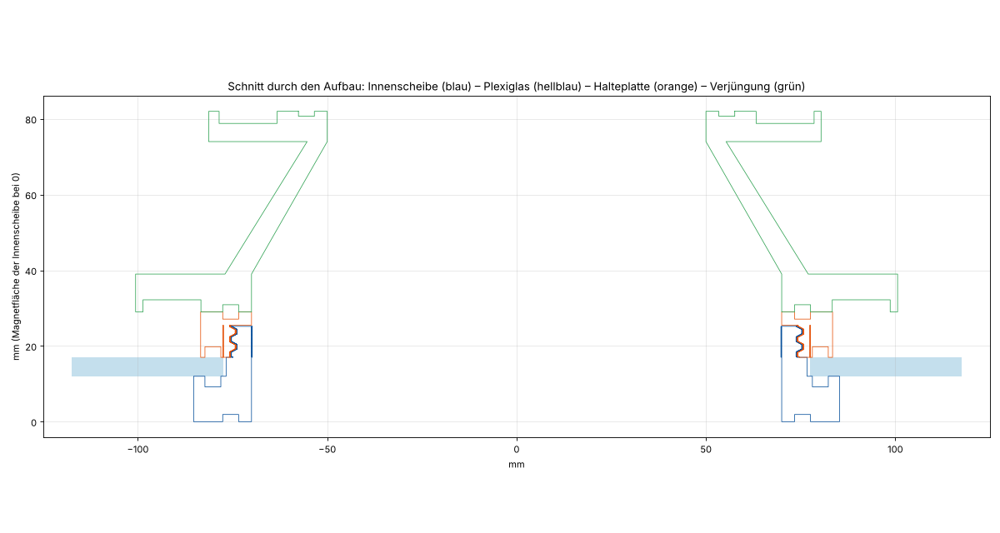
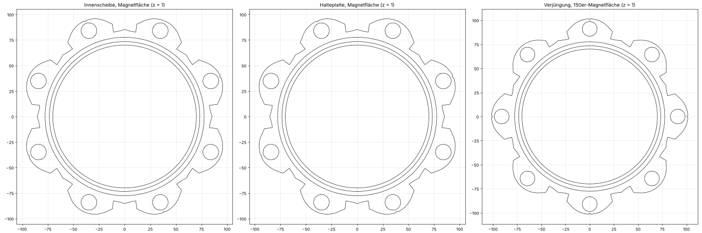
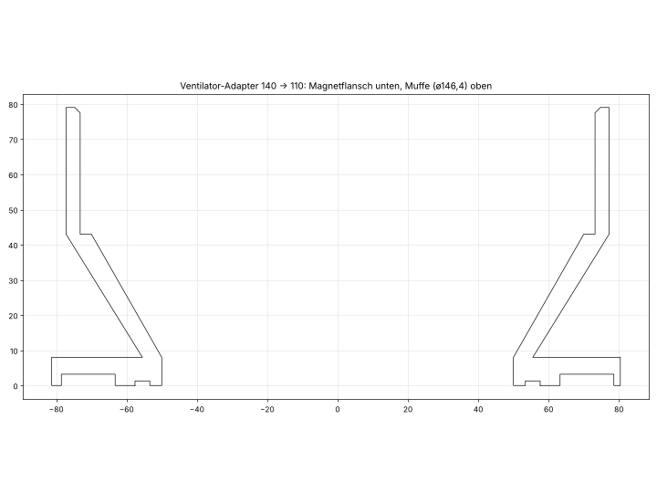
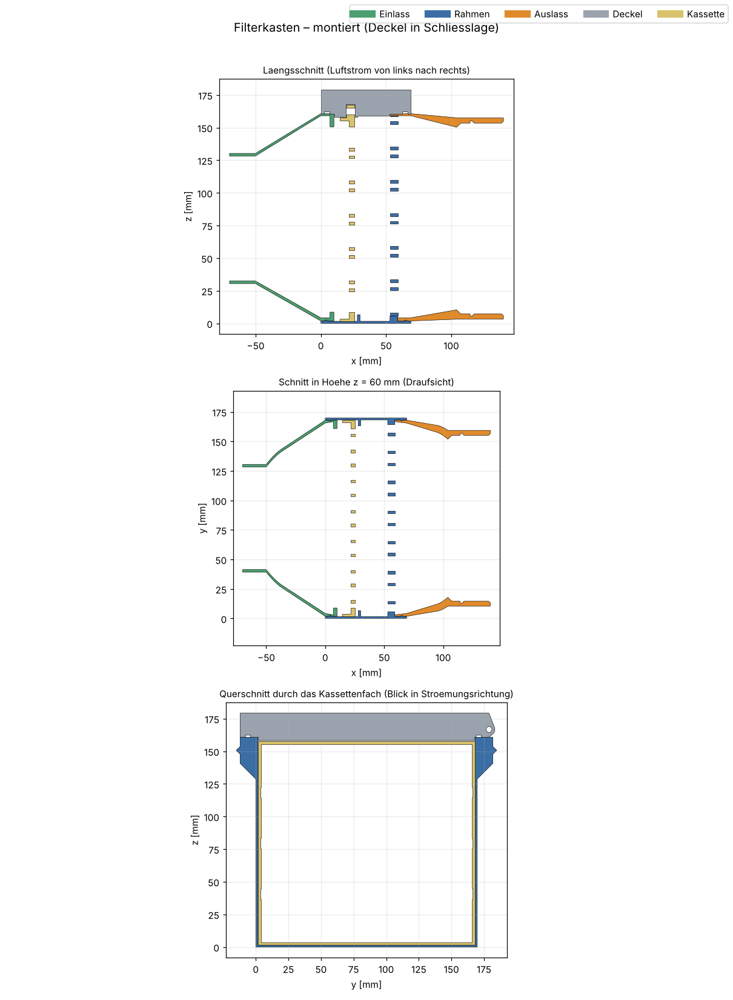
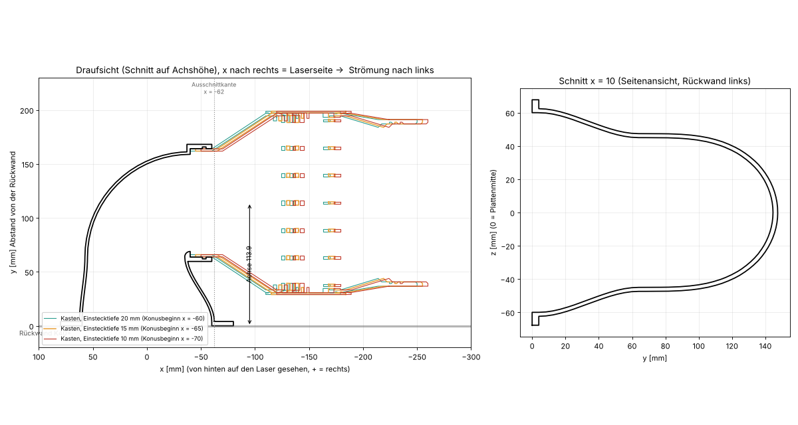

# Abluft – magnetischer Schlauchanschluss für ein Dachfenster (150 mm → 110 mm)

Abluft-Anschluss für einen Laser-Cutter: Eine 5 mm dicke Plexiglasscheibe hängt in einem Dachfenster und hat einen runden Ausschnitt mit **155 mm Durchmesser** (für 150-mm-Schläuche). Auf der Innenseite hängt ein 110-mm-Abluftschlauch daran, auf der Außenseite lassen sich später z. B. Umlenker ansetzen. Alles wird aus PETG gedruckt, die Dichtungen aus TPU. Das System ist an die magnetischen Schlauchadapter von MakerWorld angelehnt (siehe [Vorlagen](#vorlagen-und-lizenz)); neue Teile sollen sich **nahtlos** an dieselben Magnetflächen anschließen.

## Prinzip

- **Durchführung durch das Plexiglas (zwei Teile):**
  - **Innenscheibe** (Raumseite): flache Scheibe mit Magnetlappen, aus ihr wächst ein **Rohr** (Luftkanal ø140 mm) durch den Ausschnitt. Das Rohr hat einen glatten **Zentrierbund** im Bereich der Plexiglasdicke und darüber ein feines Außengewinde.
  - **Halteplatte** (Dachseite): flache Scheibe mit Magnetlappen und Innengewinde. Sie wird von oben auf das Rohr geschraubt und klemmt das Plexiglas zwischen beiden Scheiben.
  - Auf **beiden Außenflächen** sitzen 8 Magnete (15 × 3 mm) und eine Dichtungsnut, und auf der **Plexiglasseite** jeder Scheibe sitzt eine zweite Nut für eine TPU-Dichtung.
- **Verjüngung 150 → 110:** Magnetflansch (150) → Trichter (35 mm, ca. 30° Halbwinkel) → am 110er-Ende ein Magnetflansch im Muster der 110er-Referenz. Darauf passt der Schlauchanschluss mit 110-mm-Stutzen. Als Varianten gibt es statt des Flanschs einen festen Schlauchstutzen mit Wulsten oder einen glatten Rohrstumpf (ø109 × 36 mm, zum Überstülpen der Muffe eines 110er-KG-Rohrs), wahlweise gerade oder gewinkelt.
- **Lastpfad (Dachfenster, Schlauch hängt innen):** Schlauch und Kupplung hängen über die **Magnete** an der Innenscheibe. Die Innenscheibe hängt über das **Gewinde** an der Halteplatte. Die Halteplatte liegt auf dem Plexiglas. Das Gewinde steht also dauerhaft unter Zug; Seitenkräfte gehen über den Zentrierbund ins Plexiglas.
- **Abdichtung:** TPU-Rundschnüre (Ø 4 mm) in Nuten. Auf den Magnetflächen liegt jeweils **ein** Ring in den beiden gegenüberliegenden Nuten. Die Plexiglas-Ringe dichten Scheibe gegen Plexiglas. Gewinde und Zwischenräume liegen im abgeschlossenen Totraum innerhalb der Plexiglas-Ringe, die Dichtung hängt nicht am Gewinde.
- **Magnetlappen sind um 22,5° gedreht** (`lobe_offset150`): Das Plexiglas hat in der Ecke nur etwa 20 mm Rand ab der Ausschnittkante. Die Scheiben reichen nur 95,7 mm vom Mittelpunkt (frei sind 97,5 mm). Anschlussteile mit 8 Magneten werden deshalb **um 22,5° gedreht** aufgesetzt, damit die Magnete übereinanderliegen.

## Dateien

| Datei | Inhalt |
|---|---|
| `abluft_system.scad` | **Basis**: gemeinsame Parameter, Magnetflansch, Gewinde, O-Ring (gibt selbst kein Teil aus; OpenSCAD 2021.01 oder neuer) |
| `abluft_durchfuehrung.scad` | Durchführung durch das Plexiglas (`part` = inner, nut, oring150_plexi, assembly) |
| `abluft_verjuengung.scad` | Verjüngung 150 → 100/110 (`part` = funnel, oring150_face) |
| `abluft_ventilator_adapter.scad` | Ventilator-Muffe mit 100er Magnetflansch (`part` = adapter140, oring_fan, oring110) |
| `abluft_magnetring.scad` | freie Magnetringe/Deckel zum Anbau an eigene Rohre, Filterkästen usw. (`part` = ring150, ring100, deckel150, deckel100) |
| `abluft_filterkasten.scad` | Filterkasten (G4-Vlies + Kassette) zwischen 100er Schlauch und Ventilator: Rahmen, Einlass, Auslass, Deckel, Kassette, Schneidlehre → `filterkasten/` |
| `abluft_k40_anschluss.scad` | Ersatz für das Abluftblech des OMTech K40+: Platte im Lochbild des Blechs + Bogen nach links zum Filterkasten (Muffe über den ø100-Stutzen oder Magnetflansch) → `k40_anschluss/` |
| `magnetring_150.stl`, `magnetring_100.stl` | Magnetringe in Standardmaßen (Dicke 8, ohne Schraublöcher) |
| `durchfuehrung_innen.stl` | Innenscheibe mit Zentrierbund und Gewinderohr (Raumseite) |
| `durchfuehrung_aussen.stl` | Halteplatte mit Innengewinde (Dachseite), mit Bohrungen für zwei M4-Sicherungsschrauben |
| `verjuengung_150_100_magnet.stl` | Verjüngung 150 → 100 mit Schlauch-Magnetflansch, 100er Schlauchmuster (Standard) |
| `verjuengung_150_100_stutzen.stl` | Variante: fester Schlauchstutzen mit 5 Wulsten statt Schlauchflansch |
| `verjuengung_150_110_rohr.stl` | Variante: glatter Rohrstumpf ø109 (innen ø100), 36 mm lang, gerade; 150er-Seite mit Magneten wie gehabt |
| `verjuengung_150_110_rohr_45grad.stl` | wie oben, Stumpf um 45° gewinkelt (Biegeradius 80 mm); Stützen nötig, bei Winkeln über ca. 45° besonders |
| `adapter_ventilator_140_100.stl` | Ventilator-Adapter: Muffe für den 140-mm-Ventilatoranschluss → Trichter → 100er-Magnetflansch, mit 4 Schraublöchern |
| `dichtung_150_plexiglas_tpu.stl` | TPU-Ring zwischen Scheibe und Plexiglas (ID 156,4 / AD 164,4 mm) – 2 Stück |
| `dichtung_150_anschluss_tpu.stl` | TPU-Ring für 150er-Anschlussflächen (ID 147 / AD 155 mm) |
| `dichtung_100_anschluss_tpu.stl` | TPU-Ring für alle Schlauch-Magnetflächen (bei `hose_nom=100`: ID 97 / AD 105 mm, Schnur 4 mm, Nut r 48,4–52,6 mm): Flansch der Verjüngung, Ventilator-Adapter und 100er-Schlauchanschluss haben dieselbe Nut. Bei `hose_nom=110`: ID 107 / AD 115 |
| `schraubkappe_110_auf_100.stl` | Reduzierer: wird auf den Stutzen des vorhandenen **110er**-Schlauchanschlusses geschraubt und endet in einem 100er-Schlauchstutzen mit Wulsten (siehe Schraubkappe) |
| `dichtung_stutzenende_tpu.stl` | TPU-O-Ring (Schnur 2,5 mm, ID 101,5 / AD 106,5) für die Dichtfläche zwischen Stutzenende des 110er-Anschlusses und Schraubkappe |
| `dichtung_ventilator_muffe_tpu.stl` | TPU-O-Ring für die Nut in der Muffenwand des Ventilator-Adapters (Schnur 3 mm, ID 143,6 / AD 149,6 mm) |
| `bilder/` | Vorschaubilder, erzeugt mit `werkzeuge/bilder.py` |
| `werkzeuge/` | `export_alle.sh` (alle STL aus der SCAD erzeugen), `pruefung.py` (Passungs- und Gewindeprüfung), `bilder.py` |
| `agent.md` | Arbeitsstand, Entscheidungen und Arbeitsweise für KI-Agenten |

Alle Dateien sind eingecheckt. Der Stand steht in der Git-Historie. Neu erzeugen: `werkzeuge/export_alle.sh` (ca. 6 Minuten mit OpenSCAD 2021.01) oder in OpenSCAD `part` wählen, F6, STL exportieren.

## Ventilator-Adapter 140 → 110

Übergang vom Ventilatoranschluss auf den 110er-Magnetanschluss (Magnetflansch im Muster der 110er-Referenz, darauf passt der vorhandene Schlauchanschluss).

- **Muffe:** Innendurchmesser **146,4 mm**, **36 mm tief** (`socket_depth`), Wand 4 mm. Sie wird über den Ventilatoranschluss geschoben und liegt auf einer 3,2 mm breiten **Schulter** an; dahinter bleibt eine lichte Weite von **140 mm** (`fan_bore_d`, Annahme für den Innendurchmesser des Ventilatoranschlusses). Am Rand ist innen eine 1,5-mm-Einführfase.
- **Trichter:** 35 mm lang (`ad_cone_len`, ca. 30° Halbwinkel) von ø140 auf ø100, am 110er-Ende Magnetflansch (6 Magnete, Nut r 55,5 mm).
- **Dichtung:** Zwei Stellen. (1) **Muffe:** O-Ring-Nut in der Muffenwand (`fan_groove`, 3-mm-TPU-Schnur, Nuttiefe 1,6 mm, Mitte 24 mm vom Rand, Dach unter 45° ohne Stützen); der Ring dichtet radial gegen den Außendurchmesser des Ventilatoranschlusses und ragt 1,4 mm nach innen (Restwand 2,4 mm). (2) **110er-Magnetflansch:** Dichtungsnut wie die Referenz, optional (`fan_flange_groove`, Standard an).
- **Fixierung (offen):** Standardmäßig **4 radiale Schraublöcher** ø4,5 mm im Abstand von 12 mm vom Muffenrand (`fan_screw_n`, `fan_screw_d`, `fan_screw_from_mouth`, `fan_screw_angle0`; `fan_screw_n = 0` entfernt sie). Gedacht für Blechschrauben 4,2 mm mit Unterlegscheibe in den Ventilatoranschluss, alternativ Muffe mit Duct Tape abkleben. Die Fixierung ist noch nicht erprobt.
- Gedruckt wird mit dem Magnetflansch auf dem Bett, ohne Stützen (Trichter ca. 30° Überhang).
- Magnetbedarf: 6 (zusammen mit dem restlichen System 36 von 40).
- Parameter der Dichtung: `fan_groove`, `fan_oring_d`, `fan_groove_depth`, `fan_groove_from_mouth`, `fan_flange_groove`. Den passenden Ring erzeugt `part = "oring_fan"`.

## Fensterkanal (`abluft_fensterkanal.scad`)

Ein durchgehender Luftkanal für eine flache Fensterdurchführung: 150er-Magnetflansch (wie bei Verjüngung und Adapter) → Rundrohr `fk_L1` → Bogen `fk_angle` (Radius `fk_bend_r`) → Rundrohr → Übergang rund → flach (`fk_trans`) → Flachkanal (`fk_flat_len`, Höhe `fk_H`, links `fk_WL` und rechts `fk_WR` der Rohrachse, abgerundete Ecken, Stützstege). `fk_after_total` ist die Gesamtstrecke vom Bogenende bis zum Ende des Auslasses. Das Rundrohr hat den Innendurchmesser `bore_d` (140) aus der Hauptdatei, die Wand `fk_wall` (2,8 mm).

- **Warnung:** Ist der Querschnitt des Flachkanals (innen, ohne Stege) kleiner als der des Rundkanals, gibt OpenSCAD in der Konsole `WARNUNG` aus. Ebenso bei zu steilem Übergang, zu kleinem Biegeradius oder negativem Rohrstück.
- **Teilung nur wenn nötig:** Der Druckraum `fk_bed` (Standard 240×240×250 = nutzbarer Raum, ca. 20 mm Rand für Brim/Skirt/Stützen von der 260er Platte abgezogen) wird gegen die Maße geprüft. Passt alles hinein, entstehen so wenige Teile wie möglich (Standard: 2 Teile, ohne Seitenteile). Sonst teilt das Programm automatisch: längs mit Steckverbindung (Spigot/Muffe, `fk_joint_len`, Klebespalt `fk_joint_gap`), und ist der Flachkanal breiter als der Druckraum, zusätzlich in Spalten mit Falz (Halbwand-Überlappung) in der Teilungsebene. Stege werden an den Falzen ausgespart.
- **Druckrichtung:** Teile stehen auf der Stoßfläche. Nur Flachkanal-Teile, die so nicht passen oder in Spalten geteilt sind, liegen flach; die Stege stützen dann die Decke.
- **Ausgabe:** `ausgabe="info"` listet Querschnitt, Warnungen und die Teile; `"teil"` mit `teil_nr` ist ein Druckteil; `"gesamt"` und `"montage"` sind Vorschauen; `"montiert"` ein Teil in Einbaulage.
- **Werkzeuge:** `werkzeuge/export_fensterkanal.sh [ordner] [-D name=wert ...]` exportiert alle Teile (Dateien `fensterkanal/fensterkanal_teil_N.stl`, Reihenfolge vom 150er-Flansch zum Auslass), `werkzeuge/pruefung_fensterkanal.py [-D ...]` prüft wasserdicht, Druckraum und Überlappung in Einbaulage.
- **Varianten (`fk_split`):** `"auto"` (Standard) teilt nur, wenn es der Druckraum erzwingt; `"einteilig"` = alles in einem Druck (Warnung, wenn es nicht passt); `"zweiteilig"` = zwei Drucke mit einem Schnitt (Position `fk_cut_s`, 0 = automatisch). Einteilig und zweiteilig teilen den Kanal nie in Seitenspalten; ist der Kanal breiter als der Druckraum, warnt OpenSCAD.
- **Messwerte vom Fenster (`fk_use_messung=true`):** Die Ausmesshilfe (Stab senkrecht zur Scheibe) liefert: `m_a` (waagerechter Abstand Stab → Unterkante Rahmen), `m_beta` (Winkel Stab/Waagerechte, Dachneigung = 90 − `m_beta`), `m_h` (Höhe des Schnittpunkts auf dem Stab ab Plattenoberkante), `m_s` (Abstand Stab → Fensterrand, Seite `m_s_side`), `m_B` (Fensterbreite), dazu `m_gap` (Spalthöhe = `fk_H`), `m_reach` (Überstand über die Rahmenkante, 60, gemessen ab der Rahmenkante in Austrittsrichtung), `m_exit_waagerecht` (Standard `true`: Kanal tritt waagerecht in Verlängerung von `m_a` unter dem geöffneten Fenster aus, Knickwinkel = `m_beta`; `false`: parallel zur Scheibe, mit `m_exit_tilt` verstellbar), `m_frame_depth`, `m_margin` (Randabstand). Daraus berechnet die Datei `fk_L1`, `fk_angle`, `fk_after_total`, `fk_flat_len`, `fk_trans`, `fk_WL`, `fk_WR` und gibt sie samt Warnungen in der Konsole aus (Rohr vor dem Bogen negativ, zu wenig Platz für den Übergang, Rand größer als Abstand).
- Beispiele: `-D fk_angle=45`, `-D fk_flat_in_plane=true` (Breite in der Bogenebene), `-D 'fk_bed=[220,220,250]'`, `-D fk_WL=177 -D fk_WR=163 -D fk_H=60` (breiter Kanal, 6 Teile), `-D 'fk_split="zweiteilig"'`.
- Nicht gedruckt getestet: Passung der Steckverbindungen (Spiel 0,25 mm), Dichtheit der Klebestellen, Steifigkeit der 2,8-mm-Wand im breiten Flachkanal.

## Ausströmer direkt (`abluft_ausstroemer_direkt.scad`)

Alternative zum Fensterkanal ohne Rohr und ohne Bogen: ein gerader Keil aus ebenen Flächen (rechteckiger Querschnitt, scharfe Kanten) vom 150er-Flansch zum flachen Ausströmer. Rund ist nur der Flansch.

- **Seiten:** Von innen auf das Fenster gesehen ist der Kanal auf der Seite von `m_s_side` schmal (`m_s − m_margin`), rechts davon breit. Der Flansch sitzt in der Spalte, in der die Achse liegt.
- **Lage am Fenster:** Die Unterseite des Flachkanals liegt auf der Unterkante des Fensterrahmens (Punkt E aus der Ausmesshilfe: `m_a`, `m_beta`, `m_h`, `m_plate_t`), das Fenster liegt auf dem Kanal. Er ragt `m_reach` (Standard 60, mindestens 50 wegen des Abtropfrands) hinter E hinaus. Die Richtung ergibt sich aus der Geraden Flansch → E; liegt E tiefer als der Flansch, zeigt der Kanal nach unten (Winkel > 90° zur Flanschachse).
- **Form:** Am Flansch schräg abgeschnitten (Öffnung deckt die Flanschbohrung ab, Höhe ca. 90 mm), bis `S_F0` Aufweitung auf die volle Breite (links `m_s − m_margin`, rechts der Rest) und auf die Spalthöhe `m_gap`, danach Flachkanal (Länge `m_reach + m_frame_depth`).
- **Strömungsstege:** Sie stützen Ober- und Unterwand und führen die Luft: im Keil strahlenförmig ab `fk_rib_gap0` (35 mm) Abstand, im Flachkanal parallel mit `fk_rib_pitch` (70 mm), Stegdicke `fk_rib_t`; Reibungsverlust der Stege ca. 1 bis 3 Pa, Blockade unter 3 %. An jedem Stoß laufen die Stege des Vorderteils durch die Steckverbindung bis zum Anfang der Stege des Folgeteils und liefern dort eine Klebe- und Stützfläche. In der OpenSCAD-Vorschau sind sie von der Wand verdeckt: `ausgabe="schnitt"` nimmt die Fensterseite ab.
- **Breite und Teilung:** Der Kanal muss nicht die ganze Fensterbreite haben: `fk_W_max` (Standard 450 mm, 0 = ganze Fensterbreite) begrenzt die Gesamtbreite, die breite Seite wird gekürzt (Hinweis in der Konsole). Zusätzlich höchstens `fk_max_cols` (3) Teile nebeneinander. Schmaler heißt kleinerer Aufweitwinkel (bei 110 + 340 mm ca. 57° statt 73°) und weniger Teile. Steckverbindungen (Spigot/Muffe, Halbwandfalz) zum Verkleben. Teil 1 (mit Flansch) steht mit der Flanschfläche auf dem Bett (Stützen), alle anderen Teile liegen flach.
- **Querschnitt:** Die Konsole vergleicht den Flachkanal mit dem Schlauch (ID 90 mm = 6362 mm²) und nennt die Höhe, bei der beide gleich groß sind (bei 741 mm Breite ca. 15 mm).
- Beispiel (`m_a` 270, `m_beta` 60, `m_h` 10, `m_s` 120 links, `m_B` 1140, `m_gap` 30, `fk_W_max` 450): 56° zur Flanschachse, Länge 332 mm, Breite 110 + 340 mm (von innen links schmal, rechts breit), Querschnitt 167 % des Schlauchs, 6 Teile in `ausstroemer_direkt/ausstroemer_teil_1…6.stl`.
- Export: `werkzeuge/export_ausstroemer.sh [ordner] [-D …]` (erzeugt auch `ausstroemer_alle.3mf`: alle Teile als getrennte Objekte, je eine Plattenbreite auseinander; OpenSCAD selbst kann kein 3MF mit mehreren Platten schreiben, der Slicer verteilt sie per „Anordnen“ auf Platten), Prüfung (wasserdicht, Druckraum, keine Überlappung in Einbaulage): `werkzeuge/pruefung_ausstroemer.py [-D …]`.

## Ausmesshilfe (`abluft_ausmesshilfe.scad`)

Dünne Platte (Magnetdicke + 1,2 mm), die mit eingeklebten Magneten auf eine Kupplungsstelle gelegt wird und in der Mitte einen senkrechten Stift trägt (Standard ø5 mm, Länge `pin_len` 150 mm). Zum Anpeilen der Kupplungsmitte, z. B. gegen einen Fensterausschnitt oder ein Rohr.

- Voreinstellungen `preset="150"` (8 Magnete, Teilkreisradius 91), `"100"` (6 Magnete, Radius 66,0) und `"110"` (Radius 70,9), außerdem `"frei"` mit `n_mag` und `R_mag`. Magnet rund oder Quader (`mag_shape`), Durchmesser/Länge, Breite, Höhe, Spiel und Quetschrippen frei wählbar.
- Öffnungen zwischen den Speichen (`openings`, `spoke_w`), Nabe `hub_r`, optional fester Plattendurchmesser `plate_d`. Kerbe an jedem zweiten Magneten markiert die abwechselnde Polung.
- Stift: `pin_mode="gedruckt"` (Kegelfuß, PETG; bei Länge über 12 × Durchmesser empfindlich) oder `"loch"` (Bohrung ø5,2 mm mit Führungsnabe für einen Metallstift).
- `werkzeuge/export_ausmesshilfe.sh [ordner] [-D ...]` erzeugt `ausmesshilfe_150.stl` und `ausmesshilfe_100.stl`. Nicht gedruckt getestet; die Winkellage der Magnete der Referenzteile (`mag_angle0`) ist nicht verifiziert.

## Schlauchgröße (`hose_nom`, Standard 100 mm)

Dateinamen: `…_100_…` = Schlauchseite für 100-mm-Schlauch; `verjuengung_150_110_rohr*.stl` behalten die 110, weil dort das 110er-KG-Rohr (Muffe über ø109) gemeint ist.

Der Schlauch hat nominal **100 mm**. Alle Schlauchseiten (Verjüngung, Ventilator-Adapter) folgen dem `hose_nom` in der Basis `abluft_system.scad` und sind auf deinen vermessenen **100er-Schlauchanschluss** (`Anschluss_100mm_Schlauch.stl`) abgestimmt: 6 Magnete (Taschen ø15,2) auf Teilkreisradius 66,0 mm, Dichtungsnut Mitte r 50,5 mm (4,2 breit), Bohrung ø90, Körperradius 58,4 mm, Lappen bis r 76,5 mm. Stutzen-Außen ø100 (Gewindegrund deines Anschlusses), innen ø90. Mit `hose_nom=110` entsteht das ursprüngliche 110er-Muster.

- **Magnete:** 15 × 3 mm auch an den Schlauchflächen (`hose_mag_d`). Der erste vermessene 100er-Anschluss hatte noch Taschen ø10,2 auf R 61,0; der aktuelle (15-mm-Magnete, R 66,0) ist die Referenz.
- **Dichtung:** Dieselbe Nut an allen 100er-Flächen, ein Ring `dichtung_100_anschluss_tpu.stl` (ID 97 / AD 105) passt überall.
- **Prüfung:** Verjüngung (Magnetflansch) und Ventilator-Adapter überlappen sich nicht mit deinem 100er-Anschluss (`werkzeuge/pruefung.py --ref110`).

## Schraubkappe 110 → 100 (`abluft_schraubkappe.scad`)

Damit der vorhandene 110er-Schlauchanschluss weiter nutzbar ist: Die Kappe wird auf dessen Stutzengewinde geschraubt (Rechtsgewinde, Steigung ca. 10 mm, ein Gang, leicht konisch, Gewindegrund ø109, Kamm ø114) und endet in einem 100er-Schlauchstutzen (Wulste wie das Abluft-System, innen ø90). Das Gewindeprofil ist direkt aus der Referenz-STL gemessen (Profiltabelle, mittlere Abweichung 0,1 mm) und wird als Innengewinde mit Spiel `thread_clear` (0,8 mm) berechnet; Länge `thr_len` 34 mm, Griffrippen, Dichtungsnut in der Deckplatte für einen O-Ring auf dem Stutzenende (`dichtung_stutzenende_tpu.stl`). Geprüft: überlappungsfrei beim Aufschrauben entlang der Gewindesteigung, kleinster Abstand zur Referenz 0,3 mm; nicht gedruckt getestet.

## Maße

| | |
|---|---|
| Ausschnitt Plexiglas | ø155 mm, Plattendicke 5 mm |
| Luftkanal | ø140 mm innen (150-mm-Seite), ø90 mm an der Schlauchseite (`hose_nom` 100; bei 110: ø100) |
| Gewinde | ø151 mm außen, Steigung 4 mm, Tiefe 1,5 mm, Wand am Gewindegrund 4 mm; Gewindelänge = Dicke Halteplatte − 3,5 mm Steg (Standard 8,5 mm = 2,1 Gänge) |
| Plattendicken | Innenscheibe 12 mm, Halteplatte 12 mm, Flansch der Verjüngung 10 mm (alle einstellbar: `disc_t`, `nut_t`, `adapter_t`) |
| Zentrierbund | ø153,4 mm (0,8 mm Spiel zum Ausschnitt), liegt im Bereich der Plexiglasdicke |
| Magnete | 15 × 3 mm, 8 je 150er-Fläche (Teilkreisradius 91,0 mm), 6 je Schlauchfläche (Teilkreisradius 66,0 mm bei `hose_nom` 100, 70,9 mm bei 110) |
| Magnettasche | ø15,3 × 3,2 mm mit 3 feinen Klemmnasen, Magnet plan eingelassen, mit Sekundenkleber |
| Dichtungsnut | 4,2 mm breit; Anschlussflächen 150: Radius 75,5 mm, 1,9 mm tief; Schlauchfläche: Radius 50,5 mm (100) bzw. 55,5 mm (110), 1,3 mm tief; Plexiglasseite: Radius 80,2 mm, 2,8 mm tief |
| Trichter | 35 mm lang, innen ø140 → ø100, Wand ≥ 5 mm |
| Ausdehnung | Scheiben ø ca. 191 mm, Flansch der Verjüngung ø ca. 203 mm; größtes Teil (Variante Stutzen) 203 × 203 × 95 mm |

**Magnetbedarf:** Innenscheibe 8 + Halteplatte 8 + Verjüngung 8 + 6 (Flansch 110) = **30 von 40** vorhandenen Magneten.

## Magnete und Polung

- Alternierende Polung. In der SCAD kennzeichnet eine **kleine Kerbe am Lappenrand** jeden zweiten Magnet (`polarity_marks`). Alle gekerbten Lappen bekommen denselben Pol nach außen, die ungekerbten den entgegengesetzten.
- Regel für die Teile dieses Systems: **Kerbe auf Kerbe stößt ab, Kerbe auf glatt zieht an.** Eine Gegenfläche wird deshalb in Schritten von einem Lappen gedreht aufgesetzt (45° bei 8 Magneten, 60° bei 6), bis sie anzieht; bei den um 22,5° gedrehten Scheiben liegt die Anziehungslage 22,5° + n · 45° gegenüber dem Adapter. Ob die Referenzteile aus MakerWorld nach derselben Regel gepolt sind, ist **nicht** aus der Geometrie ablesbar: vor dem Verkleben aller Magnete probeweise auflegen.
- Die Klemmnasen sind sehr fein (0,25 mm). Mit 0,4-mm-Düse bleiben sie eher eine leichte Erhöhung. Mit `mag_clear` und `crush_rib_h` anpassen.

## Druckhinweise

- Alle Teile liegen mit der **Magnetfläche auf dem Druckbett**, ohne Stützen. Die Taschen werden überbrückt.
- Innenscheibe und Halteplatte mit **100 % Füllung oder mindestens 5 Wänden** drucken, damit Gewinde und Rohr unter Dauerzug nicht kriechen. Bei dauerhaft warmer Abluft (PETG erweicht ab etwa 70 °C) sind ASA oder ABS sicherer.
- Dichtungen aus TPU (Shore 95A oder weicher) liegend drucken. Das Profil hat wie die mitgelieferten O-Ring-Vorlagen kleine Abflachungen oben und unten.
- Das Gewinde ist feiner als die erste Fassung: Radialspiel 0,35 mm, Flankenspiel 0,03 Steigung je Seite (`thread_clear`, `thread_widen`). Im Rechenmodell bleibt ein freier Drehwinkel von etwa 50° (0,56 mm axial). Wenn die Teile nach dem Druck zu streng laufen, `thread_clear` vergrößern.

## Montage

1. Magnete in die Taschen kleben (Polung beachten), Dichtungsringe in die Nuten legen.
2. TPU-Ring in die Plexiglasnut der Innenscheibe, Rohr von unten durch den Ausschnitt stecken.
3. TPU-Ring in die Plexiglasnut der Halteplatte, Halteplatte von oben auf das Rohr schrauben, bis sie plan aufliegt.
4. Optional: M4-Madenschrauben (Kunststoff- oder Nylonspitze, ca. 8–10 mm) durch die radialen Bohrungen der Halteplatte eindrehen; sie drücken auf die Gewindespitzen des Rohrs. Bei hängender Last ist das nur eine Reserve gegen Vibration (`lock_screw_n = 0` entfernt die Bohrungen).
5. Verjüngung (um 22,5° gedreht) mit einem 150er-Anschlussring an die Innenscheibe setzen, 110er-Anschluss mit dem 110er-Ring auf den Flansch der Verjüngung.
6. Schlauch zusätzlich an einem Dachbalken abfangen: Magnete halten seitlich nur über Reibung.

## Wichtige Parameter – wo sie stehen

Jedes Bauteil hat **seine eigenen Parameter in seiner eigenen Datei**; nur gemeinsam genutzte Maße stehen in der Basis `abluft_system.scad`. `part` wird in der jeweiligen Teile-Datei gesetzt (oder per `-D part="…"`).

**Basis `abluft_system.scad`** (gemeinsam, von mehreren Dateien genutzt)

| Parameter | Bedeutung |
|---|---|
| `mag_d`, `mag_h`, `mag_clear`, `crush_ribs`, `polarity_marks` | Magnetmaße, Spiel, Klemmnasen, Polungskerbe |
| `n_mag_150`, `n_mag_110` | Magnetzahl je Fläche (Referenzumrisse nur für 8 bzw. 6; sonst runder Fallback-Umriss) |
| `oring_d`, `groove_w`, `groove_depth_mag`, `groove_depth_150` | Dichtschnur, Nutbreite und Nuttiefen auf den Magnetflächen |
| `hole_d`, `plate_t` | Ausschnitt und Plattendicke des Fensters |
| `bore_d`, `R150`, `adapter_t`, `lobe_offset_funnel`, `use_ref_outline` | 150er Flanschmuster: Luftkanal, Teilkreis, Flanschdicke, Drehlage |
| `thread_pitch`, `thread_depth`, `thr_hr`, `thr_hc`, `thread_clear`, `thread_widen` | Gewindeprofil (Durchführung, Doppelbogen, Schraubkappe) |
| `hose_nom`, `hose_mag_d` | Nominaldurchmesser des Schlauchs (100 oder 110, an Referenzanschlüssen vermessen), Magnetdurchmesser der Schlauchflächen |
| `cone_len`, `stub_len`, `stub_taper`, `bead_*` | Trichterlänge sowie Schlauchstutzen mit Wulsten (auch von der Schraubkappe genutzt) |

**`abluft_durchfuehrung.scad`:** `disc_t`, `nut_t` (Dicken von Innenscheibe und Halteplatte; Gewindelänge wächst mit `nut_t`), `thread_major`, `collar`, `collar_clear` (Zentrierbund), `lock_screw_n`, `lock_screw_d` (Sicherungsschrauben), `tube_gap`, `plexi_gap`, `groove_depth_plexi`, `lobe_offset150`, `edge_free`.

**`abluft_verjuengung.scad`:** `end110` (`"magnet"` Standard, `"stub"` Schlauchstutzen, `"pipe"` Rohrstumpf), `cone_wall0`; Rohrstumpf `pipe_od` (109), `pipe_bore_d` (100), `pipe_len` (36), `pipe_straight` (ungebogene Strecke vor dem Bogen), `pipe_angle` (0 = gerade), `pipe_bend_r` (80), `pipe_dir` (0 = +X), `pipe_chamfer` (1 mm).

**`abluft_ventilator_adapter.scad`:** `fan_socket_d`, `fan_bore_d`, `socket_depth`, `socket_wall`, `socket_chamfer`, `ad_cone_len`, `ad_cone_wall0`; Schraublöcher `fan_screw_n/_d/_from_mouth/_angle0`; Dichtung `fan_groove`, `fan_oring_d`, `fan_groove_depth`, `fan_groove_from_mouth`, `fan_flange_groove`.

**`abluft_magnetring.scad`:** `ring_t`, `ring150_bore_d`, `ring100_bore_d`, `ring_groove`, `ring_screw_n/_d`, `ring150_screw_r`, `ring100_screw_r`, `ring_offset150`.

Beim Rendern gibt die SCAD eine Kontrollausgabe (Konsole): Ausdehnung der Scheiben über der Ausschnittkante, Gewindedaten (Wand, Gänge) und O-Ring-Maße.

## Geprüft und nicht geprüft

Mit `werkzeuge/pruefung.py` im Rechenmodell geprüft (Boolesche Überlappung mit `manifold3d`):

- alle STL wasserdicht,
- Innenscheibe, Plexiglas (mit Ausschnitt) und Halteplatte überlappen sich nicht, Gewinde passt (Drehspiel ca. 50°),
- Verjüngung sowie die Referenz-Adapter 150 (Halteplatte und Innenscheibe) und 110 überlappen sich nicht,
- Ventilator-Adapter: der 110er-Anschluss passt unter den Flansch; ein angenommener Ventilatoranschluss (AD 146,0 / ID 140 mm) sitzt ohne Überlappung in der Muffe,
- Magnettaschen und Dichtungsnuten liegen deckungsgleich zu den Referenzteilen (Radius der Ringe und Taschen).

**Nicht** am echten Druck geprüft: Gewindesitz, Haltekraft der Magnete (Überschlag: 8 × 15×3 mm ca. 7–10 kg Zug im Stoß), Dichtheit, Verhalten unter Wärme und Dauerlast, Madenschrauben in PETG, Druckbarkeit der Klemmnasen. Auch die Polungsregel der Referenzteile ist offen.

## Vorlagen und Lizenz

Die Magnetflächen orientieren sich an diesen MakerWorld-Modellen (nicht im Repository, bitte die dortigen Lizenzen beachten):

- [Dust hose tank connector magnetic 100 mm](https://makerworld.com/de/models/445028-dust-hose-tank-connector-magnetic-100mm)
- [Dust extraction hose magnetic coupling 100 mm](https://makerworld.com/de/models/252336-dust-extraction-hose-magnetic-coupling-100mm)
- [Sammlung: compatible dust collection](https://makerworld.com/de/collections/16020952-compatible-dust-collection)

Verwendete Vorlagendateien (liegen bei der Nutzerin; `4inchto6inchDuct_v5.stl` war Vorbild für den Ventilator-Adapter: Muffe 35 mm tief, Trichter 35 mm, Stutzen): `Magnetic_Hose_Adapter_Parametric.stl` (110er-Adapter), `Magnetic_Hose_Adapter_150.stl` (150er-Adapter), `Anschluss_110mm_Schlauch.stl`, `Enclosure_Port*.step`, `Hose_Adapter_Model.step`, `Attachment_Holder1.step`, zwei O-Ring-STL.
Der Umriss der 150er-Magnetflansche (`ref150_pts` in der SCAD) wurde aus `Magnetic_Hose_Adapter_150.stl` übernommen. Vor einer Veröffentlichung des Repositorys die Lizenz dieser Vorlage prüfen.

## Ersatz-Füße (`abluft_fuss.scad`)

Für Magnetlappen („Füße“), die mit einem verpolten Magneten bestückt wurden: Lappen samt Randsegment mit **einem geraden Sägeschnitt** (Sehne rechtwinklig zur Lappenrichtung) abtrennen und den Ersatz ankleben. Der Fuß hat denselben Umriss wie der Flansch (`outline2d`), die Magnettasche mit Klemmnasen und liegt mit der Magnetfläche auf dem Druckbett.

- `fuss = "6er"` (Schlauchflansch, Dicke `f6_dicke` = 8, Sägeabstand `f6_r_saege` = Nutaußenkante + 2 mm = 54,6 mm bei 100er-Schlauch), `"8er"` (150er-Flansch, `f8_dicke` = 10, `f8_r_saege` = 79,6 mm) oder `"beide"`.
- Weitere Parameter: `fuss_kerbe` (Polungskerbe, nur an jedem 2. Lappen), `fuss_zugabe` (Länge zum Nachschleifen), `fuss_nase_l/_b/_t` (optionale Stützlasche auf der Rückseite).
- `f8_dicke` bei der Durchführung innen auf 12 (`disc_t`) stellen. Export: `werkzeuge/export_fuss.sh` → `fuesse/fuss_6er.stl`, `fuesse/fuss_8er.stl`.
- Der Schnitt liegt außerhalb der Dichtungsnut (2 mm Steg) und vor der Magnettasche. Die Klebefläche ist nur die Schnittfläche (Stumpfstoß); die Haftung ist nicht erprobt.

## DN110-Doppelbogen (`abluft_dn110_winkel.scad`)

Anschluss an ein DN110-Rohr: Rohrstumpf ø109/100 (36 mm, wie bei der Verjüngung) → 90° nach links → waagerechte Strecke `wk_h` (100 mm) → 90° nach oben → senkrechte Strecke `wk_v` (30 mm) mit Außengewinde → **aufgeschraubter Flanschring** mit 6 Magneten (wie das 110er-Ende von Verjüngung/Adapter; Magnetfläche zeigt nach oben). Das Schraubprinzip ist dasselbe wie bei der Halteplatte der Plexiglas-Durchführung (gleiches Gewindeprofil, Steigung 4, Spiel `thread_clear`).

- **Längen:** `wk_h` = gerade Strecke zwischen den Bogenenden (Rohrmitte), `wk_v` = gerade Strecke zwischen Bogenende und Rohroberkante (Anlage des Rings), mindestens 8 mm. Die Magnetfläche liegt `wk_v` + 2,9 mm (Lippe) über dem Bogenende. Die Teilung der Waagerechten (`wk_split`, 0 = automatisch die Hälfte) passt sich an; bei Überschreiten von `wk_bed` (240×240×250) gibt OpenSCAD eine WARNUNG aus.
- **Drei Druckteile:** Teil 1 (Stumpf + Linksbogen + Anfang der Waagerechten, liegend, Stützen unter dem Rohr), Teil 2 (Rest + Bogen nach oben + Senkrechte mit Gewinde, Gewindeende auf der Platte, Stützen unter dem oberen Bogen, ca. 109 × 187 × 155 mm), Teil 3 (Flanschring, Magnetfläche unten, 153 × 135 × 23 mm). Teil 1/2 verbindet eine Halbwand-Steckverbindung (0,25 mm Klebespalt).
- **Flanschring:** Lippe 2,9 mm mit Bohrung ø90 und Dichtungsnut auf der Magnetfläche; das Rohrende liegt von hinten an der Lippe an. `wk_thread_l` (20 mm) = Gewindelänge = Einschraubtiefe. Gewinde im Rohr: Grund ø106 (Wand 3 mm). Dichtung der Gewindeverbindung: Teflonband oder Silikon (nicht erprobt); Gewindepassung per Software geprüft (Gewinde greift ohne Überlappung ineinander), gedruckt noch nicht.
- Weitere Parameter: `wk_links`, `wk_r` (Biegeradius, 70), `wk_stumpf`, `wk_od/id`, `wk_joint_len/gap`, `ausgabe` (`gesamt`, `teil` mit `teil_nr` 1–3, `montiert`, `info`).
- Export: `werkzeuge/export_dn110_winkel.sh` → `dn110_winkel/dn110_winkel_teil_1.stl` … `_3.stl` (ca. 5 Minuten).

## DN110-Doppelbogen für die Arbeitsplatte (`abluft_dn110_arbeitsplatte.scad`)

Variante des Doppelbogens für den Einbau unter einer waagerechten Arbeitsplatte, die an eine 30°-Dachschräge stößt. Adapter: `Hose_Adapter_Angled_v42` (Flansch unten, Stutzen 60° aus der Senkrechten = Einschlusswinkel 120°, Schlauch läuft parallel zum Dach). Die Datei bindet `abluft_dn110_winkel.scad` ein und rechnet die Längen aus der Einbausituation:

- Rohr (Muffe Ø128,4 gemessen) liegt tangential im Knick zwischen Dach und Plattenunterseite (4 mm Luft nach oben, 3 mm zum Dach), läuft nach dem 90°-Knick nach vorn und biegt (Radius 66 mm) durch die 30 mm dicke Platte nach oben.
- **Versenkt und mit Deckel:** Ring (Teil 3) und magnetischer Deckel (Teil 4) sind **runde Scheiben ø153 mm** (Ring 5 mm, Deckel 5 mm) in einer **runden Senkung ø155 × 10 mm Tiefe** der Arbeitsplatte; darunter ein **Loch ø120 mm** für den Gewindehals (Resttragschicht 20 mm). Mit aufgelegtem Deckel schließt alles bündig mit der Plattenoberseite ab. Ohne Deckel liegt die Magnetfläche 5 mm unter der Oberseite, der Adapterflansch sinkt in die Senkung. `dp_deckel_t = 0`: keine Senkung, Ring liegt 5 mm hoch auf der Platte.
- **Deckel:** gleiches Lochbild (6 Magnete 15×3), Magnetfläche unten, Griffmulde ø16 am Rand (`wk_deckel_griff`). Polung: Kerbe auf glatt zieht an; Deckel wie den Adapter in 60°-Schritten gedreht auflegen, bis er anzieht. Der Ring hat zwei Stiftlöcher ø4,5 (Winkel 30°/210°, r 64) zum Festdrehen; Ring so drehen, dass die Adapterrichtung stimmt (60°-Raster).
- **Flanschmitte** `dp_u_flansch` = 237 mm vor der Schnittkante Dach/Plattenoberseite (Mindestabstand aus dem v42-Modell mit 5 mm Luft; bei seitlich gekipptem Stutzen 258–283 mm). Ergebnis: waagerechte Strecke 141 mm, Senkrechte 24 mm.
- **Übergangskegel:** Am oberen Rohrende verjüngt sich die Bohrung auf 15 mm Länge von Ø100 auf Ø90 (`wk_kegel_l`).
- Teile (alle wasserdicht, passen in 240×240×250): Teil 1 191 × 157 × 109, Teil 2 109 × 203 × 145, Teil 3 153 × 153 × 23, Teil 4 153 × 153 × 5 mm. Export: `werkzeuge/export_dn110_arbeitsplatte.sh` → `dn110_arbeitsplatte/`.
- Annahmen: Plattendicke 30 mm, Biegung nach links (`wk_links`). Offen: Standard-Rohrbogen statt Teil 1 (Schenkellänge fehlt); Polung von Ring/Deckel nur nach Regel, nicht erprobt.

## Filterkasten (`abluft_filterkasten.scad`)

Kompakter Filterkasten zwischen dem 100er Schlauch und dem Ventilator: Einschub-Kassette (166 × 156 mm, 8 / 11,5 / 15 mm tief je nach Lagenzahl) mit Funkenfilter (1 bis 3 Lagen vhbw-Metallfettfilter, Standard 1 Lage, siehe unten) plus G4-Vlies (23 mm) in einer Kammer von 166,6 × 157,5 mm, Klappdeckel mit Scharnier und GH-4001-Verschluss. Die ursprüngliche Datei (ein Gehäuse, ca. 510 cm³, nur mit sehr vielen Stützen druckbar, ca. 1,5 Tage) wurde für das System umgebaut und für den Druck zerlegt:

| Teil (STL in `filterkasten/`) | Inhalt | Druckpose |
|---|---|---|
| `filterkasten_rahmen.stl` | Kammer mit Anschlagrahmen, Stützgitter (diagonale Stege), Deckelkragen, Scharnier, Verschlusspolster mit 2 Kernlöchern, Rastwülste für die Zapfen. Decke über den Zapfen 1,6 mm. **Über dem Einlass-Zapfen eine Brücke: mit Stützen drucken** | wie gebaut (Deckelseite oben), 69 × 197 × 173 mm |
| `filterkasten_decke.stl` | nur für die Variante `decke_getrennt = true`: flache Deckenplatte über den Zapfen, wird in einen Falz geklebt (dann Rahmen ohne Stützen). Im Standard nicht nötig | flach, 69 × 172 × 1,6 mm |
| `filterkasten_einlass_stutzen.stl` | **Standard:** glatter Stutzen ø100 außen (20 mm lang, 2 mm Wand, Schlauch wird aufgeschoben) → Trichter → Zapfen mit Kassettenanschlag | Stutzenende auf dem Bett, 156 × 168 × 80 mm |
| `filterkasten_einlass_magnet.stl` | Variante: **100er Magnetflansch des Systems** (passt auf Schlauchanschluss und Ventilator-Adapter) statt Stutzen (`einlass_typ = "magnet"`) | Magnetfläche auf dem Bett, 156 × 168 × 68 mm |
| `filterkasten_auslass_ventilator.stl` | Trichter → **Ventilator-Muffe** (146,4 mm, O-Ring-Nut und Schraublöcher aus `abluft_ventilator_adapter.scad`) → Zapfen | Muffenmündung auf dem Bett, 156 × 168 × 81 mm |
| `filterkasten_deckel.stl` | Klappdeckel, **massiv** (18,5 mm) mit erhabenem, zweistufigem Mittelteil („Stempel“) statt Lippenring, Rippen und Damm: über der Kassette knapp über deren Oberkante (Platz für 1 mm Schaumstoff), über Anschlagrahmen und Vlies auf Höhe der Kammerdecke; Vertiefung für die Griffasche; Verschluss-Kernlöcher | Außenseite unten, ca. 250 cm³ (Füllung 15 % reicht) |
| `filterkasten_fuesse.stl` | 4 optionale Füßchen 24 × 24 × 10 mm (`foot_h`, `foot_size`, `foot_inset`; `foot_h = 0` = ohne), flach gedruckt, **unter die Ecken des Rahmens geklebt** | flach, 114 × 24 × 10 mm |
| `filterkasten_kassette.stl`, `filterkasten_lehre.stl`, `filterkasten_lehre_klemmleiste.stl` | Kassette (Standard 1 Lage; geschlossener Rahmen 166 × 156 × 8 mm mit 4 mm tiefem Diagonalgitter als Filterträger und Griffasche 40 × 10 mm mit Langloch zum Herausziehen, Gitterseite auf dem Bett, 39 cm³; `filterkasten_kassette_2lagen.stl` und `_3lagen.stl` sind die tieferen Varianten für mehr Lagen; die Lasche ragt in eine Tasche im Deckel) und Schneidlehre für das Vlies | |

- **Zusammenbau:** Einlass und Auslass haben je einen 10 mm langen Steckzapfen (0,25 mm Spiel je Seite), der in den Rahmen geschoben wird. Eine umlaufende Einrastverbindung (Rastwulst im Rahmen, Nut im Zapfen, links, rechts und unten; 0,8 mm hoch, lange Einlaufschräge, steile Rückseite, Spiel 0,15 mm, 0,55 mm Eingriff) hält sie ohne Schrauben und ohne Durchbrüche; die Decke trägt keinen Wulst, weil er dort nur mit Stützen druckbar wäre. Danach die Fuge verkleben oder mit Silikon abdichten. Die Rastung ist nur eine Fixierung bis zum Kleben; die Haltekraft ist nicht erprobt. Der Kassettenanschlag sitzt am Ende des Einlass-Zapfens. Das Vlies liegt auf dem Stützgitter im Rahmen.
- **Ablauf:** Schlauch (100er Magnetflansch) → Einlass → Kassette → G4-Vlies → Gitter → Auslass → Ventilator. Standard ist der glatte ø100-Stutzen aus dem Briefing; mit `einlass_typ = "magnet"` gibt es stattdessen den Magnetflansch.
- **Maße:** Innenmaß der Kammer 166,6 × 157,5 mm (passt zur Kassette 166 × 156; 0,3 mm Spalt je Seite, 1,5 mm oben, der Spalt oben wird vom Deckeldamm gesperrt); das Außenmaß ist durch dünnere Wände kleiner als im Original (176 × 165), das war so gewünscht. Montiert 210 × 194 × 173 mm (mit Stutzen) (das Original war 151 mm lang, die Trichter sind für den stützfreien Druck länger geworden).
- **Gemeinsame Bausteine:** Muffe über `fan_muffe_schnitte()` und die `fan_*`/`socket_*`-Parameter der Ventilator-Datei, Magnetflansch über `mag_flange()` der Basis. Parameter des Kastens (Kammermaße, Wandstärken, Zapfen, Trichterlängen, Deckel) stehen in `abluft_filterkasten.scad`. Export: `werkzeuge/export_filterkasten.sh`, Prüfung: `werkzeuge/pruefung_filterkasten.py`.

**Decke über den Zapfen:** Über dem Einlass-Zapfen ist kein Stützgitter möglich (dort steckt der Zapfen), die Decke ist eine freie Brücke von 166 mm und braucht beim Druck Stützen. Gegen Einsaugen ist sie durch den Zapfen darunter gesichert. **Standard (`decke_getrennt = false`):** einteiliger Rahmen, Decke 1,6 mm wie die Wände (Parameter `roof_extra` = 0; optional dicker nach oben, dann steigt die Deckelauflage), mit Stützen drucken. **Variante `decke_getrennt = true`:** Die Kammer ist oben über die ganze Länge offen (Rahmen: waagerechte Decken 4119 → 24 mm², keine Stützen), und die Decke ist die flach gedruckte Platte `filterkasten_decke.stl` (Parameter `decke_getrennt`, `roof_lap` 3 mm Auflage je Seite, `roof_fit` 0,2 mm Spalt). Sie liegt im Falz bündig mit der Deckelauflage, 0,25 mm über den Zapfen, und wird mit Kleber/Silikon eingesetzt; der Unterdruck drückt sie zusätzlich in den Falz, die Gitterstege stützen sie am Auslass. **Die Schnittstelle zu Einlass und Auslass ist unverändert** (Kammermaß, Rastwülste, Rahmenlänge): die bereits gedruckten Trichter passen (mit den STL aus dem Repository geprüft, 0 mm³ Überlappung). 

**Scharnier (02.11.2026):** Vorher saßen nur zwei Rahmenglieder an den Enden und ein kurzes Deckelglied (x = 10,5…27,5), dazwischen lag der Stift 31 mm frei. Jetzt fünf Glieder ohne Lücke, abwechselnd Rahmen (0…10) | Deckel (10,5…29) | Rahmen (29,5…39,5) | Deckel (40…58,5) | Rahmen (59…69), 0,5 mm Spalt dazwischen (Parameter `kn_end`, `kn_mid`, `kn_gap`). Stift ø4 durch alle Glieder (Bohrung 4,5). Schwenk 30/60/75° kollisionsfrei geprüft.

**Verschluss GH-4001 (Maße an den Beschlägen gemessen):** Hebelblech 30,6 × 15,6 mm, Löcher ø6,4 in einer Reihe, Abstand 17,5 mm; Hakenlänge max. 59,5 mm; Einhängehaken 24 breit, 17,8 hoch (inkl. Fangleiste unten), Löcher ø6,4 im Abstand 14 oben im Blech. Das Hebelblech liegt **senkrecht** auf einem **Polster** am Rahmen (Kragenfläche nach unten verlängert, darunter 45°, stützfrei; Schwenkachse oben, Haken zeigt nach oben, Hebel zieht nach unten), der Einhängehaken sitzt vollständig auf der Stirnfläche des Deckels (Deckel jetzt `lid_t` = 18,5 mm hoch statt 12, Haken unten bündig zur Trennebene); Deckel und Polster am Rahmen sind an den Schrauben massiv. Beide Beschläge liegen bündig in der Ebene y = −12 mm, Mitte x = RL/2. Kernlöcher ø4,2 × 10 mm für selbstschneidende 5-mm-Schrauben (Blechloch 6,4 lässt den Kopf mit Scheibe zu). **Annahme:** Abstand Fangleiste → Schwenkachse geschlossen `lt_reach` = 30 mm (Haken ist verstellbar); bei Bedarf ändern, Blech und Polster wandern mit. `lt_ghost = true` zeigt die Beschläge als Platzhalter in `assembly`.

**Deckel-Stempel und Schaumstoff (03.11.2026):** Statt Lippenring, Querrippen und Damm hat der Deckel ein massives, zweistufiges Mittelteil (`lid()`): Über der Kassette (x < 27,9) endet es 0,6 mm über der Kassettenoberkante und füllt den Spalt `cart_head` samt Umgehungsschlitz oben über die ganze Kassettentiefe (8 bis 15 mm statt einer 2-mm-Kante). Dort klebst du **1 mm dicken selbstklebenden Schaumstoff** (EPDM/PE, `plug_foam`) auf, ausgeschnitten um die Vertiefung der Griffasche (Pressung ca. 40 %). Über Anschlagrahmen und Vlies liegt der Stempel auf Höhe der Kammerdecke und drückt das Vlies an. Die Seitenschlitze neben der Kassette (0,3 mm) und die Dichtwirkung am Vlies bleiben wie beschrieben. Geprüft: keine Überlappung mit Kassette (kleinster Abstand 0,5 mm), Schwenk 30/60/75° frei. Nicht erprobt: Dichtwirkung, Druckzeit des massiven Deckels.

**Dichtheit innen (Vorbeiströmen):** Die Kassette sitzt mit 0,3 mm Spiel je Seite und 1,5 mm Luft oben in der Kammer, unten liegt sie auf. Der Raum über der Kassette (Spalt) ist durch den Stempel des Deckels gesperrt, übrig bleiben Schlitze von 0,3 mm, durch die Luft und Funken praktisch nicht gelangen (rund 1 % der Fläche, nicht gemessen). Der Damm liegt hinter der dicksten Kassette, gilt also für 1 bis 3 Lagen, ohne den Deckel zu tauschen. Der Anschlagrahmen vor dem G4-Fach ist oben offen (Brücke über 158 mm wäre nicht druckbar): das G4-Vlies muss deshalb die Kammer ausfüllen. Die Schneidlehre schneidet es auf Kammermaß + 1 mm (`target_w`, `mat_h` folgen aus `inner_h`, `inner_w`). Die Auflage des Deckels auf dem Kragen dichtet eine **Rundschnur** (EPDM-Schaum, Ø 3 mm Standard oder Ø 5 mm, Parameter `seal_d`): Nut in der Deckelunterseite, umlaufend um die Kammeröffnung (abgerundetes Rechteck, ca. 465 mm Länge plus Überlapp; Nutbreite 1,3 × Schnurdurchmesser, Tiefe 0,55 ×). Die Nut ist beim Druck nach oben offen (keine Stützen). Damit die Schnur hinten an der Scharnierseite eine ebene Fläche hat, liegt die Scharnierachse jetzt 9 mm hinter und 6 mm über der Auflageebene (Rahmen-Knuckles als Türme, kein Ausschnitt im Rahmen mehr, Deckel öffnet ohne Kollision bis 75°). Nicht erprobt: Anpressdruck der Schnur und Dichtwirkung; bei Ø 5 mm ist die Nut 6,5 mm breit, das Spiel am Rand ist klein. Geprüft nur geometrisch (Schnittbilder, Abstände, Montage ohne Kollision), nicht mit Rauch oder Messung.

**Füßchen (optional):** Der Rahmen kann auf vier Füßchen stehen: `foot_h` = 10 mm (Standard, 0 = ohne), `foot_size` 24 mm, `foot_inset` 6 mm. Sie sind eigene Teile (`filterkasten_fuesse.stl`, 4 Stück auf einer Platte, unterkleben), weil ein angehängter Fuß den Rahmenboden beim Druck zu einer 10-mm-Brücke über die ganze Fläche machen würde. Einlass und Auslass haben keine Füßchen. Mit Füßchen liegt die Unterkante des 100er Stutzens 40,35 mm über der Stellfläche, ohne 30,35 mm.

**Zweiteilige Kassette (03.11.2026):** Kassette (`filterkasten_kassette.stl`, Gitter hinten) plus **Frontgitter** (`filterkasten_kassette_front.stl`, 3 mm, Diagonalgitter wie hinten). Das Frontgitter sitzt bündig in der Tasche vor dem Filter und klemmt ihn; 6 Rastnocken (3 je Seite, 0,4 mm) rasten in Nuten der Seitenwände (0,5 mm tief). Einklicken: Filter einlegen, Frontgitter mit der Hand eindrücken, bis es bündig sitzt. Lösen: einen Schraubendreher in eine der 4 Hebelnuten an den Ecken stecken und vorsichtig herausheben (blind 2 mm tief, hebelt am Boden der Nut). Tiefe der Kassette damit 11 mm (1 Lage), 14,5 mm (2 Lagen) statt 8 / 11,5; **3 Lagen gehen nicht mehr** (18 mm > Fach 15 mm), dafür `filterkasten_kassette_3lagen.stl` ohne Frontgitter. Parameter: `kassette_front`, `cover_t`, `cover_clear` (0,2 je Seite), `bump_h`, `notch_d`. Strömung: das Frontgitter nimmt etwas Querschnitt (Stege 1,6 mm, Teilung 18 mm). Geprüft: keine Überlappung mit der Kassette (1 und 2 Lagen), Passung 0,2 mm. Nicht erprobt: Rasthaltekraft in PETG, Einrast-/Lösekraft der 2-mm-Wand.

**Funkenfilter in der Kassette:** vhbw Metallfettfilter für Bauknecht 481948048232, Maße 452 × 160 × 3,5 mm (Herstellerangabe 45,2 × 16 × 0,35 cm). Die Breite 160 mm bleibt ungeschnitten (Kassette innen 162 mm), geschnitten wird nur quer: 452 mm / 3 = 150,7 mm lange Streifen (`filter_n`). **Standard ist 1 Lage** (`filter_lagen = 1`, Tasche 4 mm: 3,5 mm Filter + 0,5 mm Spiel, Kassette 8 mm tief). Mehr Lagen: `filter_lagen` auf 2 oder 3 setzen und **nur die Kassette** neu drucken (fertige STLs: `filterkasten_kassette_2lagen.stl`, `_3lagen.stl`). Die Kammer ist immer für 3 Lagen ausgelegt (`filter_lagen_max`, Fach 16 mm); die flachere Kassette sitzt mit ihrer Gitterseite am Anschlagrahmen, davor bleibt Platz. Rahmen, Einlass, Auslass und Deckel ändern sich dabei nicht (geprüft: gleiche Maße und Volumina; Montage für 1, 2 und 3 Lagen ohne Kollision). Nicht erprobt: Druckverlust, Funkenfang-Wirkung, ob 1 Lage als Schutz für das G4-Vlies reicht. Die Metallfilter sind scharfkantig geschnitten: Handschuhe, Grate entfernen.

**Dateien für den Filterkasten:** `filterkasten/filterkasten_alle.3mf` enthält alles in Druckpose (Rahmen, Einlass Stutzen, Auslass Ventilator-Muffe, Deckel, Kassette, Schneidlehre, Klemmleiste, O-Ring Muffe aus TPU) mit den empfohlenen PETG-Einstellungen (0,4er Düse, 0,28 mm, 3 Umrisse, 15 % Gyroid, 240/80 °C, ohne Stützen); die Teile liegen je eine Druckplatte auseinander und werden im Slicer auf Platten verteilt. Der TPU-Ring ist ein separater Druck mit anderem Filament. Erzeugt mit `werkzeuge/export_filterkasten_3mf.py`. Dazu Hardware: Scharnierstift ø4, selbstklebender Schaumstoff 1 mm dick (ca. 50 × 170 mm), EPDM-Rundschnur Ø 3 mm (ca. 0,5 m), 2 × GH-4001, Kleber oder Silikon für die Fugen und zum Ankleben der Füßchen.

**Druckzeit (Schätzung mit Slic3r 1.3, 0,4er Düse, 0,28 mm, 3 Umrisse, 15 % Füllung, `werkzeuge/druckzeit.sh`, nur zum Vergleich):**

| | Original (ohne Stützen gerechnet) | neu |
|---|---|---|
| Gehäuse | 22,8 h (387 cm³) | Rahmen 7,4 h + Einlass 6,2 h + Auslass 6,1 h = 19,7 h (327 cm³) |
| Deckel | 3,0 h | 3,7 h (60 cm³) |
| Summe | 25,8 h **plus Stützen** (große Überhänge an Trichtern, Rundteilen und Kragen; so kommt die gemeldete Zeit von 1,5 Tagen zustande) | 23,4 h **ohne Stützen**, drei kleinere Drucke statt eines |
| mit 0,6er Düse, 0,4 mm Schicht, 2 Umrisse, 10 % Füllung | | ca. 12,4 h (Einlass besser mit 0,4er Düse drucken wegen der Magnettaschen) |

Wo die Zeit herkommt: Bei einem dünnwandigen Kasten bestimmen Wandfläche × Wandstärke das Material; deshalb sind Wände (Original 4 mm, jetzt 1,6 mm), Trichterwände (2 mm), Gitter (6 mm statt 12 mm tief, diagonale Stege statt Vollplatte) und Deckel (hohl statt 12 mm Voll) reduziert. Die Trichter sind so lang, dass ihre Ecken höchstens ca. 50° von der Senkrechten geneigt sind (Einlass 50 mm, Auslass 35 mm); Brücken über Hohlräume sind höchstens 3–10 mm breit.

**Nicht erprobt:** Steifigkeit der 1,6-mm-Wände, Dichtheit der Steckfugen, Passung der Zapfen (0,25 mm Spiel), Scharnier (öffnet ohne Kollision bis ca. 80°), Verschluss GH-4001 (Lage/`lt_reach`, Schrauben in PETG), Falzpassung und Dichtheit der Decke, Druckqualität der Rautengitter-Stege und der 50°-Trichterecken. Strömung: Trichter sind kurz und die Kammer ist flach (Druckverlust des Vlies/Kassette bestimmt ohnehin).

## K40+-Abluftanschluss (`abluft_k40_anschluss.scad`)

Ersetzt das Abluftblech samt Mini-Lüfter an der Rückwand des OMTech K40+ (der Lüfter entfällt, den Unterdruck macht der Ventilator hinter dem Filterkasten). Ein Druckteil: Platte → Übergang Rechteck → Kreis ø90 → Bogen 90° nach **links** (von hinten auf den Laser gesehen) → Ende.

- **Befestigung:** vier Schlitze 5 × 8 mm im Lochbild des Blechs (145 × 113 mm), M4 an den vorhandenen Gewinden. Platte 160 × 135,5 × 4 mm mit Senkungen ø8 für die Schraubenköpfe (Restdicke 1,5 mm wie das Originalblech, damit auch kurze M3-Schrauben mit 5 mm Gewinde greifen). **Dichtung:** 1 mm dickes selbstklebendes Schaumstoffband (ca. 5 mm breit) rundum direkt außerhalb des Ausschnitts auf die Rückseite kleben; bei dickerem Band `kopf_rest` verkleinern. Lochbild und Plattenkontur stammen aus den STL des MakerWorld-Modells "Vertical Exhaust Fan Housing for OMTech K40"; der Rückwandausschnitt (124 × 124 mm, Öffnung mit 2 mm Rand, mittig zwischen den Schlitzen angenommen) ist gemessen; **am Laser noch nicht geprüft**.
- **Ende `muffe` (Standard):** Muffe ID 100,5 über den ø100-Stutzen des Filterkasten-Einlasses (`einlass_typ = "stutzen"`, 20 mm lang), Anschlag am Muffengrund, O-Ring-Nut für eine 3-mm-TPU-Schnur (`k40_anschluss_oring_tpu.stl`). Der Stutzen steckt 10–20 mm tief: **der Kasten kann in der Länge um bis zu 10 mm nachgeben**. Der Konus des Kastens beginnt bei Einstecktiefe 20 / 15 / 10 mm bei x = −60 / −65 / −70 mm (Ausschnittkante links: x = −62).
- **Ende `magnet`:** 100er Magnetflansch (Einlass mit `einlass_typ = "magnet"`), etwa 8 mm länger, ohne Einstecktoleranz.
- **Platzbedarf nach links:** `rb` (Biegeradius der Kanalmitte, mindestens 49,4), `x_ax` (Rundachse nach rechts verschoben, Standard 10 mm; maximal ca. 12, sonst ragt der Kanal über die Öffnung). Jeder Millimeter `x_ax` spart einen Millimeter Länge.
- **Abstand zur Rückwand:** Kastenachse `y_ax` = 113,9 mm (Kastenmitte + Scharnierachse + 20 mm Freiraum). Der Kasten steht um 180° gedreht, **Scharnier zur Rückwand** (der Verschluss bleibt zugänglich); die Scharnierachse liegt 20 mm von der Rückwand, der Deckel öffnet bis 90° (12,5 mm über die Achse hinaus). Kastenkante 14 mm von der Rückwand. Höhe: Achse bei Plattenmitte plus `z_ax`; die Kastenachse liegt 80,35 mm über der Unterkante, mit den 10-mm-Füßchen 90,35 mm über dem Tisch.
- **Druck:** Platte flach, Rückwandseite unten (`ausgabe = "druck"`); **Stützen unter dem Bogen und der Muffe nötig**. Maße 160 × 135 × 168 mm (Magnetvariante 190 mm hoch). Export: `werkzeuge/export_k40_anschluss.sh` (ca. 1 Minute), Bild: `werkzeuge/bild_k40_anschluss.py`.
- **Geprüft:** wasserdicht, keine Überlappung mit der montierten Kasten-Baugruppe bei Einstecktiefe 10, 15 und 20 mm (Python/manifold). **Nicht geprüft:** Passung am Laser, Druck, Dichtheit der Muffe, Strömung (enger Bogen, Innenradius ca. 2,6 mm; Verlust größer als bei einem weiten Bogen).

