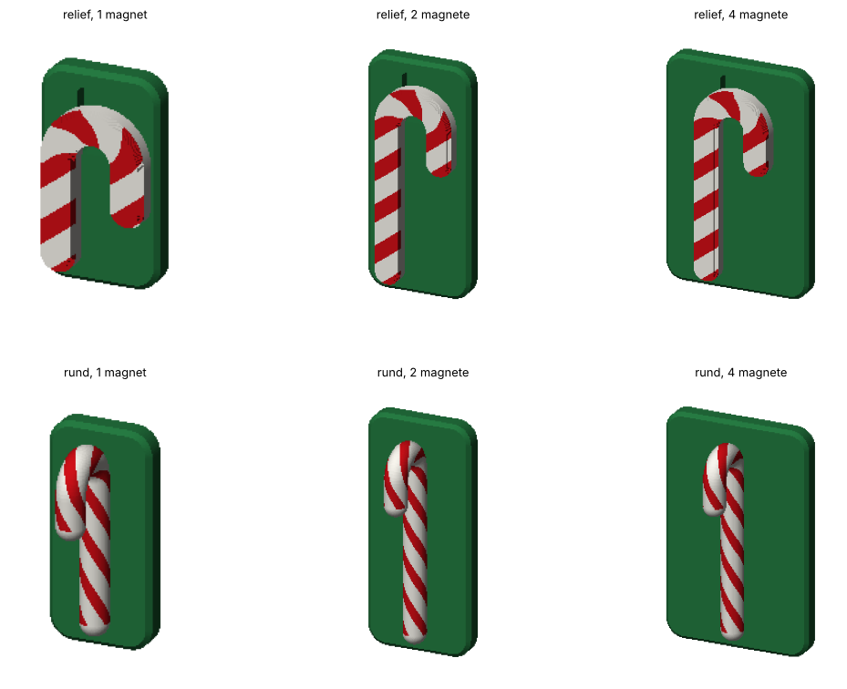
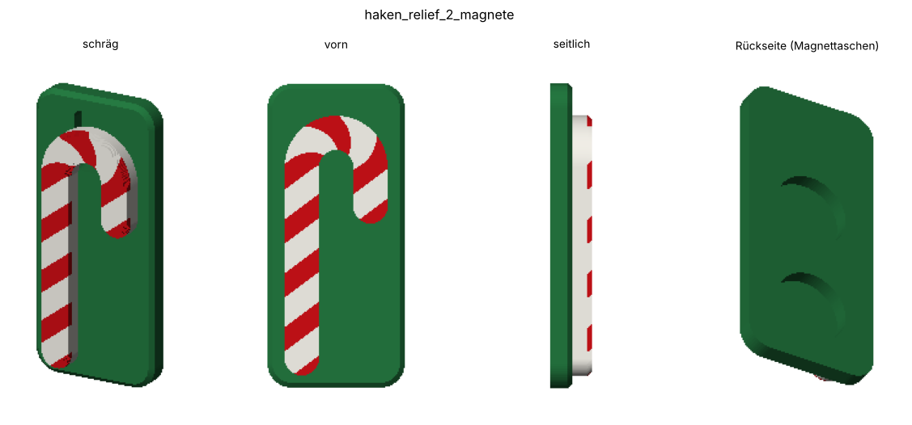
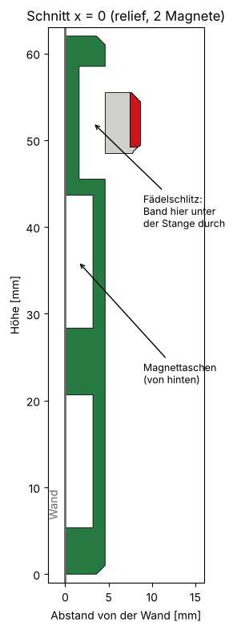
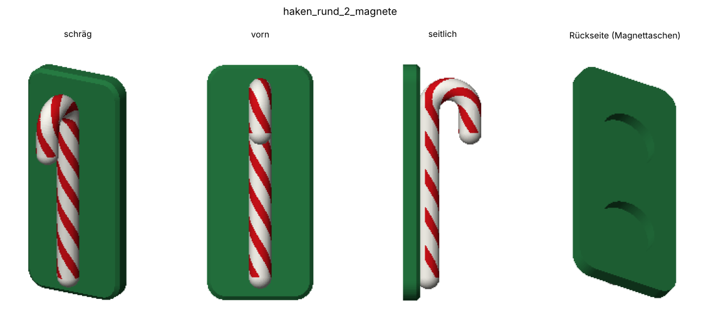

# Zuckerstangen-Haken für den Adventskalender

Magnethaken im Look einer rot-weißen Zuckerstange, zum Aufhängen eines Adventskalenders an Stahl (Tür, Zarge, Whiteboard). In der Basisplatte sitzen Neodym-Scheibenmagnete **Ø 15 × 3 mm**. Ausgelegt für den Mehrfarbdruck mit Filamentwechsler (Bambu AMS, Anycubic ACE 2 Pro o. Ä.).



Es gibt zwei Bauformen, jede mit **1, 2 oder 4 Magneten**:

| | **relief** (empfohlen) | **rund** |
|---|---|---|
| Form | flache Zuckerstange auf der Platte, Streifen nur auf der Sichtfläche | runde Stange mit Spiralstreifen, Bogen steht nach vorn ab |
| Tiefe ab Wand | 8,6 mm | 20,6 mm |
| Schichten mit Farbwechsel (0,2 mm) | **6** | 74 |
| Aufhängen | Band unter dem Bogenscheitel durchfädeln (Schlitz 9 × 3 mm) | offener Haken, lichte Weite 5 mm |
| Stützen | keine (Schlitz wird überbrückt) | unter dem Bogen |

| Variante | Platte B × H | Magnete |
|---|---|---|
| `1_magnet` | 24 × 42 mm (relief), 22 × 46 mm (rund) | 1 |
| `2_magnete` | 28 × 62 mm | 2 übereinander |
| `4_magnete` | 40 × 62 mm | 2 × 2 |

## Dateien

Je Variante `haken_<bauform>_<magnete>`:

| Datei | Inhalt |
|---|---|
| `….3mf` | alle drei Teile zusammen, zum direkten Öffnen im Slicer |
| `…_platte.stl` | Basisplatte mit Magnettaschen (Farbe frei wählbar, in den Bildern grün) |
| `…_weiss.stl` | weiße Grundfarbe der Stange |
| `…_rot.stl` | rote Streifen |
| `werkzeuge/erzeuge_modell.py` | erzeugt alle STL/3MF; alle Maße als Parameter oben in der Datei |
| `werkzeuge/bilder.py` | erzeugt die Bilder in `bilder/` (kleiner Z-Puffer-Renderer, kein OpenGL nötig) |

```sh
python3 werkzeuge/erzeuge_modell.py                       # alle 6 Varianten
python3 werkzeuge/erzeuge_modell.py --bauform relief --magnete 2
python3 werkzeuge/bilder.py
```

Benötigt: Python mit `numpy trimesh manifold3d shapely` (für die Bilder zusätzlich `matplotlib`).

## Bauform relief



- Stange 7 mm breit, 4 mm hoch, oben mit einer umlaufenden Fase von 1 mm. Die roten Streifen reichen von der Oberseite 1,2 mm tief (Fase + 0,2 mm). Darunter sind die Flanken weiß.
- **Farbwechsel nur in Z 7,4 bis 8,6 mm.** Darunter liegen nur Platte (Z 0 bis 4,6) und weiße Stange (ab 4,6). Platte und Stange überlappen in Z nicht, deshalb gibt es an der Plattenoberseite genau einen Wechsel. Wenn die Platte auch weiß sein soll, gib ihr dasselbe Filament, dann fällt dieser Wechsel weg.
- Die Grenzen liegen auf dem 0,2-mm-Raster (4,6 / 7,4 / 8,6), also ohne halbe Schichten.
- **Aufhängen:** Unter dem Bogenscheitel ist ein Schlitz 9 mm breit und 3 mm tief in die Platte gelassen. Das Band des Kalenders wird von unten hinter dem Scheitel durchgefädelt und hängt dann am höchsten Punkt des Bogens. Es passt Band bis etwa 8 mm Breite.



## Bauform rund



- Stange Ø 6 mm, 1 mm in die Platte eingelassen. Der Bogen (R 5,5) zeigt nach vorn und unten, die Schlaufe liegt im Scheitel. Lichte Weite 5 mm.
- Die Flanke direkt an der Platte (bis 1,2 mm über der Plattenoberseite) bleibt weiß, weil man sie kaum sieht. Das spart 6 Wechsel. Trotzdem hat jede weitere Schicht beide Farben (74 Wechsel bei 0,2 mm).
- Ohne Filamentwechsler: nur `_platte` und `_weiss` drucken und die Streifen danach bemalen.

## Druck

- **Lage:** Rückseite auf das Druckbett, so wie die Dateien liegen. Die Magnettaschen sind nach unten offen und brauchen keine Stützen.
- **3MF öffnen** (Bambu Studio, Orca, Anycubic Slicer Next, PrusaSlicer). Auf die Frage „als ein Objekt mit mehreren Teilen laden?“ mit **Ja** antworten. Dann den Teilen `platte`, `weiss` und `rot` ihre Filamente zuweisen.
- **Schichthöhe 0,2 mm.** Bei 0,12 mm gibt es entsprechend mehr Wechselschichten.
- **Mehrere Haken auf einmal drucken.** Ein Wechsel gilt pro Schicht für alle Teile auf der Platte. Vier Haken kosten also so viel Spülmaterial wie einer.
- Spülmaterial sparen: Spülen ins Infill bzw. ins Objekt aktivieren, falls der Slicer das anbietet. Der Spülturm bleibt für die wenigen Wechsel klein.
- **relief:** keine Stützen. Die Stange überbrückt den Schlitz auf 9 mm Länge mit flacher Unterseite.
- **rund:** Baum-Stützen nur von der Druckplatte aus, unter dem Bogen.

## Magnete

- Tasche Ø 15,3 × 3,2 mm, von hinten. Der Magnet sitzt 0,2 mm vertieft, damit die Platte plan an der Wand liegt.
- Mit einem Tropfen Sekundenkleber einkleben. Die Polung ist auf Stahl egal.
- Über den Magneten bleiben 1,4 mm Kunststoff, zwischen den Taschen und zum Rand mindestens 2 mm (wird im Skript geprüft).
- Die Haltekraft hängt stark vom Untergrund ab (Blechdicke, Lack). Für schwere Kalender die 4-Magnet-Variante oder zwei Haken nehmen.

## Stand

- 10.11.2026: erste Version mit beiden Bauformen und je drei Magnetvarianten. Noch nicht gedruckt erprobt.
