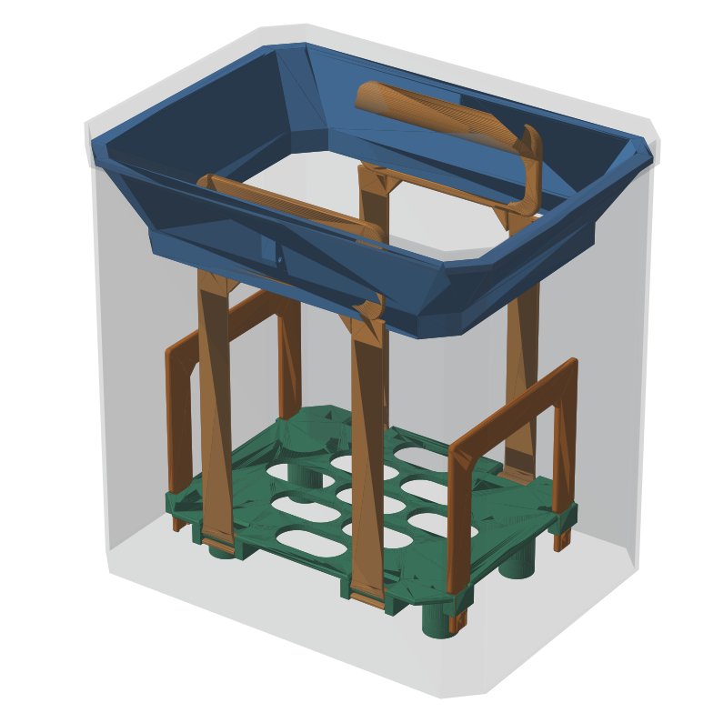
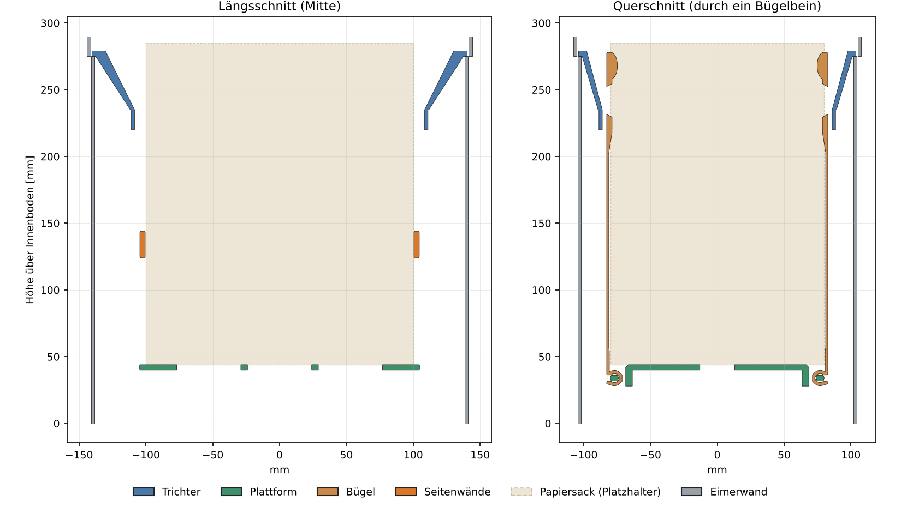
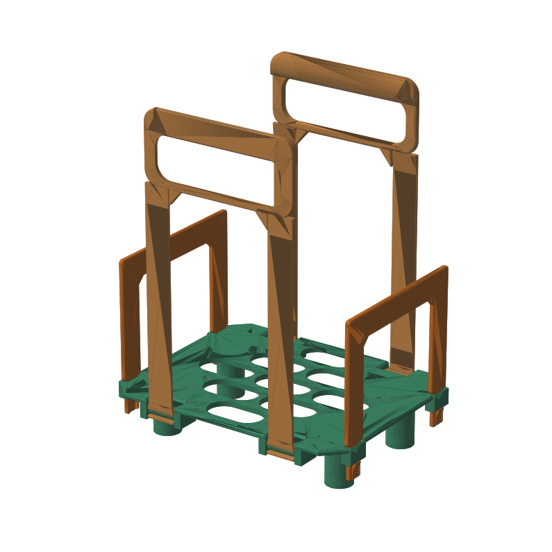
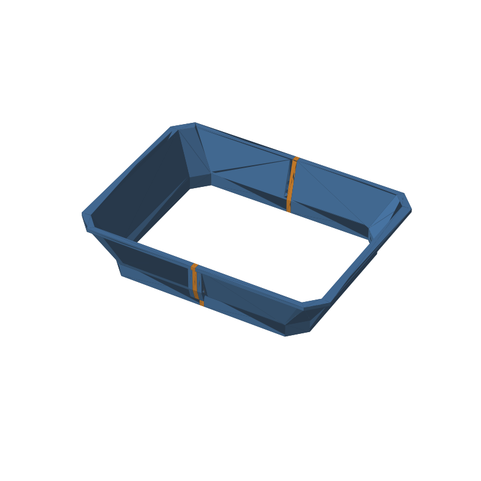
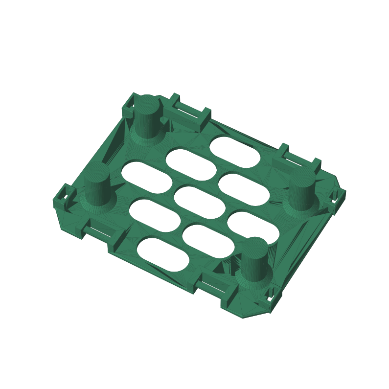
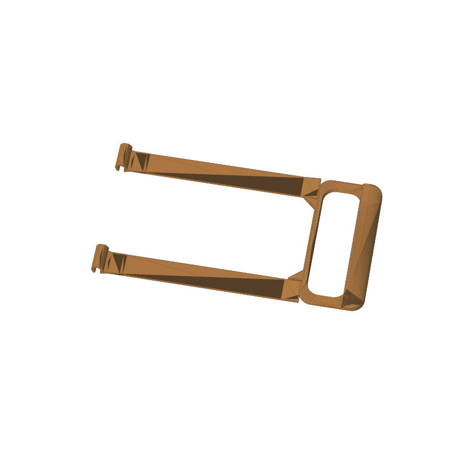
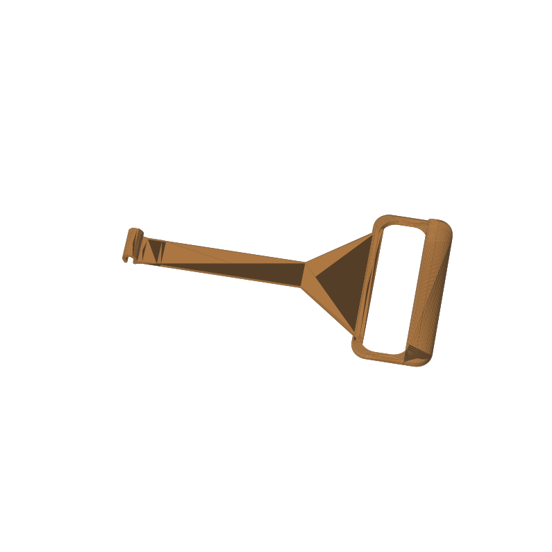
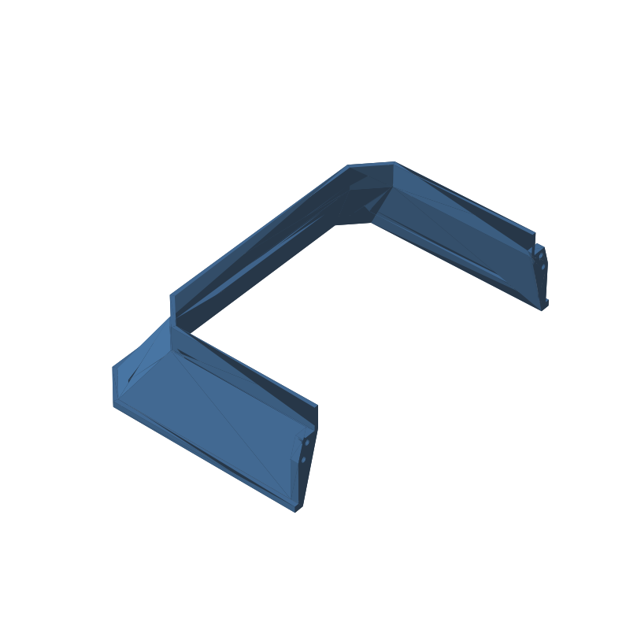
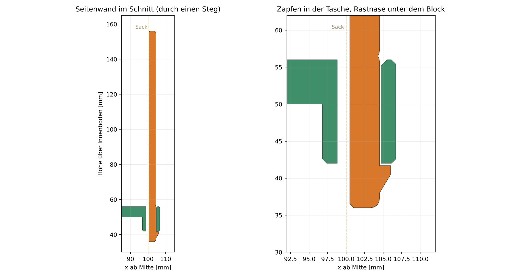

# Biomüll-Einsatz – Korb und Trichter für den Biomülleimer

Einsatz für einen Biomülleimer in einem Küchenauszug. Ein Papier-Biomüllsack steht auf einer Plattform und wird mit Griffen herausgehoben. Ein Trichter liegt rundum auf dem Absatz am oberen Eimerrand, bleibt dauerhaft im Eimer und hält den Sack in Position. Alle Teile werden aus PETG gedruckt und sind spülmaschinenfest.

## Prinzip

- **Korb:** Eine Plattform auf vier Füßen trägt den Sack. An den Langseiten sind zwei Bügel eingehängt, die am Sack hochlaufen und in Griffschlaufen enden. An den Schmalseiten stecken zwei steife, abnehmbare **Seitenwände** (Version 3, siehe unten). Gehoben wird nur an den Bügeln.
- **Trichter:** Der Kragen liegt auf dem 3-mm-Absatz des Eimers. Darunter folgt eine 40 mm tiefe Schräge bis zur Öffnung, an der ein 15 mm hoher senkrechter Haltekragen hängt.
- Der Sack ragt durch die Trichteröffnung nach oben. Bügel und Seitenwände laufen zwischen Sack und Trichterrand. Die Griffe liegen dort greifbar, 10 mm unter der Eimerkante.
- Zum Leeren wird der ganze Korb mit dem Sack **durch die Trichteröffnung** gehoben. Der Trichter bleibt im Eimer.
- Nichts ragt über die Eimerkante, weil der Eimer unter eine Ablage fährt.

| Korb (Plattform + Bügel + Seitenwände) | Trichter (2 Hälften) |
|---|---|
|  |  |

## Dateien

| Datei | Inhalt |
|---|---|
| `biomuell_system.scad` | Hauptdatei: alle Teile, parametrisch, Customizer auf Deutsch (OpenSCAD 2021.01 oder neuer). |
| `mittelteil_v1.scad` | Optional: Mittelteil für bereits gedruckte Trichterhälften der Version 1 (Eimerlänge 278 mm). |
| `biomuell_system.3mf` | Bambu-Studio-Projekt vom ersten Druckdurchgang (Trichter Version 1), Teile mit Druckeinstellungen auf Platten verteilt. Enthält zusätzlich zwei Testobjekte. |
| `bilder/` | Vorschaubilder, erzeugt mit `werkzeuge/bilder.sh`. |
| `archiv/` | Zwischenstände vom 16.10.2026: Python-Generator (V0) und erste SCAD-Version (V1), jeweils mit Vorschau und Kennwerten. |
| `werkzeuge/` | Skripte für die Bilder, OpenSCAD als WebAssembly (für Umgebungen ohne OpenSCAD), STL-Prüfungen (`stl_pruefung.py`) und der 3MF-Generator (`korb_3mf.py`). |
| `agent.md` | Arbeitsstand, Konzeptentscheidungen und Arbeitsweise für KI-Agenten. |
| `v3_plan.md` | Plan und Umsetzungsstand von Version 3 (abnehmbare Seitenwände an den Schmalseiten). |

Alle Konstruktionsstände sind eingecheckt: STL, 3MF, PNG und SCAD stehen direkt in diesem Ordner, jeder Stand ist ein eigener Commit (siehe [Verlauf](#verlauf)). **Versioniert wird nur über Git:** Ein neuer Stand überschreibt die gleichnamige Datei, ältere Stände stehen in der Git-Historie (Versionen als Tags `biomuell-v2`, `biomuell-v3`, …), nicht als eigene Dateien. Neu erzeugen aus der SCAD-Datei: `teil` wählen, `stueck` setzen, F6, als STL exportieren.

**Druckdateien** (Stand = letzter Commit, der die Datei geändert hat; „rekonstruiert“ = aus dem SCAD-Stand desselben Commits neu erzeugt, weil das ausgelieferte Original nicht mehr vorlag):

| Datei | Stand | Herkunft | Inhalt |
|---|---|---|---|
| `biomuell_system.scad` | V3-2 | Original | Hauptdatei, Version 3 (`schmalseite_typ`, Seitenwand, feste Trichteröffnung) |
| V3-3 | 19:54 | Mittelteil optional: `mittelteil = 0` als Standard. Trichter wie gemessen 280,5 mm lang aus zwei Hälften à 140,25 mm (je 2,5 mm länger als mit Mittelteil), Öffnung unverändert 217 × 172 (feste Parameter), Schrauben M3 × 16. Neu: `trichter_v2_haelfte_2x.stl`, `lehre_haelfte_2x.stl`, `trichter_v2.3mf`, `trichter_v2_druckhilfe.3mf`, `druckhilfe_steg.stl`; die bisherige Passlehre heißt jetzt `lehre_haelfte_mittelteilversion_2x.stl`. |
| V3-4 | 14:10 | Rastnase vergrößert: `rast_nase` 1,0 → 1,5 mm, `tasche_relief` 1,2 → 1,5, `rast_wurzel` 3 → 1 (Zunge 19 mm, Dehnung ca. 2,8 %, Haltefläche nominal 1,3 mm). Grund: Die Seitenwände rasteten nicht spürbar ein. Plattform, Seitenwand, Rastprobe und `korb_v3.3mf` neu. |
| `vergleich_v1_v2.png` | 1 | Original | Vergleich Version 1 (rot) und Version 2 (grün), Schnitte durch die Trichterschräge |
| `trichter_v2_haelfte_2x.stl` | V3-3 | Original | Trichterhälfte (Standard, ohne Mittelteil), Eimer 283 mm, Öffnung 217 × 172: 140,25 × 207,5 × 59, 2× drucken |
| `trichter_v2.3mf` | V3-3 | Original | Trichter ohne Druckhilfe, ohne Mittelteil (je Platte eine Hälfte), Einstellungen wie zuvor; mit `werkzeuge/trichter_3mf.py` neu erzeugt |
| `druckhilfe_steg.stl` | V3-3 | Original | Druckhilfe-Steg für Eimer 283 mm (Hälfte 140,25 mm) |
| `trichter_v2_druckhilfe.3mf` | V3-3 | Original | wie zuvor mit abtrennbarer Druckhilfe, ohne Mittelteil |
| `plattform.stl` | V3-2 | Original | Plattform **210** × 166 × 56 (213,4 mit den Ohren der Taschenblöcke) mit abgeflachten Scharnierstiften an den Langseiten und vier Taschen für die Seitenwände, Eckfüße bei x = ±78,6, 1× drucken. Die Plattform der Version 2 (206 mm, mit Scharnier an den Schmalseiten) steht in der Git-Historie; sie passt zu `band_schmalseite_2x.stl`. |
| `buegel_langseite_2x.stl` | 5 | Original | Bügel Langseite mit 2 Haken (Kanal), 239,75 × 134, 2× drucken |
| `band_schmalseite_2x.stl` | 5 | Original | Band Schmalseite mit 1 Haken (Kanal), 239,75 × 124, 2× drucken. Nur für die Plattform der Version 2 (`schmalseite_typ = "band"`). |
| `scharnier_flachlage.png` | 5 | Original | Scharnier in drei Stellungen: aufrecht (hält), waagerecht (löst), dazwischen |
| `korb_v2.3mf` | 6 | Original | Korb Version 2 auf 5 Platten: Plattform, 2 Bügel, 2 Bänder, Druckeinstellungen je Objekt |
| `seitenwand_h100_2x.stl` | V3-2 | Original | Seitenwand 120 × 134 × 5 (Höhe 100 mm über der Plattenoberseite), flach, 2× drucken |
| `rastprobe.stl` | V3-2 | Original | Rastprobe: Taschenblock mit Plattenstück und ein kurzes Wandstück, vorab drucken |
| `korb_v3.3mf` | V3-2 | Original | Korb Version 3 auf 5 Platten: Plattform, 2 Bügel, 2 Seitenwände (4 Wände, 100 %), erzeugt mit `werkzeuge/korb_3mf.py` |
| `schnitt_wand.png` | V3-2 | Original | Schnitt durch einen Wandsteg: Zapfen in der Tasche, Rastnase unter dem Block |
| `lasche_loecher.png` | 7 | Original | Schnitt durch die Laschen, je 2 volle Schraublöcher |
| `lehre_haelfte_2x.stl` | V3-3 | Original | Passlehre (Standard, ohne Mittelteil): 140,25 × 207,5 × 10, 2× drucken |
| `lehre_haelfte_mittelteilversion_2x.stl` | 9 | Original | Passlehre 5 mm kürzer (137,75 × 207,5 × 10) für die Verwendung mit Mittelteil (früher `lehre_haelfte_2x.stl`) |
| `mittelteil_v1_5mm_2x.stl` | 9 | Original | Optional: Mittelteil 5 mm für die alten Hälften (Version 1) aus `mittelteil_v1.scad`, 2× drucken |
| `mittelteil_5mm_2x.stl` | 9 | Original | Optional: Mittelteil 5 mm für Hälften der Version 2 mit Mittelteil (`mittelteil = 5`), 2× drucken |
| `trichter_haelfte_mittelteilversion_2x.stl` | 9 | Original | Optional: Trichterhälfte für die Verwendung mit Mittelteil (137,75 × 207,5 × 59), 2× drucken |
| `trichter_v2_mittelteil.3mf` | 9 | Original | Optional: Trichter mit Mittelteil, je Platte eine Hälfte und ein Mittelteil |

## Teile

| `teil` | Anzahl | Maße (mm) | Beschreibung |
|---|---|---|---|
| `plattform` | 1 | 210 × 166 × 56 | Massive 6-mm-Platte mit 9 Langlöchern, 4 runde Füße (50 mm Bodenabstand), 4 abgeflachte Scharnierstifte (Bügel) und 4 Taschen für die Seitenwände |
| `langseite` | 2 | 239,75 × 134 | Bügel mit zwei Haken und Griffschlaufe |
| `seitenwand` | 2 | 120 × 134 × 5 | Seitenwand (∩): zwei Stege 20 × 4 mm, Quersteg, Steckzapfen mit Rastzunge; Höhe `wand_h` |
| `rastprobe` | 1 + 1 | 38 × 62 × 14 | Taschenblock mit Plattenstück und kurzes Wandstück zum Probieren von Spiel und Rastkraft |
| `schmalseite` | 2 | 239,75 × 124 | Band mit einem Haken und Griffschlaufe, nur bei `schmalseite_typ = "band"` (Version 2) |
| `trichter` | 2 | 140,25 × 207,5 × 59 | Trichterhälfte, Keilwand, Laschen mit M3-Löchern an der Fuge (mit `mittelteil = 5`: 137,75) |
| `mittelteil` | 2 | 5 × 207,5 × 59 | **Optional** (nur bei `mittelteil > 0`, Standard 0): Zwischenstück je Längsseite zwischen den Trichterhälften, z. B. um schon gedruckte Hälften weiterzuverwenden |
| `lehre` | 2 | Hälften | Passlehre für den Trichterkragen – zuerst drucken und im Eimer prüfen |

| Plattform | Bügel Langseite | Band Schmalseite | Trichterhälfte |
|---|---|---|---|
|  |  |  |  |

**Kaufteile:** 8 Edelstahlschrauben M3 × 16 mit Muttern für die Trichterfugen (mit Mittelteil M3 × 20, siehe Konsolenausgabe). Optional 2K-Epoxid für die Fugen.

## Bedienung der SCAD-Datei

- `teil = "uebersicht"` zeigt alles im Eimer, mit Sack und Eimer als Platzhalter.
- `stueck = -1` zeigt alle Druckstücke eines Teils nebeneinander, `stueck = 0, 1, …` liefert genau ein druckfertig orientiertes Stück.
- Die Konsole (ECHO) meldet Stückzahlen, Längen, Höhen, Schrägen und Warnungen.
- Teile, die größer als das Druckbett sind (`bett_x/y`, abzüglich `bett_rand`), teilt die Datei automatisch:
  - Plattform: Schwalbenschwanz-Puzzle über die volle Höhe, geklebt.
  - Bänder/Bügel: verdickter Stoß mit Schwalbenschwanz, geklebt.
  - Trichter: immer geteilt; gerade Fugen mit Laschen und M3-Schrauben.

## Anpassen an den eigenen Eimer

Die Maße stehen im Abschnitt „Eimer – gemessen“:

| Parameter | Vorgabe | Bedeutung |
|---|---|---|
| `eimer_l`, `eimer_b` | 283, 210 | Innenmaß oberhalb des Absatzes |
| `eimer_gerade_l`, `eimer_gerade_b` | 245, 170 | gerade Wandstücke zwischen den 45°-Eckschrägen |
| `absatz` | 3 | Rücksprung der Wand je Seite am Absatz |
| `absatz_z` | 275 | Höhe des Absatzes über dem **Innenboden** – noch nicht nachgemessen |
| `absatz_bis_rand` | 15 | Absatz bis Oberkante Eimer |
| `mittelteil` | 0 | Optionales Zwischenstück je Längsseite (z. B. 5); 0 = keins. Die Eimerlänge bleibt wie gemessen, die Öffnung 217 mm |
| `oeffnung_l`, `oeffnung_b` | 217, 172 | Trichteröffnung, **fest** (nicht mehr von der Plattform abhängig) |
| `schmalseite_typ` | wand | `wand` = Seitenwand (Version 3), `band` = Band mit Griffschlaufe (Version 2) |
| `wand_h` | 100 | Wandhöhe ab Plattenoberseite; andere Höhen passen in dieselbe Plattform |
| `wand_t` | 4 | Wanddicke (Steifigkeit ~ Dicke³) |

Bügellänge und Griffhöhe werden aus `absatz_z` berechnet (`laenge_lang/kurz = 0`). Die Trichteröffnung ist fest (`oeffnung_l/b`); Plattform, Wand und Taschenblöcke müssen hineinpassen, die Konsole warnt bei weniger als 1,5 mm Abstand.

## Druck

PETG, 0,4-mm-Düse, alle Teile ohne Stützen.

| Teil | Lage auf dem Bett | Wände | Füllung | Oben/Unten |
|---|---|---|---|---|
| Plattform | Oberseite unten, Füße oben | 4 | 25 % Gyroid | 5/5 |
| Bügel / Band | flach | 3 | 100 % | 5/5 |
| Seitenwand | flach, Außenseite (Rastnase) oben | 4 | 100 % | 5/5 |
| Trichterhälfte | Kragenoberseite unten | 4 | 100 % | 5/5 |
| Mittelteil | Profil flach | 4 | 100 % | 5/5 |
| Passlehre | Kragen unten | 2 | 15 % | 3/3 |

Bei den großen Flächen ggf. eine Brim verwenden. Für die Trichterhälften gibt es optional eine abbrechbare Druckhilfe (`druckhilfe = true`), die die offene Seite beim Druck zum Ring schließt.

### Slicer-Hinweise (Anycubic Kobra S1)

- Jede Trichterhälfte auf ein eigenes Druckbett.
- Außenwand 60–80 mm/s, Wandbeschleunigung höchstens 3000.
- 240–245 °C, Lüfter 30–40 %, Überhang-Lüfter höchstens 50 %.
- Stützen aus, Brim 8–10 mm.
- In `trichter_v2*.3mf` hinterlegt: 4 Wände (Arachne), 40 % Gyroid, oben/unten 5 Lagen, 0,2 mm, Brim 6 mm, Außenwand 70 mm/s, Innenwand 100 mm/s, Beschleunigung 2000/3000, Naht hinten. Temperatur und Lüfter stehen nicht in der 3MF (Filamentprofil).
- `korb_v2.3mf`: Plattform 4 Wände, 25 % Gyroid, 5/5, Brim 5 mm; Bügel und Bänder 3 Wände, 100 %, 5/5, kein Brim.
- `korb_v3.3mf`: wie V2, aber statt der Bänder zwei Seitenwände (4 Wände, 100 %, 5/5, kein Brim). Die Datei ist noch in keinem Slicer geöffnet (die Netze sind geprüft dicht).
- Die Trichter-3MFs sind in PrusaSlicer geprüft (Teile dicht), im Anycubic Slicer Next nicht geöffnet.

## Montage

1. Passlehre in den Eimer legen und prüfen. Bei Bedarf `flansch_spiel` oder `trichter_spiel` anpassen.
2. Trichterhälften (und, falls verwendet, die Mittelteile) mit M3-Schrauben und Muttern verbinden und in den Eimer legen.
3. Bügel waagerecht nach außen liegend von oben auf die abgeflachten Stifte der Plattform setzen und hochklappen. Aufgeklappt halten die Haken fest.
4. Seitenwände senkrecht von oben mit den Zapfen in die Taschen an den Schmalseiten stecken, bis die Schulter auf der Plattform aufliegt und die Rastnase unter dem Block einschnappt. Lösen: Nase von unten mit dem Daumen eindrücken und die Wand nach oben abziehen. Zum Reinigen alles abnehmen (Plattform ohne Sackloch, die Taschen sind unten offen).
5. Sack auf die Plattform stellen und den Korb durch die Trichteröffnung einsetzen.

## Verlauf

Jeder Konstruktionsstand ist ein eigener Commit mit allen erzeugten Dateien. Details je Stand stehen in [`agent.md`](agent.md) und in den Commit-Meldungen.

| Stand | 18.10.2026 | Änderung |
|---|---|---|
| 1 | 10:04 | Trichter Version 2: Keilwand (innen steilere Schräge, oben dickere Wand), abbrechbare Druckhilfe (Standard an), Eimer weiter 278 mm. Neue Trichterhälfte (STL) und Vergleich V1/V2. |
| 2 | 10:13 | `trichter_v2.3mf`: beide Hälften auf je einer Platte, Druckeinstellungen je Objekt. |
| 3 | 10:17 | `druckhilfe = false` als Standard (der Steg stünde im fertigen Trichter quer in der Öffnung). STL, 3MF und SCAD neu. |
| 4 | 10:19 | `trichter_v2_druckhilfe.3mf`: Druckhilfe als eigenes, abtrennbares Teil; `druckhilfe_steg.stl`. |
| 5 | 11:31 | Scharnier: Stift mit zwei Abflachungen (`stift_flach = 4.2`, `kanal_spiel = 0.25`, `kanal_fase = 0.6`), Haken mit Kanal, Lösefenster ±7°. Neue Plattform, Bügel und Bänder. |
| 6 | 12:32 | `korb_v2.3mf`: Plattform, 2 Bügel und 2 Bänder auf 5 Platten. |
| 7 | 16:10 | Laschenlöcher korrigiert: je Lasche 2 volle Löcher (M3 × 16), Lage aus der Laschenbreite berechnet (`loch_rand_min = 1.5`). Beide Trichter-3MFs neu. |
| 8 | 16:13 | Eimer nachgemessen: `eimer_l` 278 → 283, `eimer_gerade_l` 240 → 245. Hälften 140,25 mm lang, ohne Mittelteil. Passlehre `lehre_haelfte_2x.stl`. |
| 9 | 16:19 | Parameter `mittelteil` (5 mm): Hälften wieder 137,75 mm, je Längsseite ein Mittelteil. `mittelteil_v1.scad` für die alten Hälften der Version 1. |
| V3-1 | 18:30 | Plan für Version 3 eingecheckt ([`v3_plan.md`](v3_plan.md)): abnehmbare ∩-Seitenwände statt Schmalseiten-Bänder. Noch keine Geometrie. |
| V3-2 | 18:55 | Version 3 umgesetzt: `schmalseite_typ = "wand"`, Seitenwand `wand_h = 100` / `wand_t = 4` mit Steckzapfen und Rastzunge, Taschenblöcke an der Plattform (210 mm), Eckfüße bei x = ±78,6, feste Trichteröffnung 217 × 172 (Trichter, Bügel, Mittelteil geometrisch unverändert), `teil = "seitenwand"` und `"rastprobe"`, STL, `korb_v3.3mf`, Bilder. |

## Version 3: abnehmbare Seitenwände an den Schmalseiten

Die Griffbänder der Schmalseiten sind durch zwei steife, abnehmbare **∩-förmige Wände** ersetzt (Standardhöhe 100 mm ab Plattenoberseite, `wand_h` frei einstellbar). Gehoben wird nur an den beiden Bügeln der Langseiten.

- **Form:** zwei Seitenstege 20 × 4 mm, die direkt nach den Eckschrägen der Plattform beginnen (y = ±47 … ±67), und ein Quersteg 20 mm hoch. Alle Kanten gerundet, Innenecken gefast.
- **Steifigkeit:** 4 mm dick, 100 % Füllung, flach gedruckt (Biegelast entlang der Schichten). Rechnerisch gibt die Oberkante bei 5 N etwa 3,7 mm nach (ein Griffband wäre rund 30-mal weicher), plus höchstens 2,9 mm Spiel im Zapfen. Für höhere Wände `wand_t` erhöhen (bis 6 mm; die Konsole meldet Durchbiegung und Abstand zur Öffnung).
- **Clip:** Jeder Steg endet in einem 14 mm breiten, 20 mm langen Zapfen. Er wird von oben in eine unten offene Tasche der Plattform gesteckt (14 mm Führung, Spiel 0,2 mm je Seite). Die Stegkanten neben dem Zapfen bilden die Schulter auf der Plattenoberseite. In der Mitte des Zapfens liegt eine federnde Rastzunge (8 mm breit, 17 mm lang) mit 1 mm hoher Nase, die unter dem Taschenblock einschnappt (Haltefläche 0,8 mm, Dehnung beim Einrasten ca. 2,5 %). Hinter der Zunge hat die Tasche ein Relief, in das die Zunge einfedert.
- **Taschenblöcke:** Sie sitzen als Ohr an der Plattenkante und reichen bis x = ±106,7, also 1,8 mm vor die feste Trichteröffnung (±108,5). Die Wand selbst liegt bei x = ±100,5 … ±104,5, 0,5 mm vom Sack und 4 mm von der Öffnung.
- **Plattform:** wächst im Wandmodus auf 210 mm (`platte_l_wand`); die Eckfüße rücken auf x = ±78,6, damit sie die Taschenblöcke nicht berühren.
- **Trichteröffnung:** fest 217 × 172 mm, unabhängig von Plattform und Mittelteil. Mit `mittelteil = 5` sind Trichterhälfte, Mittelteil und Bügel geometrisch unverändert gegenüber Stand 9 (Eckpunktabweichung 0,0000 mm); Standard ist seit V3-3 `mittelteil = 0` (Hälften 140,25 mm).
- **Wand tauschen:** Zapfen, Rastzunge und Tasche hängen nicht von der Höhe ab. Andere Höhen drucken (`wand_h` ändern, Datei `seitenwand_h<Höhe>_2x.stl`) und in dieselbe Plattform stecken. Die Konsole warnt, wenn die Wand an die Eimerkante reicht (bei angenommenem `absatz_z` ab etwa 230 mm).
- **Zuerst drucken:** `teil = "rastprobe"` (Taschenblock mit Wandstück), um Spiel und Rastkraft zu prüfen. Nicht gedruckt, nicht im Eimer erprobt.
- **Version 2 bleibt wählbar:** `schmalseite_typ = "band"` erzeugt wieder Plattform (206 mm, Scharniere an den Schmalseiten) und Bänder.

Plan, Entscheidungen und Abweichungen vom Plan: [`v3_plan.md`](v3_plan.md).

> **Hinweis (V3, Stand 4): Rastnase noch nicht am Druck geprüft.**
> Die erste Fassung (`rast_nase = 1,0`) rastete nicht spürbar ein, die Wand glitt ohne Widerstand wieder heraus. Seit Stand 4 gilt `rast_nase = 1,5`, `tasche_relief = 1,5`, `rast_wurzel = 1` (Zunge 19 mm, Dehnung ca. 2,8 %, Haltefläche nominal 1,3 mm). Das ist nur gerechnet. **Vor dem Druck der ganzen Teile zuerst `rastprobe.stl` drucken** und prüfen, ob die Wand hörbar einrastet und nicht zurückgleitet.
> Reicht es nicht: `rast_nase` bis 1,8 mm erhöhen (dann `rast_wurzel` 0,5 oder `zapfen_l` größer wählen, die Konsole warnt ab 3 % Dehnung) oder die Rastkante leicht hinterschneiden. Das hält besser, macht aber das Lösen mit dem Daumen schwerer.
> Die Plattform ist wegen der geänderten Tasche neu zu drucken. Bügel und Trichter bleiben unverändert.

## Stand

Laufender Stand und offene Punkte stehen in [`agent.md`](agent.md).
