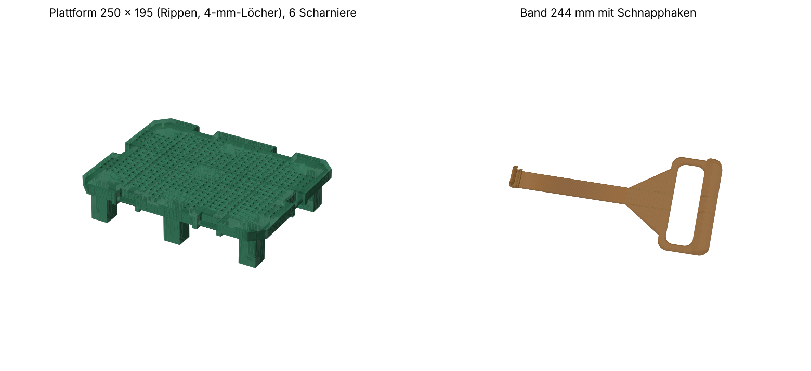

# V0 – Python-Generator (vor dem 16.10.2026, 01:55)

Erste Generation des Korbs: Plattform und Tragebänder werden von einem Python-Skript ohne externe CAD-Bibliothek als STL erzeugt. Einen Trichter gab es noch nicht. Die SCAD-Konstruktion (V1) hat Plattform und Bänder aus diesem Stand übernommen und dagegen geprüft.

## Dateien

| Datei | Inhalt |
|---|---|
| `biomuell_plattform.py` | Generator für Plattform, Band und Bügel (nur Python 3). `python3 biomuell_plattform.py [datei.stl …]` erzeugt einzelne Teile. |
| `make_3mf.py` | Packt die STL-Dateien druckfertig auf das 260-mm-Bett und legt die Einstellungen je Objekt ab (PrusaSlicer- und Bambu/Orca-Format). |
| `plattform_6baender.3mf` | Plattform mit 6 Scharnieren: je 2 an den Langseiten, je 1 an den Schmalseiten. Dazu 2 Bügel und 2 Bänder. |
| `plattform_4baender.3mf` | Plattform mit 4 Scharnieren, je 1 pro Seite. Dazu 4 Bänder. |
| `buegel.3mf` | Bügel: zwei Haken, ein gemeinsamer Griff (Langseiten). |
| `baender_2x.3mf` | Zwei Bänder ineinander verschachtelt auf einem Bett. |

Nicht eingecheckt (`.gitignore`, je 8–9 MB): `plattform_6baender.stl`, `plattform_4baender.stl`, `band.stl`, `band_kurz.stl`. Alle außer `band_kurz.stl` erzeugt das Skript. `band_kurz.stl` ist ein Band von 164 mm Länge (`len` in `BANDS` auf 164 setzen).

## Kennwerte

- Eimer laut Skript: innen 205 × 275, Höhe 290, Ecken 45° abgeschrägt.
- Plattform 250 × 195 × 4 mm, Rippen 8 mm hoch, quadratische Abflusslöcher 4 mm im 8-mm-Raster, Füße 22 mm (Aufweitung 30 mm), Bodenabstand 50 mm. STL-Höhe 54 mm.
- Band 244 mm lang, 22 mm breit, 1,6 mm dick, Hals 2 mm. Griffschlaufe mit 108-mm-Fenster, Griffsteg 12 mm dick und gewölbt.
- Scharnier: Stift 6 mm, Schnapphaken (Spiel 0,35 mm, Wand 2,4 mm), Hakenbreite 24 mm.
- Druckeinstellungen in den 3MF (`make_3mf.py`): Plattform 3 Wände, 25 % Gyroid, oben/unten 5/4. Bänder 4 Wände, 100 % konzentrisch. Keine Stützen.

## Warum abgelöst

Die Rippenplatte sammelt Ablagerungen und ist schwer zu reinigen. V1 ersetzt sie durch eine massive Platte mit Langlöchern und kleiner Grundfläche, die durch die Trichteröffnung passt.
