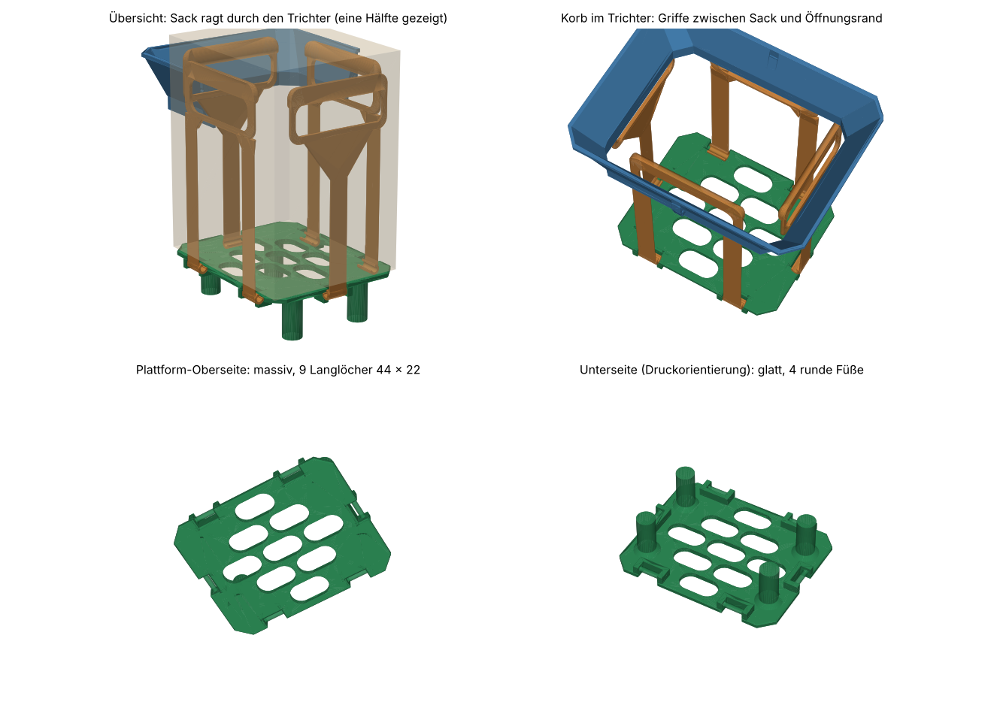

# V1 – erste SCAD-Version (16.10.2026, 01:55)

Erste parametrische OpenSCAD-Datei mit Korb, Trichter und Passlehre. Auf diesem Stand beruht das Bambu-Studio-Projekt des ersten Druckdurchgangs.

## Dateien

| Datei | Inhalt |
|---|---|
| `biomuell_system.scad` | Hauptdatei von damals (Eimer 278 × 210, Trichter mit gleich dicker Wand, runder Scharnierstift mit Schnapphaken). |
| `biomuell_projekt_stand.md` | Übergabedokument von damals mit Konzept, Parametern, Prüfergebnissen und offenen Punkten. Unverändert, Pfade wie `/home/claude/work/` gelten nicht mehr. |
| `biomuell_system.3mf` | Druckfertiges Paket: 9 Teile, orientiert und mit Druckeinstellungen je Objekt (PrusaSlicer- und Bambu-Format). |
| `vorschau.png` | Vorschau von damals. |

Die STL-Dateien aus der damaligen Zip (`plattform`, `buegel_langseite_2x`, `band_schmalseite_2x`, `trichter_haelfte_2x`, `lehre_haelfte_2x`) sind nicht eingecheckt. Mit dieser SCAD-Datei lassen sie sich neu erzeugen (`teil` wählen, `stueck` setzen). Maße und Volumen der neu erzeugten Teile stimmen mit den damaligen STLs überein.

Das Bambu-Studio-Projekt des ersten Druckdurchgangs liegt im Hauptordner: [`../../biomuell_system.3mf`](../../biomuell_system.3mf).

## Kennwerte

- Plattform 206 × 166 × 56 mm, massiv mit 9 Langlöchern (44 × 22), 4 runde Füße.
- Bügel (Langseiten) und Band (Schmalseiten) je 239,75 mm, Griff-Oberkante 280 mm über Boden (mit angenommenem `absatz_z = 275`).
- Trichterhälfte 137,75 × 207,5 × 59 mm, 2 Stück, Öffnung 212 × 172 mm, Schräge 54°/69°, Ecken 52°. Beide Hälften sind identisch.
- Passlehre für den Trichterkragen, 2 Hälften.

## Unterschiede zu V2

- Eimerlänge 278 mm angenommen, später 283 mm gemessen. Die Hälften sind für 278 mm gerechnet; im 283-mm-Eimer schließt ein 5-mm-Mittelteil die Lücke (`../../mittelteil_v1.scad`).
- Gleich dicke Trichterwand statt Keilwand. Die Innenschräge ist flacher, die Kragen-Oberseite schmaler. Sie ist in V2 weiter wählbar (`innenform = "parallel"`).
- Runder Scharnierstift mit Schnapphaken statt abgeflachtem Stift mit Kanal.
- Keine Druckhilfe für die Trichterhälften.
