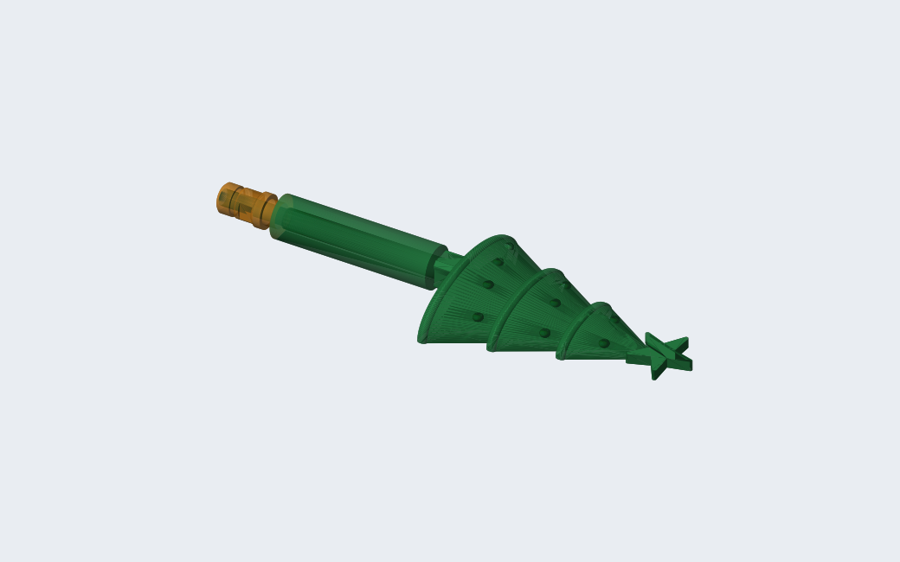
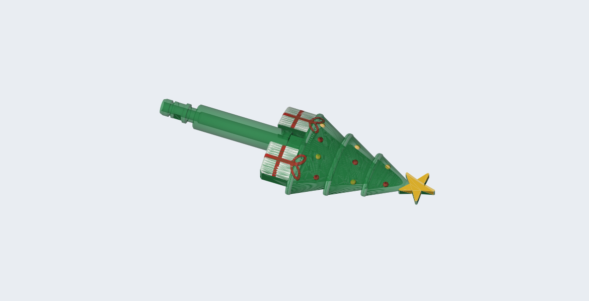
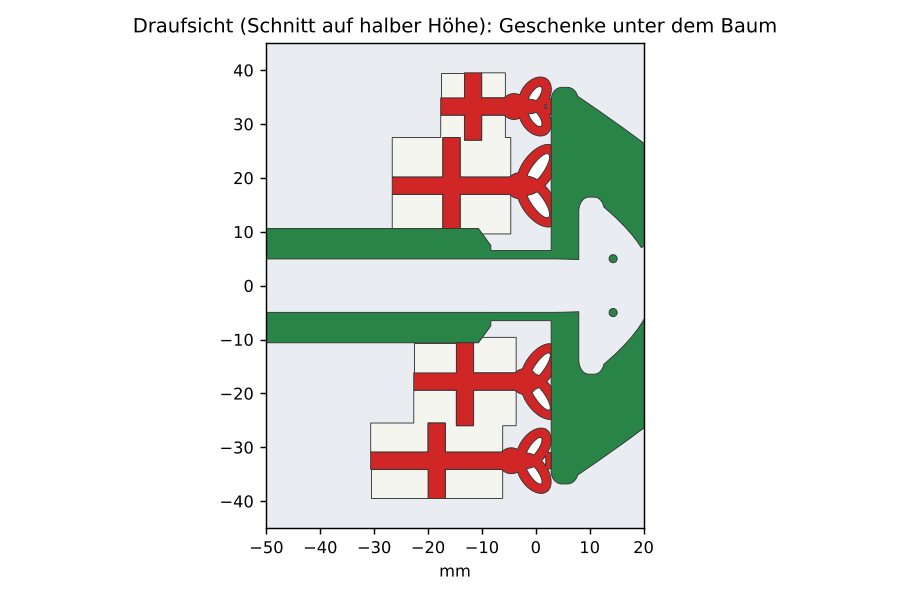
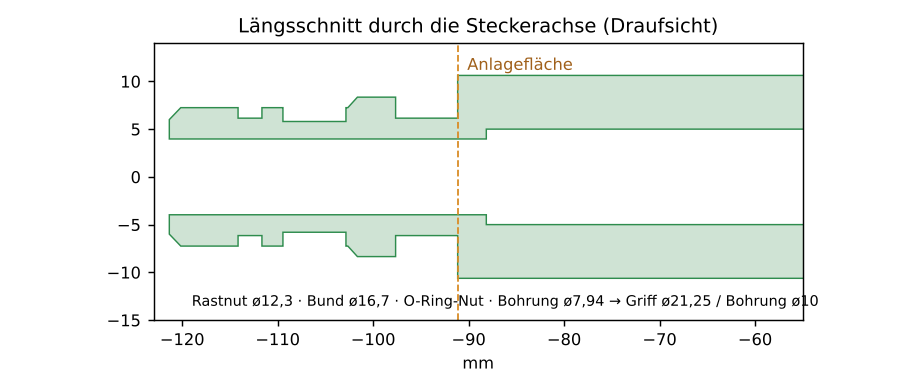
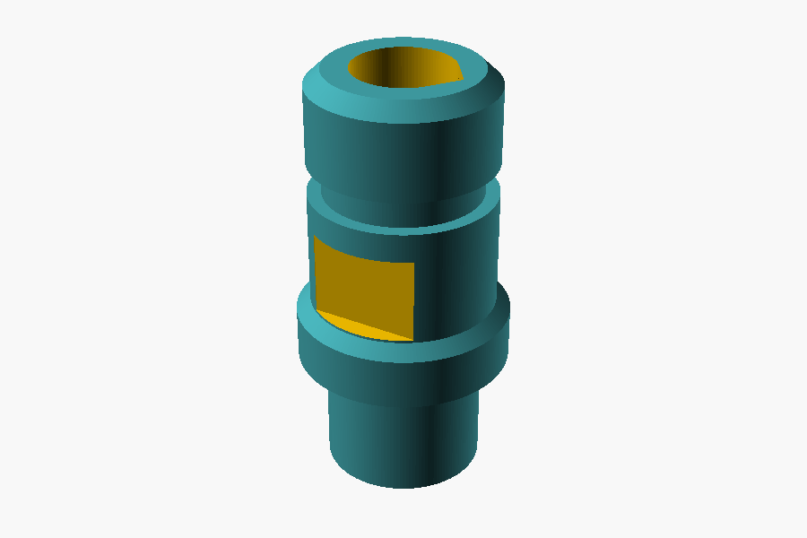

# Weihnachtsbaum-Duschkopf mit Hansgrohe-Schnellkupplung

Der „Xmas tree shower head“ von QuiqueCrimson (MakerWorld, Profil „Decorated“) hat am Griffende einen 1/2"-Außengewindezapfen für den Duschschlauch. In dieser Version ist der Zapfen durch den Stecker der **Hansgrohe-Schnellkupplung (Quick Connect 28346000)** ersetzt, und der eckige Griff ist rund. Der Duschkopf klickt damit direkt in die Kupplung am Schlauch, ohne Zwischenadapter. Gedruckt wird auf einem **Anycubic mit ACE (4 Farben)**.

Es gibt zwei Varianten:

- **Standard:** runder Griff, Schnellkupplung.
- **Mit Geschenken:** zusätzlich links und rechts ein quadratisches Geschenk unter dem Baum. Wie die übrige Deko ist die Farbe nur oben aufgebracht: weißer Karton, rote Bänder, und eine rote Schleife, die auf dem Baum liegt.





| Geschenke unter dem Baum (von oben) | Längsschnitt am Griffende |
|---|---|
|  |  |

Stecker aus `schnellkupplung_stecker.scad`:



Eine Variante mit LED-Stern und Wasserturbine im Griff ist in Planung: [`../dusche-weihnachtsbaum-led`](../dusche-weihnachtsbaum-led).

## Dateien

| Datei | Inhalt |
|---|---|
| `schnellkupplung_stecker.scad` | Stecker der Schnellkupplung. Geometrie 1:1 aus `hansgrohe_shower_quick_connect_adapter.scad` (Modul `coupler()`, Schlüsselflächen, Bohrung ø 7,94), ohne Gewindebuchse; 3 mm Überlappung in den Griff. |
| `werkzeuge/erzeuge_modell.py` | Baut aus der Original-3MF den runden Griff mit Stecker, optional die Geschenke, und schreibt STL und 3MF (Bambu/Orca-Format, öffnet Anycubic Slicer Next). Die Farbbemalung der Kugeln bleibt erhalten, umnummeriert auf 4 Filamente. |
| `werkzeuge/bilder.py` | Erzeugt die Bilder in `bilder/` (außer `stecker.png`, das kommt direkt aus OpenSCAD). |

**Das Netz des Duschkopfs ist nicht eingecheckt.** Das Original steht unter der *Standard Digital File License* von MakerWorld, die das Weitergeben der Datei und abgeleiteter Dateien nicht erlaubt; das Repository ist öffentlich. Das fertige Modell entsteht lokal aus der heruntergeladenen Original-3MF:

```sh
python3 werkzeuge/erzeuge_modell.py DuchaArbolBolas.3mf ausgabe/              # Standard
python3 werkzeuge/erzeuge_modell.py DuchaArbolBolas.3mf ausgabe/ --geschenke  # mit Geschenken
python3 werkzeuge/bilder.py ausgabe/ bilder/                                  # braucht beide Varianten
```

Benötigt: OpenSCAD (getestet 2021.01), Python mit `numpy trimesh manifold3d lxml shapely` (für die Bilder zusätzlich `matplotlib`).

## Umbau

**Schnellkupplung**
- Der Gewindezapfen (ø ≈ 19,3, 15 mm) fällt weg. Der Stecker beginnt mit der Rastnut direkt an der Stirnfläche des Griffs, genau wie im Adapter über der Gewindebuchse.
- Griffachse: y = 0, z = −0,625 mm in Original-Koordinaten (Mitte des alten 20-mm-Griffs, gemessen an Außenkontur und Bohrung).

**Runder Griff**
- Statt 20 × 20 mm eckig jetzt ein Zylinder mit ø 21,25 mm von der Stirnfläche bis an den Hals (x = −97,5 … −15). Er endet stumpf, die Fase des Originals zum Baum hin entfällt.
- Unten ist der Griff auf Bettniveau abgeflacht, die Fläche ist 7,2 mm breit. Oben endet er bei z = 10,0, also unter der Oberkante des Baums.
- Die ø-21,25-Stirnfläche entspricht der ø-21-Schulter des Adapters, an der die Kupplung anliegt.
- Wasserweg: Stecker ø 7,94 → Griffbohrung ø 10 → Hals ø 10 → Duschkopf. Durchgehend geprüft (Strahl entlang der Achse).

**Geschenke** (`KANTE`, `Y_INNEN`, `X_DECKEL`, `schleife()` in `erzeuge_modell.py`)
- Je Seite ein Karton, 26 × 26 mm, so dick wie der Baum (21,25 mm), aus Baum-Material.
- Halt:
  - Die Deckelseite reicht über die ganze Kartonbreite 1 mm in den vollen Fußrand des Baums (Unterseite x = −3,5; der Hohlraum beginnt erst bei x = +1,75).
  - Die Innenseite liegt 1 mm tief am Griffmantel an, über die ganze Kartonlänge.
  - Es gibt keine frei stehenden Teile.
- Farbe nur in der obersten Haut, 0,8 mm = 4 Lagen. Sie folgt auch schrägen Flächen: Gemeint sind alle Punkte, über denen in 0,8 mm Höhe kein Material mehr ist.
  - Karton: weiß, mit rotem Band über Kreuz (3,2 mm breit).
  - Schleife: rot. Der Knoten sitzt an der Deckelkante, die zwei Schlaufen liegen auf dem untersten Ast. Weil der Ast schräg abfällt, liegt das Rot der Schleife über etwa z = 0 … 10, also nicht nur in den letzten Lagen.
- Wasserführung: Die Kartons berühren nur Vollmaterial, weit weg von Wasserbohrung (r < 5) und Hohlraum. Die Farbe ersetzt nur Material, sie ändert keine Form. Das Skript prüft Verbindung, Lage und Volumen.

**Filamente** (ACE, 4 Slots)

| Filament | Farbe | verwendet für |
|---|---|---|
| 1 | Grün | Baum, Griff, Stecker, Kartons (Grundmaterial) |
| 2 | Rot | rote Kugeln (Bemalung), Bänder und Schleifen |
| 3 | Gold | goldene Kugeln (Bemalung) |
| 4 | Weiß | Kartonoberseite (nur Geschenk-Variante) |

**Allgemein**
- Die Farbbemalung des Originals wird Dreieck für Dreieck übernommen und von den Bambu-Slots 4/5/6 auf 3/2/1 umnummeriert. Verloren geht nur die Grün-Bemalung des alten eckigen Griffs.
- Die Druckeinstellungen des Originals (Bambu X1C, 19 Filamente) sind nicht in der 3MF. Anycubic Slicer Next nimmt beim Öffnen das eigene Drucker- und Filamentprofil.
- Das Modell ist 242,7 × 85 × 21,25 mm groß. Es passt auf 250er-Betten (Kobra 3, Kobra S1), nicht auf 220er. Der Duschkopf ist ein geschlossenes, einteiliges Netz.

## Druck

- Lage wie im Original: flach, Baum liegend, Unterseite aufs Bett.
- Im Slicer einstellen, weil die Einstellungen nicht mitkommen:
  - Filamente 1–4 den ACE-Slots zuordnen (Grün, Rot, Gold, Weiß).
  - **Stützen an**: Baum, nur vom Druckbett.
    - Die Steckerachse liegt 10 mm über dem Bett, der Bund also 1,65 mm darüber.
    - Der runde Griff steigt seitlich der 7-mm-Auflage flach an.
  - Im Original sind 0,2 mm Lagenhöhe, 2 Wände, 5 obere und 3 untere Lagen eingestellt.
- Die O-Ring-Nut und die Rastnut werden liegend gedruckt. Die Unterseite nach dem Entfernen der Stützen sauber nacharbeiten, sonst dichtet der O-Ring schlecht oder die Kupplung rastet schwer.
- O-Ring wie beim Adapter in die Nut zwischen den beiden ø-14,5-Abschnitten.
- Farbwechsel bei der Geschenk-Variante:
  - Weiß und die Bänder kommen nur in den obersten 4 Lagen.
  - Die Schleife folgt dem schrägen Ast über mehr Lagen, ähnlich wie die Kugeln.

## Stand

- 09.11.2026: erste Version mit Schnellkupplung.
- 12.11.2026:
  - Griff rund (ø 21,25, unten abgeflacht).
  - Variante mit Geschenken.
  - Die Kugel-Bemalung bleibt jetzt erhalten. In der ersten Version ging sie verloren.
- 12.11.2026, zweite Runde:
  - Je Seite nur noch ein quadratischer Karton.
  - Farbe nur oben aufgebracht, keine frei stehenden Schleifen mehr.
  - Griff ohne Fase.
  - Ausrichtung auf Anycubic/ACE mit 4 Filamenten.
- Noch nicht gedruckt erprobt. Die Steckermaße sind die des vorhandenen Adapters, nur die Drucklage ist anders (liegend statt stehend).
