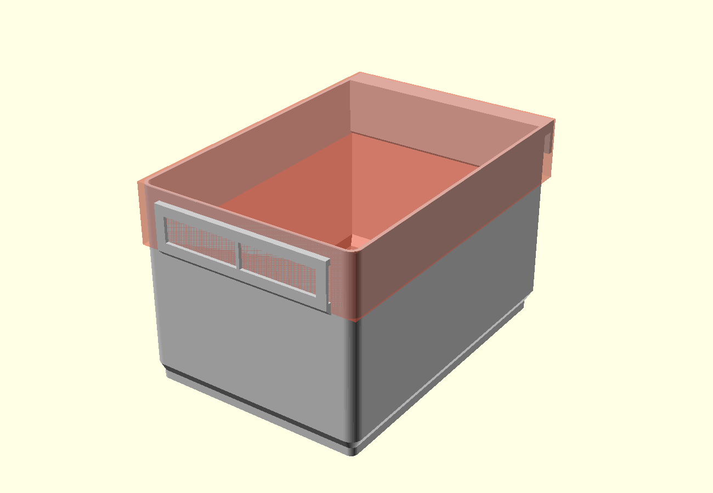
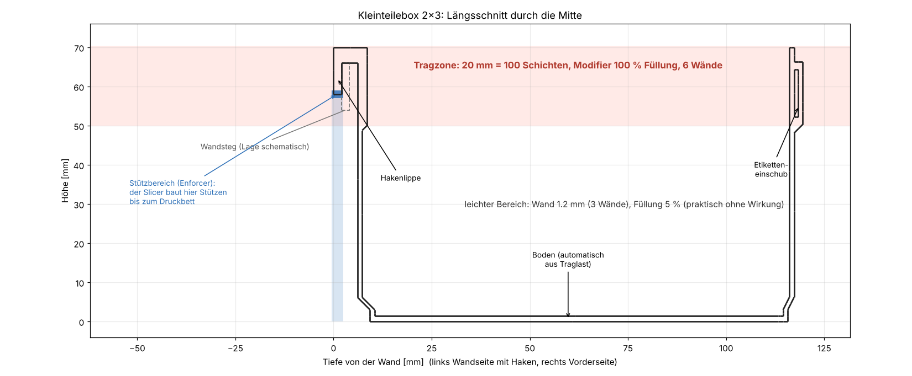

# Kleinteilebox – Sammelboxen für Eurobox und Einhängewand

Sortierboxen für Schrauben und andere Kleinteile. Jede Box passt **liegend lückenlos in eine Eurobox 60 × 40 × 8 cm** und lässt sich **an eine Einhängewand mit Stegen hängen**. Länge und Breite stellt man im festen Raster ein, Höhe und Haken sind bei allen Größen identisch, sodass jede Box an jeden Steg passt. Gedruckt wird aufrecht in PETG auf einem Anycubic (3MF für Anycubic Slicer Next liegt bei).

## Prinzip

- **Raster 40 mm.** Eine Box ist `units_w` (Breite, entlang der Wand) mal `units_l` (Tiefe, von der Wand weg) Einheiten groß, abzüglich 0,5 mm Spiel. In die Eurobox (Innenmaß laut Hersteller 555 × 355 mm, am Boden wegen der Schräge evtl. kleiner, **nachmessen**) passen 13 × 8 Einheiten, z. B. 16 Boxen 2×3 plus 4 Boxen 1×2. Haken und Etiketteneinschub sind **im Raster eingerechnet**: Der Boxkörper wird um deren Überstand kürzer, die belegte Fläche bleibt exakt `units × 40 − 0,5`.
- **Feste Höhe 70 mm** (Eurobox 60 × 40 × 12 cm, innen 105 mm hoch), kleiner als der Stegabstand von **76 mm** (Oberkante zu Oberkante), damit sich die Boxen in der Wand nicht berühren.
- **Haken über die ganze Breite**, immer gleich: Dach 4 mm dick liegt auf dem Steg, dahinter greift eine 2 mm dicke Lippe **8 mm tief** (Steglänge) hinter den Steg. Schlitz für den Steg 4,1 mm (Steg 2 mm + 2,1 mm Luft).
- **Etiketteneinschub** vorn: Rahmen oben und unten geschlossen, das Etikett wird **seitlich eingeschoben**. Höhen 6, 9, 12, 19 oder 24 mm, Breite Standard Boxbreite − 20 mm, mittig im oberen Drittel (bei hohen Etiketten weiter unten).
- **Leicht und tragfest zugleich:** dünne Wände und ein automatisch bemessener Boden, dazu ein **massiver Tragrahmen** oben, wo Haken und Box verbunden sind (siehe unten).

## Dateien

| Datei | Inhalt |
|---|---|
| `kleinteilebox.scad` | **Quelle** (OpenSCAD 2021.01 oder neuer). Alle Parameter oben, `part` wählt das Ausgabeteil |
| `kleinteilebox_BxT.stl` / `.3mf` / `.step` | je Größe: STL, 3MF (Druckdatei für Anycubic Slicer Next: Box + Tragzone + Stützbereich) und STEP. Größen: **1×2** (Probedruck), **2×3** (Basis), **2×6** (doppelte Länge), **4×3** (doppelte Breite), **6×3** (dreifache Breite), **4×6** (doppelte Länge + doppelte Breite). B = Breite entlang der Wand, T = Tiefe von der Wand weg |
| `bilder/` | Ansicht und Längsschnitt (`werkzeuge/bilder.sh`) |
| `werkzeuge/erzeuge_step.py` | baut das STEP mit build123d nach (`pip install build123d`), liest die Parameter aus der SCAD-Datei: `python3 -I werkzeuge/erzeuge_step.py 4x3` |
| `werkzeuge/export.sh` | erzeugt STL und 3MF für beliebige Größen: `werkzeuge/export.sh 4x3 3x3` |
| `werkzeuge/traglast.py` | Traglastrechnung, liest die Maße aus der SCAD-Datei |
| `werkzeuge/erzeuge_3mf.py`, `stl_werkzeug.py`, `bild_schnitt.py`, `bilder.sh` | 3MF-Bau, STL-Prüfung (wasserdicht, Volumen), Bilder |
| `agent.md` | Stand, Entscheidungen und Arbeitsweise für KI-Agenten |

Andere Größen: `werkzeuge/export.sh 4x3` (Breite × Tiefe in Einheiten). Eigene Werte mit `EXTRA="-D hook_t=3" werkzeuge/export.sh 4x4`.

## Wichtige Parameter (`kleinteilebox.scad`)

| Parameter | Standard | Bedeutung |
|---|---|---|
| `units_w`, `units_l` | 2, 3 | Größe in Rastereinheiten (Breite entlang der Wand, Tiefe von der Wand weg) |
| `H` | 70 | feste Gesamthöhe inkl. Haken |
| `wall` | 1,2 | Wandstärke der leichten Box (3 Wände à 0,4 mm) |
| `wall_band` | 2,4 | Wandstärke im Tragrahmen (6 Wände) |
| `band_h` | 20 | **Höhe des Tragrahmens von oben nach unten.** Mehr = mehr massive Schichten, die Gesamthöhe bleibt |
| `band_ring` | false | false: nur die Rückwand (Hakenseite) ist im Tragrahmen dick; true: um alle vier Wände (steifer Rand, bei 2×3 ca. 23 g mehr) |
| `floor_t` | 0 | Bodenstärke; 0 = automatisch aus Traglast und Spannweite (1,0 bis 3,2 mm je nach Größe) |
| `rail_t`, `hook_clear`, `hook_drop`, `hook_t`, `hook_top` | 2 / 2,1 / 8 / 2 / 4 | Steg- und Hakenmaße. **`rail_t` nachmessen**, `hook_t` siehe Traglast |
| `label_h`, `label_w`, `label_open_left/right` | 12, 0 (= Breite − 20), je true | Etikett: Höhe (6/9/12/19/24), Breite, seitlich offene Seiten |
| `n_laengs`, `n_quer`, `div_h` | 0, 0, 60 | gleichmäßig verteilte Trennwände (längs / quer) und deren Höhe |
| `stackable`, `stack_h`, `stack_clear` | true, 3, 0,4 | Stapelfuß (siehe unten) |
| `support_rib` | false | Abstützleiste unten hinten bis zur Wandebene (Wandanlage ohne Neigung) |
| `part` | box | `box`, `modifier` (Tragzone), `support_zone` (Stützbereich); die beiden letzten sind nur für den Slicer |

## Stapeln

Die Box hat unten einen **eingerückten Zapfen** (3 mm gerade, danach 45°-Rampe zur vollen Außenform) und oben die normale Öffnung. Der Zapfen greift in die Öffnung der Box darunter: die obere Box **zentriert sich selbst** (Rampe läuft am Innenrand der unteren auf), die Wände stehen aufeinander, der Haken oben stört nicht. Gestapelt wird auf dem Tisch oder im Regal, **nicht in der Wand** (dort hängen die Boxen im Stegabstand 76 mm).

- **Aufsetzhöhe:** Die obere Box sitzt 3,8 mm tief in der unteren, der Stapelabstand beträgt also **66,2 mm** statt 70 mm (geprüft: ab 66,2 mm berühren sich die Teile, tiefer überlappen sie, bei 66,5 mm ist Luft). Hinten ist die Rückwand dicker, deshalb ist der Zapfen dort etwas weiter eingerückt, damit die Box ringsum gleichzeitig aufsetzt und nicht kippelt.
- **Kosten:** 1 cm³ weniger Material (der Zapfen ist schmaler als die Box); der Innenraum ist in den untersten 6 mm etwas schmaler. Gedruckt wird ohne Stützen (Rampe maximal 45°).
- **Gleiche Größen stapeln sich untereinander.** Unterschiedliche Größen passen nicht, weil der Zapfen zur Öffnung der Box darunter passen muss. Tragen die Boxen Gewicht, belastet das die Wände auf Druck entlang der Schichten, das ist unkritisch (2,3 kg auf 457 mm² Wandfläche, unter 0,1 MPa).
- Ausschalten: `stackable = false`. `support_rib = true` geht nicht zusammen mit dem Stapelfuß (Assertion).

## Leichtbau und Tragrahmen

- **Leicht:** Wände 1,2 mm statt 1,6 mm, Boden nur so dick wie nötig. Die 2×3-Box hat **49,3 cm³ statt 55,8 cm³** beim vorherigen Entwurf (Wand 1,6, Boden 1,2, kein Rahmen), also **etwa 12 % weniger Material** (als Vollkörper ca. 63 g statt 71 g, im Slicer meist etwas weniger). Eine Füllung spielt kaum eine Rolle, weil die Wände ohnehin keinen Innenraum lassen. Das Gewicht steckt in den Wänden.
- **Massiv:** Die obersten `band_h` = 20 mm (100 Schichten bei 0,2 mm) sind der **Tragrahmen**, in dem Hakendach, Lippe und Rückwand zusammenlaufen. Dort ist die Rückwand 2,4 mm dick (45°-Übergang nach unten, druckbar ohne Stütze), und die 3MF enthält ein **Modifier-Volumen** (rot im Bild), das in diesem Höhenbereich **6 Wände und 100 % Füllung** erzwingt. Wer mehr Schichten tragend haben will, erhöht `band_h`. Die Gesamthöhe bleibt 70 mm, der Rahmen wächst nur nach unten.
- **Warum nur die Rückwand dick ist:** Die Rechnung (unten) braucht es nicht, die Last läuft über die Rückwand in den Haken. Ein Rahmen aus 2,4 mm rund um alle vier Wände (`band_ring = true`) kostet bei 2×3 rund 18 cm³ (23 g) mehr und macht die Box nicht tragfähiger, nur steifer am Rand.

## Traglast für Metallschrauben

Rechnung: `python3 werkzeuge/traglast.py` (Handrechnung mit Balken- und Plattentheorie, **keine FEM, nicht durch Versuch bestätigt**). Annahmen:

- Füllgut **lose Metallschrauben, 4,0 kg/l Schüttdichte** (typisch 3,5 bis 4,5), Box **voll bis zum Rand**.
- **Zuschlag ×1,5** für Ruck beim Einhängen und herausfallende Schrauben.
- Zulässig bei Dauerlast in PETG: **10 MPa quer zu den Schichten** (Schichthaftung ca. 20 MPa, halbiert wegen Kriechen und Streuung), **15 MPa in der Schichtebene**, 5 MPa Pressung auf dem Steg.
- Gewicht hängt **allein am Haken**. Reibung an der Wand wird nicht angesetzt.

**Was die Wand trägt:** Die Wand nimmt kein Gewicht ab, aber das **Kippmoment**. Der Schwerpunkt der Füllung liegt vor dem Haken, die Box will sich unten zur Wand drehen. Dagegen drückt die Rückwandunterkante an die Wand (ohne Leiste nach ca. 6° Neigung, mit `support_rib = true` sofort) und die Lippe hält oben gegen. Das entlastet den Haken nur von einem Teil, **die Horizontalkraft an der Lippe beträgt trotzdem etwa das 0,95-Fache der Gewichtskraft** (2×3, voll). Sie wirkt als Biegung an der Lippenwurzel, also **quer zu den Schichten**: Das ist die schwächste Stelle der ganzen Box.

| Größe | außen B×T×H [mm] | Boden [mm] | Inhalt [l] | voll [kg] | Lippe quer [MPa] | Boden [MPa] / Durchb. [mm] | kleinste Reserve | empf. max. Füllung [kg] | kritisch |
|---|---|---|---|---|---|---|---|---|---|
| 1x2 | 39.5 × 79.5 × 70 | 1.0 | 0.18 | 0.7 | 2.0 | 3.2 / 0.3 | **4.7×** | 0.7 | Boden (Biegung) |
| 2x3 | 79.5 × 119.5 × 70 | 1.4 | 0.58 | 2.3 | 4.8 | 5.5 / 1.5 | **2.1×** | 2.3 | Hakenlippe (Biegung quer) |
| 2x6 | 79.5 × 239.5 × 70 | 1.6 | 1.21 | 4.8 | 20.5 | 6.6 / 1.7 | **0.5×** | 1.2 | Hakenlippe (Biegung quer) |
| 4x3 | 159.5 × 119.5 × 70 | 2.2 | 1.16 | 4.6 | 4.9 | 4.6 / 1.6 | **2.1×** | 4.6 | Hakenlippe (Biegung quer) |
| 6x3 | 239.5 × 119.5 × 70 | 2.4 | 1.74 | 7.0 | 4.9 | 5.2 / 1.7 | **2.1×** | 7.0 | Hakenlippe (Biegung quer) |
| 4x6 | 159.5 × 239.5 × 70 | 3.4 | 2.39 | 9.6 | 20.3 | 4.0 / 1.9 | **0.5×** | 2.4 | Hakenlippe (Biegung quer) |

Ergebnis für die 2×3-Box: Rückwand 28-fache und Tragrahmen 56-fache Reserve, Steg-Pressung 23-fach, Seitenwände 15-fach, Boden 2,7-fach (1,5 mm Durchbiegung bei voller Box). **Die Lippe ist mit 2,1-facher Reserve das schwächste Glied.**

- **Tiefe Boxen nicht voll füllen:** Die Kippkraft wächst mit dem Quadrat der Tiefe, die Reserve sinkt ab 4 Einheiten auf 1,1×. **Bei 2×6 und 4×6 (6 Einheiten tief) liegt sie bei 0,5×: voll gefüllt würde die Lippe rechnerisch versagen.** Diese beiden Größen nur bis zur empfohlenen Maximalfüllung der Tabelle füllen (2×6 ca. 1,2 kg, 4×6 ca. 2,4 kg) oder `hook_t = 3` setzen (dann 1,1×, empfohlen 2,7 bzw. 5,3 kg). Die Tabelle nennt die empfohlene Maximalfüllung für 2-fache Reserve.
- **Lippe dicker machen hilft am meisten:** Die Spannung sinkt mit 1/Dicke². `hook_t = 3` statt 2 mm hebt 4×4 auf **2,6-fache Reserve** (`python3 werkzeuge/traglast.py hook_t=3 4x4`). Ob das geht, hängt vom **Abstand zwischen Steg und Wand** ab: Die Lippe sitzt dort. Bitte nachmessen, dann `hook_t` setzen. Der Haken wird dadurch 1 mm länger, der Boxkörper entsprechend kürzer.
- Der Boden wird aus der Durchbiegung bemessen (höchstens 2 mm bei voller Box, allseitig gelenkig gerechnet, also vorsichtig), nicht aus der Festigkeit.

## Drucken (Anycubic Slicer Next)

1. `kleinteilebox_2x3.3mf` öffnen. Es ist **ein Objekt mit drei Teilen**: Box, Tragzone (Modifier, nur Einstellungen) und **Stützbereich** (Support-Enforcer, nur ein Markierungsquader). Die Box steht aufrecht, der Haken ist oben.
2. In der 3MF stehen: Schichthöhe 0,2 mm, 3 Wände, 5 % Gyroid, oben/unten 4 Lagen, kein Brim. Tragzone: 6 Wände, 100 % Füllung, nur in den obersten 20 mm. **Temperatur und Lüfter stehen im Filamentprofil**, nicht in der 3MF (im Repo sonst für PETG auf dem Kobra S1: 240–245 °C, Lüfter 30–40 %).
3. **Stützen:** Die Hakenlippe beginnt frei in der Luft (Z = 58 mm). Dort sitzt der Stützbereich, ein flacher Quader (79,5 × 3 × 2 mm, Z 57 bis 59 mm) direkt an der Lippenunterkante. Die Objekt-Einstellung steht auf Stützen „normal (manuell)“ und „nur auf dem Druckbett“, der Slicer baut also **nur dort** Stützen, und zwar von der Lippe bis zum Bett (im Schnittbild blau). Die Stütze ist nur ca. 2 mm breit und 58 mm hoch. Wird sie wackelig, im Slicer die Stützen breiter aufziehen (Expansion) oder auf „Baum (manuell)“ stellen.
4. Nach dem Druck die Stütze von der Lippe abbrechen. Die Abstände zur Lippe (Z-Abstand, Grenzfläche) sind die Slicer-Einstellungen für Stützen, bei Bedarf dort anpassen.
5. Falls der Slicer den Modifier **nicht** übernimmt: Rechtsklick auf das Objekt, Modifier hinzufügen (Quader), über den Boxgrundriss legen (Z 48,8 bis 70,4 mm) und dort 6 Wände, 100 % Füllung einstellen.
6. Erscheinen **keine** Stützen unter der Lippe, hat der Slicer den Stützbereich nicht als Enforcer übernommen. Dann im Slicer Stützen aktivieren (Typ „normal (manuell)“, nur Druckbett) und die Lippenunterkante mit dem Stützen-Enforcer markieren (Quader Z 57 bis 59 mm, über die Lippe).
7. Etikett von der Seite einschieben. Zu locker: `label_gap` verkleinern oder eine Seite schließen (`label_open_left/right = false`).

## Stand und offene Punkte (14.11.2026)

- **Nichts davon ist gedruckt.** Alle STL sind wasserdicht, die 3MF ist strukturell geprüft (Teile, Platzierung, Einstellungen), aber **nicht im Anycubic Slicer Next geöffnet**. Ob der Slicer den Stützbereich als Enforcer übernimmt und wie die Stütze unter der Lippe ausfällt, ist unbestätigt. Erster Schritt: die 1×2-Box als Probedruck, Sitz am Steg prüfen.
- **Nachmessen:** Innenmaße der Eurobox am Boden und Innenhöhe (`eb_x`, `eb_y`, `eb_h`), Steg-Dicke (`rail_t`), Abstand Steg–Wand (für `hook_t`).
- Annahmen der Traglast (Schüttdichte, zulässige Spannungen für PETG) sind nicht gemessen. Ein Belastungsversuch mit einer gedruckten Box zeigt, ob sie stimmen.
- Bei dauerhaft hoher Last PETG verwenden, PLA kriecht (vor allem warm) und hat eine schlechtere Schichthaftung.
