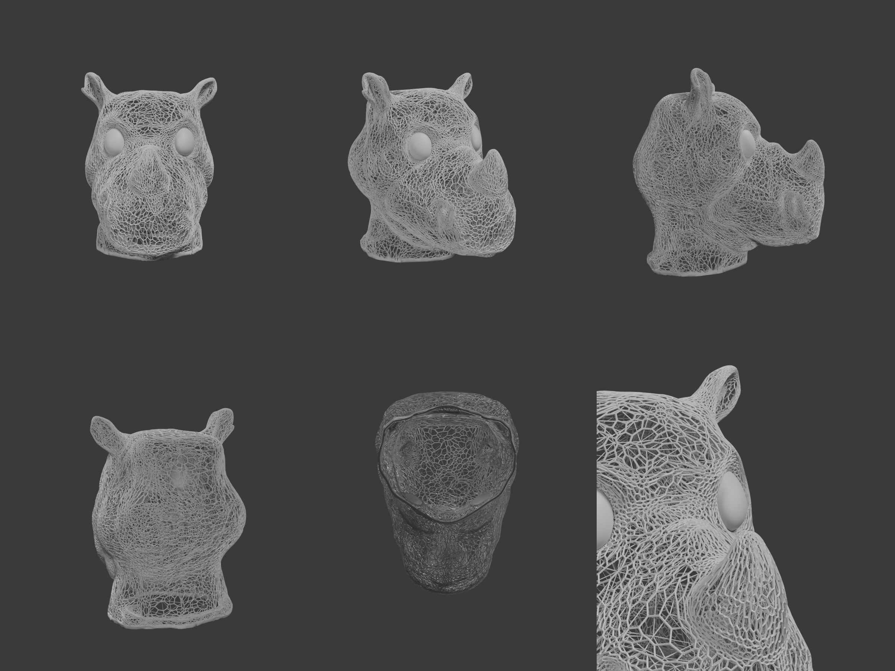
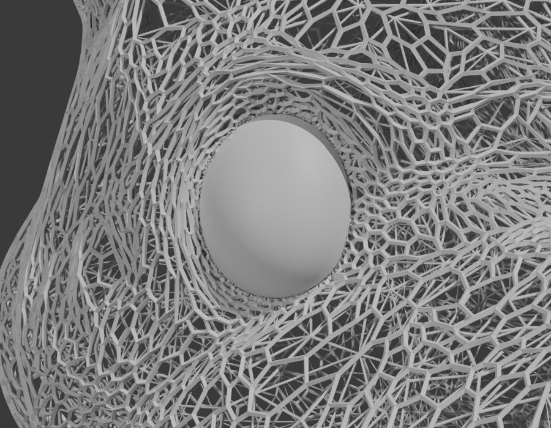
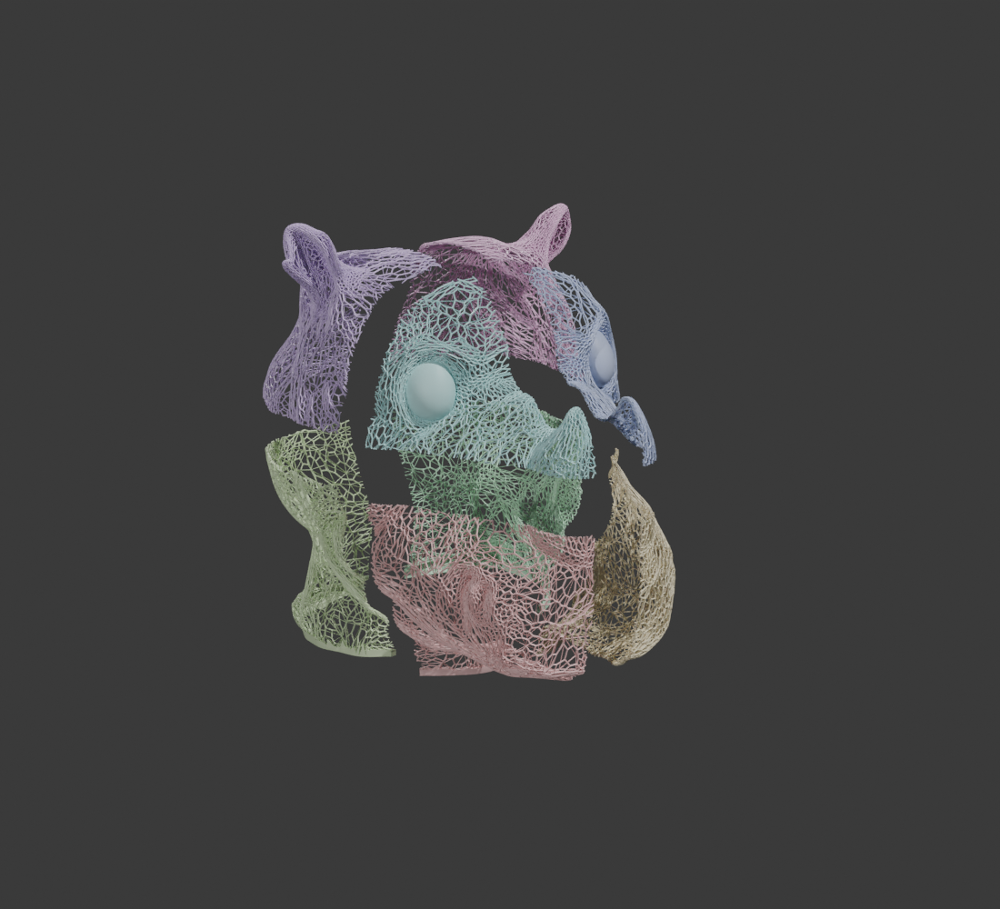

# Rhino-Gittermaske (tragbar)

Tragbare Nashorn-Kopfmaske als offene, zweilagige Gitterstruktur. Durch das Gitter kann man sehen und atmen. Die Form stammt 1:1 aus dem Meshy-Modell in `modell/`. Es wird nicht geglättet und nicht umgebaut. Das Skript fügt nur hinzu, was eine Maske braucht: die Kopföffnung unten am Hals, das Gitter, die soliden Augen und das Aufteilen für den Druckraum.



| Augen (aus dem Modell, solide) | Aufteilung für den Kobra 4 |
|---|---|
|  |  |

## Eckdaten

| | |
|---|---|
| Größe | 371 × 493 × 497 mm (B × T × H) |
| Kopföffnung | innen ca. 293 × 251 mm (Kopf 22 cm + 15 mm Luft rundum) |
| Gitter | außen Waben ca. 8 mm, Stege 2,4 mm; innen Dreiecke ca. 10 mm, Stege 2,0 mm; Wand ca. 4 mm |
| Augen | Augenwölbungen des Modells, solide, 5 mm Wand |
| Rand | massiver Kragen, 10 mm hoch, an der Kopföffnung |
| Teile | 8 Stück für 260 × 260 × 260 mm (Anycubic Kobra 4) |
| Material | ca. 0,6–0,7 kg PLA (obere Schätzung) |

## Dateien

| Datei | Inhalt |
|---|---|
| `druck/rhino_maske_kobra4.3mf` | Alle 8 Teile in einer 3MF (mm), je Teil eine Druckplatte vorgesehen |
| `druck/stl/rhino_maske_teil_XX_von_08.stl` | Die 8 Teile einzeln |
| `druck/rhino_maske_komplett.stl` | Ganze Maske am Stück (zum Ansehen oder für große Drucker) |
| `rhino_lattice_mask.py` | Generator für Blender 4.x (bpy). **Quelle** für alles in `druck/` |
| `modell/meshy_rhino.obj` | Ausgangsform (Meshy AI, Image-to-3D), wasserdicht |
| `werkzeuge/stl_to_3mf.py` | Packt STL-Teile in eine 3MF |
| `bilder/` | Vorschaubilder |

## Druck auf dem Anycubic Kobra 4

1. `druck/rhino_maske_kobra4.3mf` in Anycubic Slicer Next (oder OrcaSlicer) öffnen. Die Teile liegen schon so, dass jedes eine eigene Platte bekommt. Landen sie neben dem Bett: **Alle Objekte anordnen** (Taste A), dann verteilt der Slicer sie auf Platten.
2. Ausrichtung so lassen, wie sie geladen werden. Die oberen Teile stehen auf ihrer ebenen Schnittfläche, die unteren auf dem Kragen.
3. Empfohlene Einstellungen:
   - PLA oder PETG, Düse 0,4 mm, Schichthöhe 0,2 mm
   - 2 Wandlinien, 15 % Füllung (die Stege bestehen praktisch nur aus Wänden)
   - **Baumstützen (Tree)**, automatisch, nur auf dem Druckbett; Überhangwinkel ca. 45°. Die Kuppel am Hinterkopf und die Unterseite der Schnauze hängen über
   - Brim bei hohen, schmalen Teilen (Ohren, Horn)
4. Vor dem Druck die Vorschau prüfen: Bei sehr dünnen Stellen (Ohrränder) zeigt der Slicer, ob alle Stege mitgedruckt werden.

## Zusammenbau

Die Schnittflächen sind eben und geschlossen. Erst mit Sekundenkleber heften, dann von innen mit 2K-Epoxid oder Heißkleber verstärken. Alternativ mit einem 3D-Stift verschweißen. Reihenfolge: zuerst je zwei Teile zu einer Hälfte (links/rechts), dann die Hälften, zum Schluss oben und unten.

## Anpassen und neu erzeugen

Oben im Skript stehen die Einstellungen:

- `MASKE_HOEHE` – fertige Höhe in mm. Mit `0` wählt das Skript die kleinste Größe, bei der der Kopf durch die Öffnung passt (`KOPF_DURCHMESSER`, `KOPF_SPIEL`).
- `DRUCKRAUM`, `DRUCKRAND` – Druckraum des Druckers. Die Maske wird automatisch in passende Teile geschnitten.
- `ZELLE_A/B`, `STEG_A/B` – Zellgröße und Stegdicke der beiden Gitterlagen.
- `IMPORT_PFAD` – anderes Modell (STL/OBJ/GLB, Z oben, Schnauze nach −Y). Leer: die einfache, prozedural erzeugte Form.

```bash
blender -b -P rhino_lattice_mask.py          # oder: pip install bpy; python3 rhino_lattice_mask.py
python3 werkzeuge/stl_to_3mf.py druck/rhino_maske_kobra4.3mf druck/stl/rhino_maske_teil_*.stl --bett 260
```

Das Skript meldet Öffnungsmaß, Teilegrößen und offene Kanten. Wenn die Öffnung kleiner als der Kopf wird, gibt es eine Warnung.
