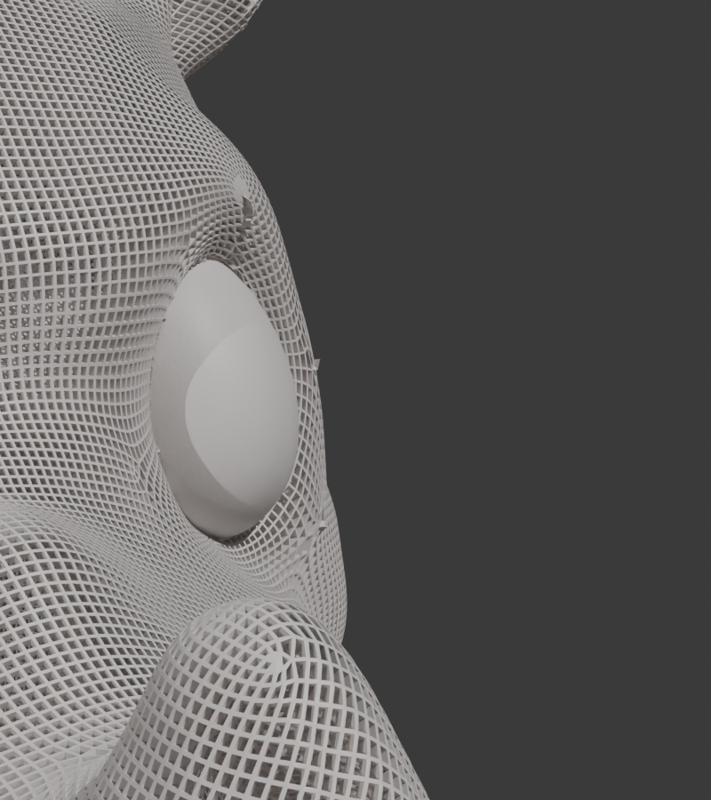
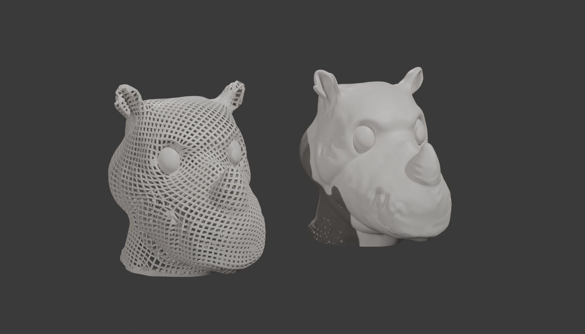

# Rhino-Gittermaske (tragbar)

Tragbare Nashorn-Kopfmaske als feines **Sichtgitter**: Von außen wirkt die Maske wie eine geschlossene Fläche, weil die Löcher nur ca. 1,6 mm groß sind. Der Träger hat das Netz direkt vor den Augen und sieht hindurch, ähnlich wie bei einem Fliegengitter oder einem Maskottchenkopf. Atmen geht ebenfalls durch das Netz. Die Form stammt 1:1 aus dem Meshy-Modell in `modell/`. Es wird nicht geglättet und nicht umgebaut. Das Skript fügt nur hinzu, was eine Maske braucht: die Kopföffnung unten am Hals, das Gitter, die soliden Augen und das Aufteilen für den Druckraum.


| Netz aus der Nähe | Aufteilung für den Kobra 4 |
|---|---|
|  |  |

## Eckdaten

| | |
|---|---|
| Größe | 385 × 511 × 515 mm (B × T × H) |
| Kopfdurchgang | Ein großer Erwachsenenkopf (95. Perzentil: 17 cm breit, 23 cm lang inkl. Nase) passt an **jeder** Höhe mit mindestens 10 mm Luft rundum durch Öffnung und Hals. Die engste Stelle liegt 27 mm über dem Rand. Das Skript prüft das automatisch. |
| Netz | Maschenweite 2,5 mm, Stege 0,9 mm breit und 2,0 mm tief, Löcher ca. 1,6 mm (rund 40 % offen) |
| Augen | Augenwölbungen des Modells, solide, 5 mm Wand |
| Rand | massiver Kragen, 10 mm hoch, an der Kopföffnung |
| Teile | 8 Stück, max. 192 × 255 × 258 mm, für 260 × 260 × 260 mm (Anycubic Kobra 4) |
| Material | ca. 0,8 kg PLA |

## Dateien

| Datei | Inhalt |
|---|---|
| `druck/rhino_maske_kobra4.3mf` | Alle 8 Teile in einer 3MF (mm), je Teil eine Druckplatte vorgesehen |
| (`druck/rhino_maske_komplett.stl`) | Ganze Maske am Stück. Das Skript erzeugt sie, mit ca. 125 MB ist sie aber zu groß für GitHub und deshalb nicht eingecheckt |
| `druck/stl/rhino_maske_teil_XX_von_08.stl` | Die 8 Teile einzeln |
| `druck/mini/` | Mini-Figur, ca. 60 mm: Gitter, massiv und beides als 3MF |
| `rhino_lattice_mask.py` | Generator für Blender 4.x (bpy). **Quelle** für alles in `druck/` |
| `modell/meshy_rhino.obj` | Ausgangsform (Meshy AI, Image-to-3D), wasserdicht |
| `werkzeuge/stl_to_3mf.py` | Packt STL-Teile in eine 3MF |
| `bilder/` | Vorschaubilder |

## Wie das Sichtgitter funktioniert

Das Skript legt ein gleichmäßiges Vierecksnetz (QuadriFlow) über die Originalfläche, dessen Maschen der Form folgen wie ein Gewebe. Jede Masche wird um die halbe Stegbreite eingerückt und ausgestanzt. Der verbleibende Rahmen wird nach innen auf 2 mm Tiefe gebracht. Die Stege sind also schmal (kleine Löcher, die Fläche wirkt von außen geschlossen) und tief (steif genug für eine große Maske).

So wirkt es am besten:

- **Außen hell, innen dunkel.** Mit dunklem Filament drucken und die Außenseite nur von außen und schräg hell lackieren. Oder hell drucken und die Innenseite schwarz sprühen. Auf einer hellen Außenfläche bleibt der dunkle Innenraum unsichtbar.
- Licht von außen, nicht innen: Bei Tageslicht oder Bühnenlicht sieht man nicht hinein, der Träger sieht aber gut hinaus.
- Stellschrauben: `ZELLE_A` (Maschenweite), `STEG_A` (Stegbreite), `NETZ_TIEFE`. Loch ≈ `ZELLE_A − STEG_A`. Tiefere Stege machen die Maske steifer, verengen aber den Blickwinkel durch jedes Loch (2 mm Tiefe bei 1,6 mm Loch: etwa ±38°).

## Druck auf dem Anycubic Kobra 4

1. `druck/rhino_maske_kobra4.3mf` in Anycubic Slicer Next (oder OrcaSlicer) öffnen. Die Teile liegen schon so, dass jedes eine eigene Platte bekommt. Landen sie neben dem Bett: **Alle Objekte anordnen** (Taste A), dann verteilt der Slicer sie auf Platten.
2. Ausrichtung so lassen, wie sie geladen werden. Die oberen Teile stehen auf ihrer ebenen Schnittfläche, die unteren auf dem Kragen.
3. Empfohlene Einstellungen:
   - PLA oder PETG, Düse 0,4 mm, Schichthöhe 0,2 mm
   - 2 Wandlinien (die 0,9-mm-Stege bestehen genau aus zwei Bahnen), „Dünne Wände erkennen“ an
   - **Baumstützen (Tree)**, automatisch, nur auf dem Druckbett; Überhangwinkel ca. 45°. Die Kuppel am Hinterkopf und die Unterseite der Schnauze hängen über
   - Brim bei hohen, schmalen Teilen (Ohren, Horn)
4. Vor dem Druck die Vorschau prüfen: Alle Stege müssen als zwei Bahnen erscheinen. Rückzug (Retraction) und „Wipe“ einschalten, damit keine Fäden in den Löchern hängen bleiben.

## Mini-Version (ca. 60 mm)



45 × 60 × 60 mm, ein Teil, nicht tragbar. Gleiches Sichtgitter wie bei der großen Maske, aber an die Düse angepasst: Maschenweite 1,6 mm, Stege 0,8 mm (zwei Bahnen), Löcher ca. 0,8 mm. Das Netz ist 0,8 mm tief und liegt mittig auf der Fläche, sonst stäche es an den dünnen Ohren durch. Augen und Kragen sind massiv, 1,2 mm. Bei dieser Größe gibt das Netz feine Details wie Ohrspitzen und Hornspitze nur auf etwa 1,5 mm genau wieder.

| Datei | Inhalt |
|---|---|
| `druck/mini/rhino_mini_gitter.stl` | Gitter-Figur |
| `druck/mini/rhino_mini_massiv.stl` | Massive Figur, unten plan |
| `druck/mini/rhino_mini_kobra4.3mf` | Beide als 3MF, je eine Platte |

Druck: Die Gitter-Figur gelingt am besten auf einem **Resin-Drucker**. Auf dem Kobra 4 geht sie mit 0,12 mm Schichthöhe, langsamen Außenwänden und Baumstützen. Die Stützen im Inneren unter dem Schädeldach lassen sich durch die Halsöffnung aber nur mühsam entfernen. Die massive Figur druckt problemlos stehend auf dem Halsrand mit wenigen Stützen unter Schnauze und Horn.

Neu erzeugen: `blender -b -P rhino_lattice_mask.py -- mini` (oder `PRESET = "mini"`), danach die 3MF wie oben mit `stl_to_3mf.py` packen.

## Zusammenbau

Die Schnittflächen sind eben und geschlossen (Teil 03 hat 8 offene Kanten an einer Schnittstelle, die der Slicer automatisch repariert). Erst mit Sekundenkleber heften, dann von innen mit 2K-Epoxid oder Heißkleber verstärken. Alternativ mit einem 3D-Stift verschweißen. Reihenfolge: zuerst je zwei Teile zu einer Hälfte (links/rechts), dann die Hälften, zum Schluss oben und unten.

## Anpassen und neu erzeugen

Oben im Skript stehen die Einstellungen:

- `MASKE_HOEHE` – fertige Höhe in mm. Mit `0` wählt das Skript die kleinste Größe, bei der der Kopf (`KOPF_BREITE` × `KOPF_LAENGE`) bis `KOPF_PRUEF_BIS` mm Höhe überall mit `KOPF_SPIEL` Luft durch Öffnung und Hals passt. Bei fester Höhe meldet das Skript die Luft und warnt, wenn es zu eng wird.
- `DRUCKRAUM`, `DRUCKRAND` – Druckraum des Druckers. Die Maske wird automatisch in passende Teile geschnitten.
- `ZELLE_A/B`, `STEG_A/B` – Zellgröße und Stegdicke der beiden Gitterlagen.
- `IMPORT_PFAD` – anderes Modell (STL/OBJ/GLB, Z oben, Schnauze nach −Y). Leer: die einfache, prozedural erzeugte Form.

```bash
blender -b -P rhino_lattice_mask.py          # oder: pip install bpy; python3 rhino_lattice_mask.py
python3 werkzeuge/stl_to_3mf.py druck/rhino_maske_kobra4.3mf druck/stl/rhino_maske_teil_*.stl --bett 260
```

Das Skript meldet Öffnungsmaß, Teilegrößen und offene Kanten. Wenn die Öffnung kleiner als der Kopf wird, gibt es eine Warnung.
