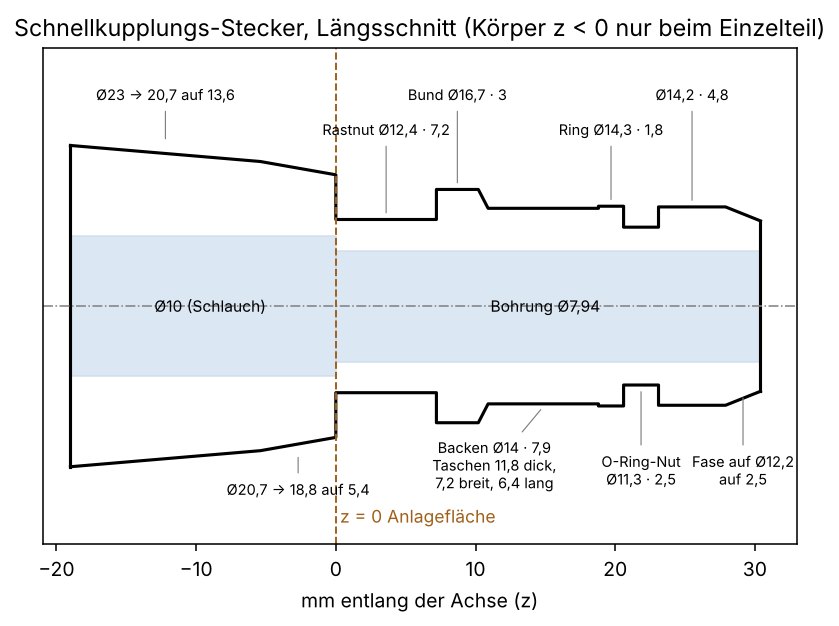

# Stecker für die Hansgrohe-Schnellkupplung (Quick Connect 28346000)

Ein **eigenständiges Modell** des Steckers, der am Duschkopf **statt des 1/2"-Gewindes** direkt angedruckt wird. Der Duschkopf klickt dann ohne Zwischenstück in die Kupplung am Schlauch.

**Stand: 12.11.2026.** Die Maße hat der Nutzer am Original gemessen. Das Einzelteil ist gedruckt und **sitzt und hält in der Kupplung**. (Der erste Stecker, übernommen aus einem Adapter-Modell, hielt nicht: Die O-Ring-Nut war 1 mm zu flach, mehrere Längen wichen ab.)



## Dateien

| Datei | Inhalt |
|---|---|
| `schnellkupplung_stecker.scad` | Parametrisches Modell. Module zum Einbinden: `stecker_aussen()`, `stecker_bohrung()`, `stecker()`; dazu das Einzelteil `stecker_einzel()`. |
| `druck/stecker_stehend.3mf` / `.stl` | Einzelteil zum Anprobieren, **stehend**, runde Bohrung. Das 3MF ist im Bambu/Orca-Format (öffnet Anycubic Slicer Next). |
| `druck/stecker_liegend.3mf` / `.stl` | Einzelteil **liegend**, Tropfenbohrung mit der Spitze oben. So sitzt der Stecker später am Duschkopf. |
| `werkzeuge/exportiere.py` | Erzeugt die Dateien in `druck/` neu (OpenSCAD, trimesh, lxml). |
| `werkzeuge/zeichnung.py` | Erzeugt `bilder/profil.png` (matplotlib). |

## Maße (mm)

Achse z, **z = 0 ist die Anlagefläche am Duschkopf**, die Mündung zeigt nach +z. Gemessen vom Nutzer, Durchmesser außen:

| z von … bis | Länge | Ø | Teil |
|---|---|---|---|
| 0 … 7,2 | 7,2 | 12,4 | Rastnut (Schaft) |
| 7,2 … 10,2 | 3,0 | 16,7 | Bund |
| 10,2 … 10,9 | 0,7 | 16,7 → 14 | Fase |
| 10,9 … 18,8 | 7,9 | 14 | Backenbereich |
| 18,8 … 20,6 | 1,8 | 14,3 | Ring |
| 20,6 … 23,1 | 2,5 | 11,3 | **O-Ring-Nut** |
| 23,1 … 27,9 | 4,8 | 14,2 | |
| 27,9 … 30,4 | 2,5 | 14,2 → 12,2 | Fase zur Mündung |

**Backen:** zwei ebene Flächen bei y = ±5,9 im Ø14-Bereich. Der Stecker ist dort nur 11,8 dick, die Tasche ist 7,2 breit (x) und 6,4 lang (z). Oben und unten bleibt je 0,75 Rand, die Tasche ist also axial geschlossen.

**Bohrung:** Ø 7,94 (5/16") durch den ganzen Stecker. Wandstärke an der Rastnut 2,2, an der O-Ring-Nut 1,7 seitlich und 1,2 an der Tropfenspitze (Kappe, siehe unten).

**Einzelteil mit Körper zum Schaft** (nur `stecker_einzel()`): Ø 18,8 an der Anlagefläche, über 5,4 mm auf Ø 20,7, dann über 13,6 mm auf Ø 23 (insgesamt 19 mm). Innen Ø 10 (`schlauch_d`, nicht kleiner als der Schlauch), mit stufenlosem 45°-Übergang auf Ø 7,94 an der Anlagefläche. Gesamtlänge 49,4.

## In ein eigenes Design übernehmen

1. **Anlagefläche:** Der Duschkopf braucht an der Stelle des Gewindes eine **ebene Stirnfläche senkrecht zur Achse**. Sie ist die Ebene z = 0. Erprobt ist eine Fläche mit Ø 21,25 und 1 mm Fase an der Außenkante, also eben bis Ø 19,25. Das Einzelteil hat hier Ø 18,8. Was die Kupplung außen berührt, ist nicht gemessen, deshalb nicht mehr als diese Fläche rund um den Stecker vorsehen.
2. **Einbinden in OpenSCAD:**
   ```openscad
   use <schnellkupplung_stecker.scad>
   difference() {
       union() { mein_duschkopf(); stecker_aussen(ueberlapp = 3); }
       stecker_bohrung(ueberlapp = 3);   // Wasserweg durch den Stecker
       mein_kanal();                     // Kanal des Duschkopfs
   }
   ```
   Den Stecker an die Stirnfläche setzen (`translate`/`rotate`), z = 0 auf die Fläche, +z nach außen. `ueberlapp` ist ein 3-mm-Stummel (Ø 12,4) in den Duschkopf hinein, damit die Vereinigung sauber ist. Der Duschkopf braucht dort eine Bohrung ≥ Ø 7,94, besser weiter (siehe Einzelteil).
3. **Ohne OpenSCAD:** Das Profil steht als Tabelle oben und als Liste `st_profil` im SCAD. Als Drehkörper um die Achse modellieren, dann die beiden Backentaschen und die Bohrung abziehen.
4. **Bohrung ist ein Tropfen**, kein Kreis. Der Kreis hat ein Dach mit 35° Neigung (über den Slicer-Grenzwert von meist 30°), damit sie liegend **ohne Stützen in der Bohrung** druckt. Die Spitze zeigt nach +x. Beim Einbau so drehen, dass +x beim Druck **oben** ist (`rotate([0, 0, …])`). Die Tropfenspitze ist bei r = 4,45 flach gekappt (`dach_kappe`), sonst bliebe an der O-Ring-Nut nur etwa 0,8 mm Wand. Wird der Stecker stehend gedruckt, geht `rund = true`.
5. **Kanal im Duschkopf an die Bohrung anschließen:** Ein Absatz von Ø 7,94 auf eine weitere Bohrung im Duschkopf sollte als 45°-Kegel oder in Tropfenform auslaufen, nicht als waagerechte Stufe (Überhang). Im Einzelteil ist das so gelöst (`hull()` zweier Scheiben).

## Drucken

- **Liegend** (Achse waagerecht, wie am Duschkopf): Die Backen-Taschen liegen seitlich, die Bohrung braucht keine Stützen. Der Bund (Ø 16,7) und der Absatz hinter der O-Ring-Nut (11,3 → 14,2) brauchen außen Stützen. Auf dem Bett ist nur eine Linie Kontakt, **Brim** oder Stützen nutzen.
- **Stehend** (Einzelteil, breiter Körper unten): nur zwei waagerechte Überhänge, nämlich am Bund (12,4 → 16,7) und hinter der O-Ring-Nut. Dort sind Stützen oder eine Brücke nötig. Rastnut und O-Ring-Nut werden so runder.
- Für nasse Teile PETG statt PLA. Werte wie Schichthöhe und Wandanzahl sind nicht vorgegeben, die Dichtfläche ist die O-Ring-Nut und der Absatz an der Mündung.

## Bezug zu anderen Ordnern

- `../dusche-weihnachtsbaum/schnellkupplung_stecker.scad` ist die Fassung für den Weihnachtsbaum-Duschkopf (Stummel, Tropfenbohrung, Option `koerper`). **Die Maße sind identisch.** Maßquelle ist dieser Ordner: Ändert sich ein Maß, beide Dateien anpassen.
- `../dusche-weihnachtsbaum-led/pruefgriff.scad` hat das Profil als Liste `st_profil`.

## Offen

- Innendurchmesser des Duschschlauchs (`schlauch_d = 10` ist eine Schätzung).
- Lizenz nicht festgelegt.
