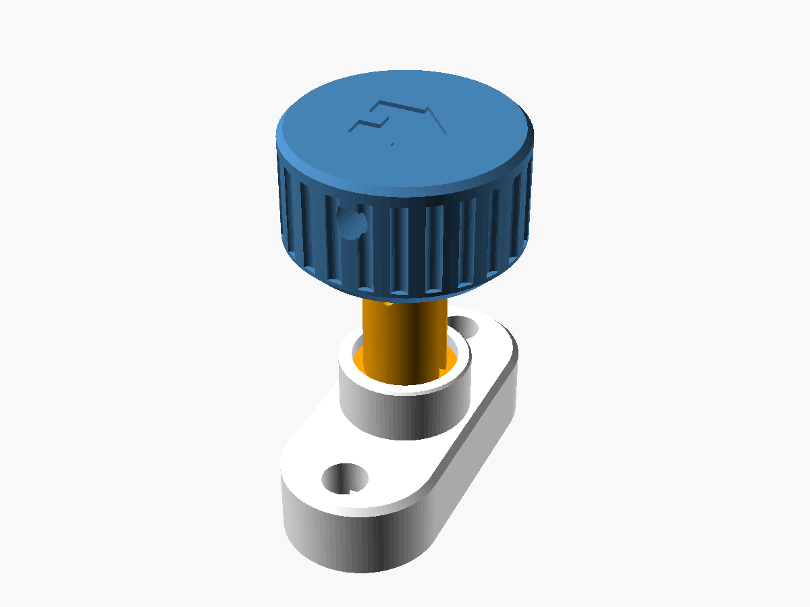
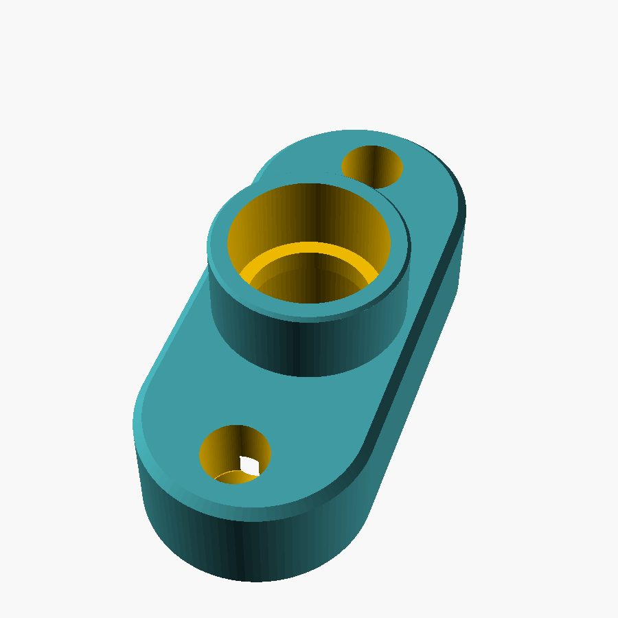
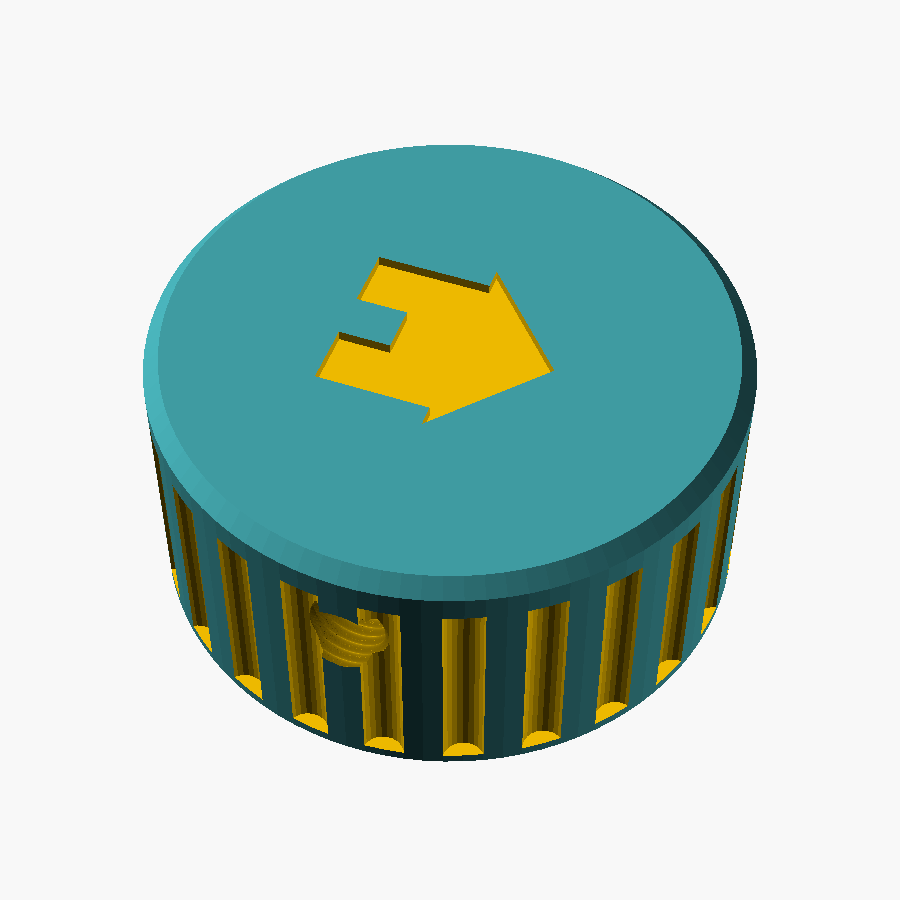

# Türknauf für einen steckenden Schlüssel (Winkhaus-Profilzylinder)

Drehknauf für die Innenseite einer Haustür, in deren Profilzylinder dauerhaft ein Schlüssel steckt. Der Knauf ersetzt die Rosette und schützt den Schlüssel vor dem Verbiegen: Der Griff läuft auf einem Lagerbund der Platte, sodass Querkräfte über Platte und Türschrauben in die Tür gehen und der Schlüssel nur noch gedreht wird. Ein bündig eingelegtes Haus auf dem Griff zeigt die Stellung des Schlüssels (Dach oben = Schlüssel hochkant).

| Platte | Griff |
|---|---|
|  |  |

## Dateien

| Datei | Inhalt |
|---|---|
| `schluesselknauf.scad` | Parametrische Vorlage für alle Teile (OpenSCAD 2021.01). Teil über `teil` wählen. |
| `bilder/` | Vorschaubilder. |

Die STL-Dateien werden nicht eingecheckt; sie entstehen aus der SCAD-Datei (`teil` setzen, F6, als STL exportieren).

## Teile

| `teil` | Anzahl | Beschreibung |
|---|---|---|
| `platte` | 1 | Beschlag mit Lagerbund (Ø 32, 14 mm hoch), wird mit den vorhandenen Türschrauben befestigt |
| `schaft` | 1 | Gabel, die den Schlüsselkopf umfasst; der Flansch läuft hinter dem Deckel der Platte |
| `griff` | 1 | Knauf Ø 56 mit Griffmulden, läuft auf dem Lagerbund |
| `haus` | 1 | Einsatz für die Stellungsanzeige, bündig im Griff (zweite Farbe) |
| `kappe_kopf`, `kappe_mutter` | je 1 | Gewindekappen M8 × 1 für die beiden Öffnungen der Querschraube im Griff |
| `kappe` | 2 | Abdeckungen für die Türschrauben in der Platte |

Kaufteile: 1 Zylinderschraube M3 × 30 (Rundkopf) mit M3-Mutter. M4 passt nicht durch das 3,7-mm-Loch im Schlüssel.

## Anpassen

Die Maße des eigenen Schlüssels und der Tür stehen im Abschnitt „gemessen“ am Anfang der SCAD-Datei:

- `c` – Stirnfläche des Zylinders über der Türoberfläche
- `k_breite`, `k_dicke`, `k_laenge`, `k_hals` – Schlüsselkopf und Hals
- `pin_z` – Mitte des Schlüssellochs über der Schulter
- `schraub_abst` – Abstand der Türschrauben
- `gr_d` – Griffdurchmesser (56 mm, damit der Daumen nicht mehr zwischen Griff und Türdrücker gerät)

Die Prüfungen (`assert`) melden, wenn Bund, Querschraube oder Wände nicht mehr zusammenpassen.

## Druck

- PETG (ABS oder TPU 68D gehen auch), 4–5 Wandlinien (Orca Slicer: „Wandschleifen“), 40 % Füllung, 0,2 mm Schichthöhe.
- Platte mit der Rückseite (Türseite) auf das Druckbett, ohne Stützen.
- Griff, Haus und Gewindekappen mit der Oberseite nach unten drucken (aus OpenSCAD kommen sie in Einbaulage, also im Slicer um 180° um X drehen).
- Haus zusammen mit dem Griff als ein Objekt laden und dem Haus ein eigenes Filament zuweisen.

## Montage

1. Alte Rosette abschrauben, der Schlüssel bleibt stecken.
2. Schaft über den Schlüssel schieben: Der Hals läuft durch den Schlitz im Flansch, der Kopf sitzt in der Gabel.
3. Platte darüber setzen, sodass der Flansch des Schafts in der Kammer hinter dem Deckel liegt, und mit den vorhandenen Türschrauben festschrauben. Die beiden Kappen in die Schraubenlöcher stecken.
4. Griff auf den Lagerbund setzen und drehen, bis Bohrung im Griff, Gabel und Schlüsselloch fluchten. Das Haus zeigt dabei nach oben, wenn der Schlüssel hochkant steht.
5. M3 × 30 von der Kopfseite durchstecken, Mutter auf der Gegenseite in die Sechskanttasche legen und anziehen.
6. Gewindekappen mit einem Schlitzschraubendreher eindrehen (`kappe_kopf` über dem Schraubenkopf, `kappe_mutter` über der Mutter).

## Smarthome-Variante

Mit `elektronik = true` entsteht eine verlängerte Platte mit Verschlusssensor (Hall-Sensoren, XIAO ESP32C6, Akku, MQTT). Beschreibung, Platinen und Firmware: Tag [`smarthome`](https://github.com/scipiojr/3dprint/tree/smarthome/tuerknauf), Datei `SMARTHOME.md`.
