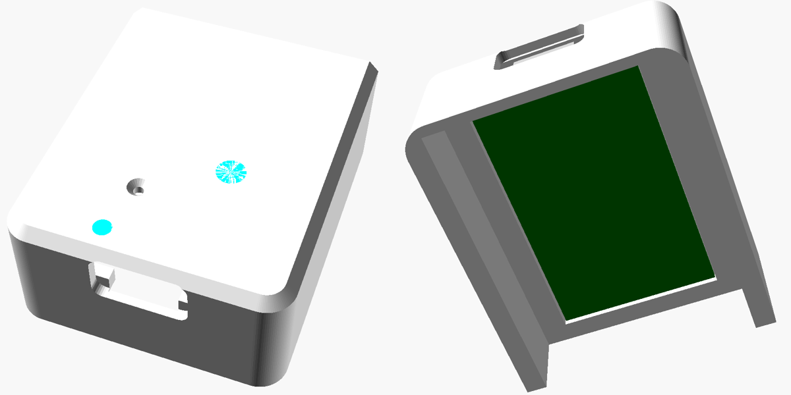
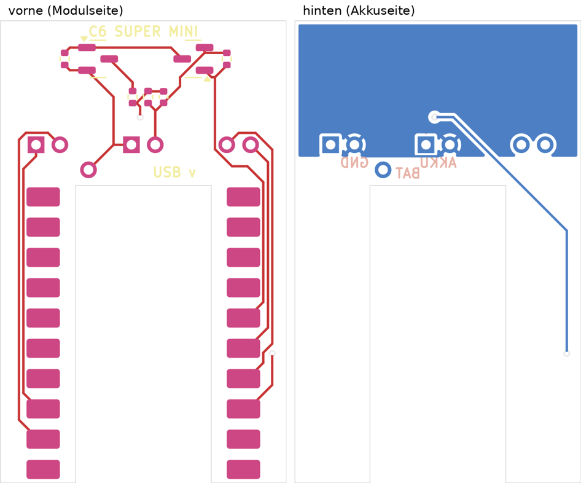
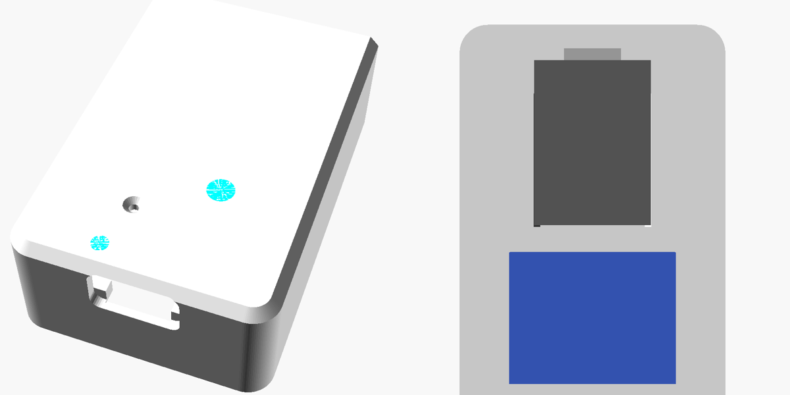

# Türknauf – Smarthome-Variante (Verschlusssensor)

Erweiterung des Türknaufs um einen Sensor, der meldet, ob die Tür abgeschlossen ist. Zwei Magnete im Griff und zwei Hall-Sensoren unter dem Griffrand zählen die Drehungen des Schlüssels. Ein XIAO ESP32C6 mit Akku sitzt in der verlängerten Platte, wacht bei jeder Drehung auf, meldet den Zustand per WLAN/MQTT an Home Assistant und schläft wieder. Laden und Flashen gehen über die USB-C-Buchse am unteren Ende, ohne die Platte abzunehmen.

Statt des XIAO passt auch ein **ESP32-C6 Super Mini** (eigene Trägerplatine, `modul = "supermini"`), siehe [Variante mit ESP32-C6 Super Mini](#variante-mit-esp32-c6-super-mini), oder ganz ohne Trägerplatine mit einem Adafruit MAX17048 (`modul = "supermini_frei"`, ESPHome), siehe [Variante ohne Trägerplatine](#variante-ohne-trägerplatine-super-mini--adafruit-max17048).

| Platte | Trägerplatine (vorne / hinten) | Sensorplatine |
|---|---|---|
|  |  |  |

## Funktion

- **Erkennung:** 2 Magnete Ø 3 × 2 mm (entgegengesetzt gepolt) in der Griffunterseite, 2 Hall-Latches TI DRV5012 bei 225° und 315° auf einer Bogenplatine in der Plattenoberseite. Das ergibt ein Quadratursignal mit 4 Schritten pro Umdrehung; die Firmware zählt in Vierteldrehungen.
- **Stellung:** Bezogen auf „abgeschlossen, Haus oben“ gilt: ab 0 abgeschlossen, −1 Zwischenstellung, ab −2 offen. Der Schlossweg (+2 … −5 Vierteldrehungen) steht in `REL_MAX`/`REL_MIN`; läuft der Zähler darüber hinaus, wird nachgeführt.
- **Funk:** Aufwachen per Pegelwechsel an den Sensoren (ext1), nach 2,5 s Stillstand Meldung per MQTT, danach Deep Sleep. Zusätzlich alle 12 h ein Lebenszeichen mit Akkustand.
- **Akku:** Schaltbarer Spannungsteiler auf der Trägerplatine (P-MOSFET, nur zum Messen an), Messung an A0.
- **Status-LED (RGB, hinter einem Lichtfenster):** weiß kurz = Neustart, grün kurz = gemeldet, 3× gelb = kein WLAN, 3× lila = kein MQTT, 2× rot = Akku unter 15 %, blau blitzend = wach am USB bzw. Wartungsmodus.
- **Reset:** Taster auf der Trägerplatine, mit einer Büroklammer durch das kleine Loch neben dem Lichtfenster.

## Dateien

| Pfad | Inhalt |
|---|---|
| `schluesselknauf.scad` | Mechanik, hier mit `elektronik = true` (Platte mit Fach, Griff mit Magnettaschen) |
| `firmware/schloss_sensor/schloss_sensor.ino` | Firmware für XIAO und Super Mini mit Trägerplatine (Arduino) |
| `firmware/esphome/haustuer_schloss.yaml`, `schloss.h` | ESPHome-Konfiguration für die Variante ohne Trägerplatine |
| `platte_supermini_frei.3mf`, `erzeuge_3mf.py` | Platte + Lichtfenster als 3MF (zwei Teile eines Objekts); das Skript erzeugt sie für jede Variante neu |
| `platine/schloss_sensor.kicad_pcb` | Sensorplatine (Bogen, 2 × DRV5012), 1,6 mm |
| `platine/traeger.kicad_pcb` | Trägerplatine für den XIAO mit Akkumessung, RGB-LED, Reset-Taster, 0,8 mm |
| `platine/traeger_supermini.kicad_pcb` | Trägerplatine für das ESP32-C6 Super Mini mit Akkumessung, 0,8 mm |
| `platine/jlcpcb/…` | Fertigungsdaten je Platine: Gerber-ZIP, Stückliste (BOM) und Bestückungsliste (CPL) für JLCPCB |
| `platine/erzeuge_*.py`, `ses_import.py`, `exportiere_jlc.py` | Skripte, aus denen die Platinen entstehen (KiCad 7 pcbnew, Freerouting für die Trägerplatine) |

## Zusätzliche Teile

| Teil | Anzahl | Hinweis |
|---|---|---|
| Seeed Studio XIAO ESP32C6 | 1 | wird auf die Trägerplatine gelötet |
| LiPo 803040 (3,7 V, ca. 1000 mAh) mit Schutzschaltung | 1 | 30 × 40 × 8 mm |
| Neodym-Magnet Ø 3 × 2 mm, axial | 2 | einer mit Nord, einer mit Süd nach unten einkleben |
| Einzeldrähte AWG 28–30 (z. B. Kynar/Wrap-Draht), 4 Stück | je ca. 15 cm | Sensorplatine → Trägerplatine; die Lötaugen haben 0,5 mm Bohrung |
| Schaumstoffstreifen 2 mm | 1 | zwischen Akku und Tür, drückt die Platine an |
| Transparentes PETG | – | für das Lichtfenster (`teil = "led_fenster"`) |

## Druck

- Platte mit der Rückseite auf das Druckbett, Stützen „nur auf dem Druckbett“ (für die Decke des Elektronikfachs).
- `platte` und `led_fenster` als ein Objekt laden, dem Fenster transparentes PETG zuweisen.
- `fach_test` druckt nur das untere Ende der Platte: vorab Trägerplatine, XIAO, USB-Stecker, Lichtfenster und Reset-Loch prüfen.
- Griff wie in der README; die Magnettaschen liegen an der Unterseite.
- Kabeldurchlass von der Sensortasche nach hinten: `kabel_loch_d` (3 mm) und Kanal `kanal_b` × `kanal_t` (3,5 × 3 mm), reicht für 4 Adern AWG 28/30, nicht für ein Kabel mit Mantel.

## Platinen bestellen (JLCPCB)

Für jede Platine eine eigene Bestellung, beide in denselben Warenkorb (kommt in einem Paket):

1. `platine/jlcpcb/traeger/traeger_gerber.zip` hochladen: 2 Lagen, **0,8 mm**, Menge 5.
2. `platine/jlcpcb/schloss_sensor/schloss_sensor_gerber.zip` hochladen: 2 Lagen, **1,6 mm**, Menge 5.
3. Jeweils „PCB Assembly“ einschalten (Economic, Top Side, Menge 2), `BOM_*.csv` und `CPL_*.csv` hochladen.
4. In der Bestückungsvorschau prüfen: Pin-1-Punkt der Hall-Sensoren, Ausrichtung der SOT-23-Transistoren, Pin-1-Ecke der RGB-LED (oben links, zu R5). Bei Abweichung in der Vorschau drehen.

## Löten und Verdrahten

**XIAO auf die Trägerplatine:** mit den Bauteilen nach oben auf das Feld „XIAO ESP32C6“ legen, USB-C zur Kante „USB“. Von hinten müssen durch die Bohrungen **VBAT** und **EN** die Pads auf der Unterseite des XIAO zu sehen sein – das vor dem Löten prüfen. Zwei Randkontakte anheften, Lage prüfen, alle 14 Randkontakte löten. Dann die Bohrungen VBAT und EN von hinten mit Zinn füllen, bis es am Pad des XIAO anbindet.

**Kabel** (von hinten durchstecken, vorne flach verlöten, höchstens 1 mm hoch):

| Trägerplatine | Gegenstelle |
|---|---|
| AKKU + / − (Mitte) | Akku |
| 3V3, GND (links) | Sensorplatine J1 Pin 1 (eckig) und Pin 2 |
| A, B (rechts) | Sensorplatine J1 Pin 3 und Pin 4 |

Pinbelegung am XIAO (für eigene Aufbauten): D0/A0 Akkumessung, D1 Sensor A, D2 Sensor B, D3 Messung/LED einschalten, D8/D9/D10 LED rot/grün/blau (LOW = an), EN Reset-Taster.

## Einbau

1. Magnete in die Taschen der Griffunterseite kleben (entgegengesetzte Pole nach unten).
2. Sensorplatine mit den Bauteilen nach vorne in die Bogentasche der Platte legen, Kabel durch das Loch nach hinten, mit einem Tropfen Kleber sichern.
3. Trägerplatine mit dem XIAO von hinten in das Fach setzen, Bauteile nach vorne, USB-C zur Öffnung unten.
   Die USB-Öffnung ist nur 9,8 × 4,1 mm: Die Buchse sitzt ca. 0,7 mm hinter der Außenfläche, die Stecker-Ummantelung liegt außen an (`usb_oeff`, `usb_vers`). Vorher `fach_test_*.stl` drucken und mit dem Kabel prüfen; nach dem Nachmessen von `usb_ueber` wird die Lage automatisch angepasst.
4. Akku mit Schaumstoffstreifen darauf legen; er drückt die Platine gegen die Auflagen.
5. Weiter wie in der README (Schaft, Platte anschrauben, Griff, Querschraube).

## Firmware

1. Arduino-IDE mit dem Boardpaket „esp32“ von Espressif ab Version 3.0, Board „XIAO_ESP32C6“ (Super Mini: „MakerGO ESP32 C6 SuperMini“ oder „ESP32C6 Dev Module“), „USB CDC On Boot: Enabled“, Bibliothek **PubSubClient**. Die Firmware erkennt am gewählten Board, welches Modul verbaut ist.
2. Oben in `schloss_sensor.ino` WLAN, MQTT-Broker und ggf. feste IP eintragen.
3. Hochladen: USB-Kabel einstecken und den Knauf kurz drehen (weckt den ESP); solange USB steckt, bleibt er wach.
4. Home Assistant findet die Sensoren „Aufgeschlossen“, „Stellung“, „Akku“ und „Akkuspannung“ per MQTT-Discovery.

**Kalibrieren** (einmalig, Nachricht mit *retain* an `haustuer/schloss/befehl`):

1. Abschließen, bis das Haus oben steht → `zu` senden, Knauf kurz drehen.
2. Eine halbe Drehung aufschließen → `auf` senden, Knauf kurz drehen.

Weitere Befehle: `wach` (10 Minuten wach, z. B. zum Flashen ohne USB-Erkennung), `reset` (Kalibrierung löschen). Der Befehl wird beim nächsten Aufwachen abgeholt und danach gelöscht.

## Variante mit ESP32-C6 Super Mini

Gleiche Mechanik, Sensorplatine, Firmware und Akku; anders sind Trägerplatine, Elektronikfach, Lichtfenster und Reset-Loch.

| Platte (Fach, vorne / hinten) | Trägerplatine (vorne / hinten) |
|---|---|
|  |  |

| | XIAO ESP32C6 | ESP32-C6 Super Mini |
|---|---|---|
| Modul | 21 × 17,8 mm | 25,5 × 18 mm, 2 × 10 Randkontakte |
| Trägerplatine | 22 × 39 mm, 12 Bauteile | 24 × 38,75 mm, 7 Bauteile (nur Akkumessung) |
| Status-LED | RGB-LED auf der Trägerplatine | WS2812 auf dem Modul (GPIO8) |
| Reset | Taster SW1 auf der Trägerplatine | RST-Taster auf dem Modul |
| Akku laden | Ladeschaltung im XIAO | Ladeschaltung LTH7R auf dem Modul |
| Ruhestrom (Deep Sleep) | ca. 15–20 µA | ca. 54 µA (Messung von dmelo.eu am BAT-Pad mit 3,7 V) |

Der höhere Ruhestrom kostet Laufzeit: Allein der Schlaf zieht aus 1000 mAh gut 2 Jahre lang, mit den Meldungen bleibt rund 1 Jahr pro Ladung (geschätzt).

**Platte:** In `schluesselknauf.scad` `modul = "supermini"` setzen und `platte`, `led_fenster` und `fach_test` neu exportieren. Griff, Schaft, Haus und Kappen bleiben gleich. Das Lichtfenster hat hier zwei Fenster: eines über der WS2812, ein kleines über der grünen Lade-LED neben der USB-Buchse.

**Trägerplatine bestellen:** wie oben, mit `platine/jlcpcb/traeger_supermini/` (2 Lagen, **0,8 mm**, Menge 5; Assembly mit `BOM_traeger_supermini.csv` und `CPL_traeger_supermini.csv`). Unter dem Modul ist die Platine ausgeschnitten: Dort stehen die Haltelaschen der USB-C-Buchse über, die Akku-Pads des Moduls bleiben von hinten erreichbar, und unter der Antenne liegt kein Kupfer.

**Löten:**
1. Modul mit den Bauteilen nach vorne auf die beiden Lötflächen-Leisten legen, USB-C zur offenen Seite des Ausschnitts. Die Leiste „TX, RX, 0 … 7“ liegt von vorne gesehen rechts.
2. Zwei Ecken anheften, Lage prüfen, alle 20 Randkontakte löten (Zinn läuft in die Bohrungen der Randkontakte).
3. Akku an **AKKU + / −**.
4. **Akku-Pads des Moduls:** Sie liegen auf der **Unterseite** am USB-Ende, zwischen den Haltelaschen der USB-Buchse, etwa 2 mm von der Kante: **B+** zur Seite „5V/GND/3V3“, **B−** zur Seite „TX/RX“ (achteckige Pads, Produktfoto). Beide liegen im Ausschnitt der Trägerplatine. Draht (AWG 28–30) vom Lötauge **BAT** der Trägerplatine auf der Rückseite flach durch den Ausschnitt zu **B+** führen; B− bleibt frei (Masse kommt über die Randkontakte). Vor dem ersten Laden nachmessen: an B+ muss die Akkuspannung anliegen.
5. Sensorkabel wie oben: 3V3/GND links, A/B rechts.

Pinbelegung Super Mini: GPIO0 Akkumessung, GPIO1 Sensor A, GPIO2 Sensor B, GPIO3 Messung einschalten, GPIO8 WS2812.

**Vor dem Bestellen prüfen** (alle Maße des Super Mini stammen aus Herstellerfoto und Quellen, nicht von einem Modul in der Hand):
- Länge (25,5 mm), Überstand der USB-C-Buchse (2,0 mm, `usb_ueber`) und Platinendicke (1,0 mm, `xiao_d`) nachmessen. `fach_test` drucken und das Modul probehalber einlegen.
- Lage von WS2812, RST-Taster und Lade-LED (`tr_led`, `tr_tast`, `tr_lade`) am Probedruck kontrollieren.
- Es gibt mehrere Super-Mini-Versionen; diese Platine passt zur Version mit Akku-Pads B+/B− auf der Unterseite und Ladeschaltung (Beschriftung „BAT“ an der Lade-LED neben der USB-Buchse). Ohne Ladeschaltung lässt sich der Akku nicht über USB laden.
- Farbreihenfolge der WS2812 (GRB angenommen): Beim Neustart muss sie weiß blinken, nach einer Meldung grün.

## Variante ohne Trägerplatine (Super Mini + Adafruit MAX17048)

Keine eigene Platine für die Elektronik: Das Super Mini liegt direkt in seiner Tasche, die Akkumessung übernimmt ein fertiges Breakout (Adafruit #5580, MAX17048). Alles wird mit Einzeldrähten verbunden. Nur die Sensorplatine wird noch bestellt.

**Platte:** `modul = "supermini_frei"` (bzw. `platte_supermini_frei.3mf`). Die Platte wird unten 7,2 mm länger, weil das Breakout (25,7 × 20,3 mm) über dem Akku oberhalb des Moduls liegt, 4 mm Abstand zur Antenne (`ant_abst`). Lichtfenster, Lade-Fenster und Reset-Loch wie bei der Super-Mini-Variante.

**Breakout vorbereiten:**
- Die beiden **JST-PH-Buchsen ablöten** (sonst 7,2 mm hoch, passt nicht); die STEMMA-QT-Buchsen dürfen bleiben (`ada_h` = 4,6 mm).
- Leiterbahn der „on“-LED auf der Rückseite durchtrennen, sonst zieht sie dauerhaft Strom aus 3V3.

**Verdrahtung** (AWG 28–30, Drähte von hinten an die Lötaugen, vorne flach halten – das Modul liegt vorne mit dem Rand auf 1-mm-Auflagen):

| Von | Nach |
|---|---|
| Akku + / − | erstes JST-Padpaar des Breakouts (Polarität laut Aufdruck) |
| zweites JST-Padpaar des Breakouts | B+ / B− auf der Unterseite des Super Mini |
| Breakout VIN, GND, SDA, SCL | Super Mini 3V3, GND, GPIO20, GPIO19 |
| Sensorplatine J1 Pin 1 / 2 | Super Mini 3V3 / GND |
| Sensorplatine J1 Pin 3 / 4 | Super Mini GPIO1 / GPIO2 |

**Einbau:** Modul mit den Bauteilen nach vorne, USB-C zur Öffnung, in die untere Tasche; Breakout mit den Bauteilen nach vorne in die obere Tasche; Drähte flach auf die Rückseiten; Akku mit Schaumstoffstreifen darauf (er drückt Modul und Breakout an).

**Firmware (ESPHome):** `firmware/esphome/haustuer_schloss.yaml` mit `schloss.h` daneben; `secrets.beispiel.yaml` nach `secrets.yaml` kopieren und ausfüllen. Funktion, LED-Signale und Kalibrier-Befehle wie oben (MQTT, Topic `haustuer/schloss/befehl`). Der MAX17048 läuft über die ESPHome-Komponente `max17043` (gleiche Register für Spannung und Ladestand) und geht bei der kleinen Last von selbst in den Ruhemodus (~3 µA). Erstes Flashen per USB („Plug into this computer“ im ESPHome-Dashboard), danach OTA, solange USB steckt oder nach dem Befehl `wach`.

**Prüfen:**
- Die ESPHome-Konfiguration ist mit ESPHome 2026.9 geprüft (`esphome config`), aber nicht kompiliert und nicht auf Hardware getestet.
- Beim Aufwachen braucht ESPHome länger als die Arduino-Firmware bis zum ersten Lesen der Sensoren; ein verpasster Zwischenschritt wird ausgeglichen, sehr schnelles Drehen direkt nach dem Aufwachen kann trotzdem einen Schritt kosten.
- Maße des Breakouts (25,7 × 20,3 mm, Höhe ohne JST-PH) am eigenen Board nachmessen; `fach_test` drucken.

## Offene Punkte vor dem Bestellen

- **Unterseiten-Pads des XIAO:** Lage von VBAT und EN stammt aus der KiCad-Bibliothek von Seeed (`XIAO-ESP32-C6-SMD`). Am eigenen XIAO nachprüfen.
- **Antenne:** Die Platine geht davon aus, dass die Keramikantenne am Ende gegenüber der USB-Buchse sitzt, und lässt dort die Massefläche frei.
- **RGB-LED LTST-C19HE1WT:** Pinbelegung (1 = R, 2 = G, 3 = B, 4 = Anode) aus den Bauteildaten von LCSC; in der JLCPCB-Vorschau kontrollieren.
- Die Firmware ist kompiliert, aber noch nicht auf echter Hardware getestet.

## Idee: Akku über Stecker anschließen (noch nicht umgesetzt)

Die Akkus kommen meist mit Stecker (JST PH 2.0). Derzeit werden die Akkukabel an die Lötaugen „AKKU“ gelötet. Für eine Steckverbindung wäre nötig:

- **Platz:** Eine liegende PH-2.0-Buchse ist mit Gegenstecker etwa 5 mm hoch und rund 12 mm lang. Vor der Trägerplatine sind nur 1,9 mm frei, über dem Akku etwa 2,5 mm. Die Buchse braucht also eine Stelle im Fach ohne Akku.
- **Vorschlag:** Platte unten um ca. 10 mm verlängern (`bat_l` von 46 auf etwa 56), Akku ans obere Ende des Fachs mit den Kabeln nach unten, SMD-Buchse (z. B. JST S2B-PH-SM4-TB) auf der **Rückseite** der Trägerplatine unter dem USB-Ende des XIAO, Öffnung zum Akku. Die Lötaugen „AKKU“ bleiben als Alternative.
- **Löten:** JLCPCB bestückt bei „Economic“ nur eine Seite – die Buchse wird von Hand gelötet (zwei Pads, zwei Haltelaschen).
- **Polarität:** Bei Akkus von AliExpress ist die Belegung am PH-Stecker nicht einheitlich. + und − auf der Platine kennzeichnen und vor dem ersten Einstecken nachmessen.
- Vorher klären: Steckertyp (PH 2.0 oder 1.25 mm) und Gesamtlänge des Akkus mit Schutzschaltung.

