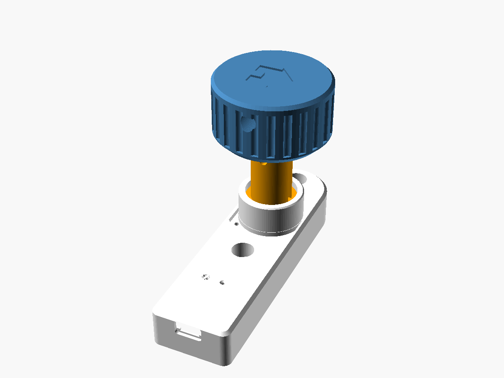
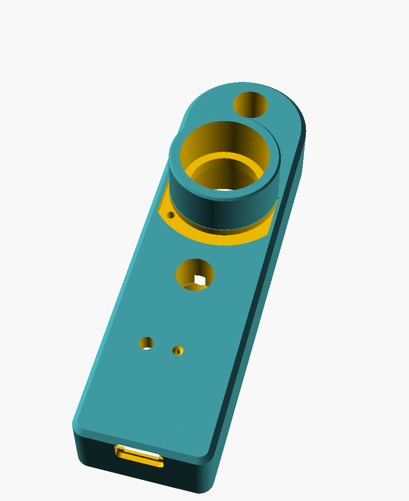
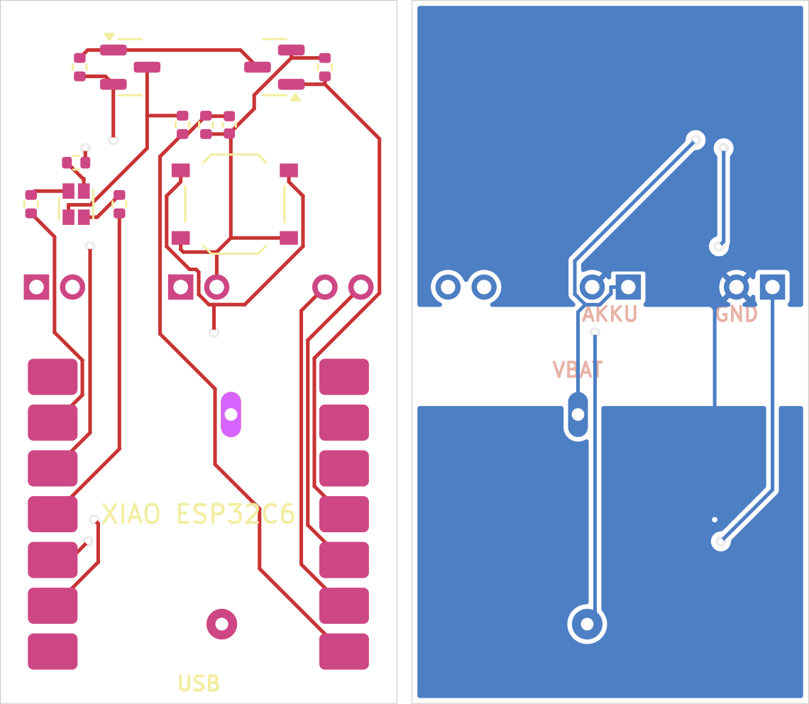
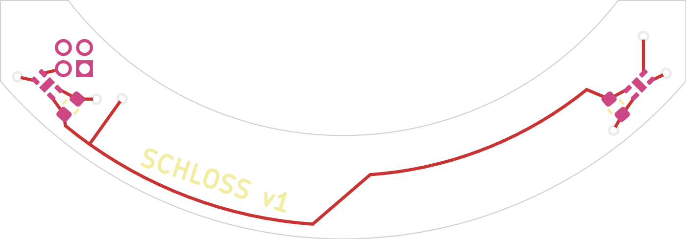

# Türknauf – Smarthome-Variante (Verschlusssensor)

Erweiterung des Türknaufs um einen Sensor, der meldet, ob die Tür abgeschlossen ist. Zwei Magnete im Griff und zwei Hall-Sensoren unter dem Griffrand zählen die Drehungen des Schlüssels. Ein XIAO ESP32C6 mit Akku sitzt in der verlängerten Platte, wacht bei jeder Drehung auf, meldet den Zustand per WLAN/MQTT an Home Assistant und schläft wieder. Laden und Flashen gehen über die USB-C-Buchse am unteren Ende, ohne die Platte abzunehmen.

| Platte | Trägerplatine (vorne / hinten) | Sensorplatine |
|---|---|---|
|  |  |  |

## Funktion

- **Erkennung:** 2 Magnete Ø 3 × 2 mm (entgegengesetzt gepolt) in der Griffunterseite, 2 Hall-Latches TI DRV5012 bei 225° und 315° auf einer Bogenplatine in der Plattenoberseite. Das ergibt ein Quadratursignal mit 4 Schritten pro Umdrehung; die Firmware zählt in Vierteldrehungen.
- **Stellung:** Bezogen auf „abgeschlossen, Haus oben“ gilt: ab 0 abgeschlossen, −1 Zwischenstellung, ab −2 offen. Der Schlossweg (+2 … −5 Vierteldrehungen) steht in `REL_MAX`/`REL_MIN`; läuft der Zähler darüber hinaus, wird nachgeführt.
- **Funk:** Aufwachen per Pegelwechsel an den Sensoren (ext1), nach 2,5 s Stillstand Meldung per MQTT, danach Deep Sleep. Zusätzlich alle 12 h ein Lebenszeichen mit Akkustand.
- **Akku:** Schaltbarer Spannungsteiler auf der Trägerplatine (P-MOSFET, nur zum Messen an), Messung an A0.
- **Status-LED (RGB, hinter einem Lichtfenster):** weiß kurz = Neustart, grün kurz = gemeldet, 3× gelb = kein WLAN, 3× lila = kein MQTT, 2× rot = Akku unter 15 %, blau blitzend = wach am USB bzw. Wartungsmodus.
- **Reset:** Taster auf der Trägerplatine, mit einer Büroklammer durch das kleine Loch neben dem Lichtfenster.

## Dateien

| Pfad | Inhalt |
|---|---|
| `schluesselknauf.scad` | Mechanik, hier mit `elektronik = true` (Platte mit Fach, Griff mit Magnettaschen) |
| `firmware/schloss_sensor/schloss_sensor.ino` | Firmware für den XIAO ESP32C6 (Arduino) |
| `platine/schloss_sensor.kicad_pcb` | Sensorplatine (Bogen, 2 × DRV5012), 1,6 mm |
| `platine/traeger.kicad_pcb` | Trägerplatine für den XIAO mit Akkumessung, RGB-LED, Reset-Taster, 0,8 mm |
| `platine/jlcpcb/…` | Fertigungsdaten je Platine: Gerber-ZIP, Stückliste (BOM) und Bestückungsliste (CPL) für JLCPCB |
| `platine/erzeuge_*.py`, `ses_import.py`, `exportiere_jlc.py` | Skripte, aus denen die Platinen entstehen (KiCad 7 pcbnew, Freerouting für die Trägerplatine) |

## Zusätzliche Teile

| Teil | Anzahl | Hinweis |
|---|---|---|
| Seeed Studio XIAO ESP32C6 | 1 | wird auf die Trägerplatine gelötet |
| LiPo 803040 (3,7 V, ca. 1000 mAh) mit Schutzschaltung | 1 | 30 × 40 × 8 mm |
| Neodym-Magnet Ø 3 × 2 mm, axial | 2 | einer mit Nord, einer mit Süd nach unten einkleben |
| Litze 4-adrig, dünn | ca. 15 cm | Sensorplatine → Trägerplatine |
| Schaumstoffstreifen 2 mm | 1 | zwischen Akku und Tür, drückt die Platine an |
| Transparentes PETG | – | für das Lichtfenster (`teil = "led_fenster"`) |

## Druck

- Platte mit der Rückseite auf das Druckbett, Stützen „nur auf dem Druckbett“ (für die Decke des Elektronikfachs).
- `platte` und `led_fenster` als ein Objekt laden, dem Fenster transparentes PETG zuweisen.
- `fach_test` druckt nur das untere Ende der Platte: vorab Trägerplatine, XIAO, USB-Stecker, Lichtfenster und Reset-Loch prüfen.
- Griff wie in der README; die Magnettaschen liegen an der Unterseite.

## Platinen bestellen (JLCPCB)

Für jede Platine eine eigene Bestellung, beide in denselben Warenkorb (kommt in einem Paket):

1. `platine/jlcpcb/traeger/traeger_gerber.zip` hochladen: 2 Lagen, **0,8 mm**, Menge 5.
2. `platine/jlcpcb/schloss_sensor/schloss_sensor_gerber.zip` hochladen: 2 Lagen, **1,6 mm**, Menge 5.
3. Jeweils „PCB Assembly“ einschalten (Economic, Top Side, Menge 2), `BOM_*.csv` und `CPL_*.csv` hochladen.
4. In der Bestückungsvorschau prüfen: Pin-1-Punkt der Hall-Sensoren, Ausrichtung der SOT-23-Transistoren, Pin-1-Ecke der RGB-LED (oben links, zu R5). Bei Abweichung in der Vorschau drehen.

## Löten und Verdrahten

**XIAO auf die Trägerplatine:** mit den Bauteilen nach oben auf das Feld „XIAO ESP32C6“ legen, USB-C zur Kante „USB“. Von hinten müssen durch die Bohrungen **VBAT** und **EN** die Pads auf der Unterseite des XIAO zu sehen sein – das vor dem Löten prüfen. Zwei Randkontakte anheften, Lage prüfen, alle 14 Randkontakte löten. Dann die Bohrungen VBAT und EN von hinten mit Zinn füllen, bis es am Pad des XIAO anbindet.

**Kabel** (von hinten durchstecken, vorne flach verlöten, höchstens 1 mm hoch):

| Trägerplatine | Gegenstelle |
|---|---|
| AKKU + / − (Mitte) | Akku |
| 3V3, GND (links) | Sensorplatine J1 Pin 1 (eckig) und Pin 2 |
| A, B (rechts) | Sensorplatine J1 Pin 3 und Pin 4 |

Pinbelegung am XIAO (für eigene Aufbauten): D0/A0 Akkumessung, D1 Sensor A, D2 Sensor B, D3 Messung/LED einschalten, D8/D9/D10 LED rot/grün/blau (LOW = an), EN Reset-Taster.

## Einbau

1. Magnete in die Taschen der Griffunterseite kleben (entgegengesetzte Pole nach unten).
2. Sensorplatine mit den Bauteilen nach vorne in die Bogentasche der Platte legen, Kabel durch das Loch nach hinten, mit einem Tropfen Kleber sichern.
3. Trägerplatine mit dem XIAO von hinten in das Fach setzen, Bauteile nach vorne, USB-C zur Öffnung unten.
4. Akku mit Schaumstoffstreifen darauf legen; er drückt die Platine gegen die Auflagen.
5. Weiter wie in der README (Schaft, Platte anschrauben, Griff, Querschraube).

## Firmware

1. Arduino-IDE mit dem Boardpaket „esp32“ von Espressif ab Version 3.0, Board „XIAO_ESP32C6“, „USB CDC On Boot: Enabled“, Bibliothek **PubSubClient**.
2. Oben in `schloss_sensor.ino` WLAN, MQTT-Broker und ggf. feste IP eintragen.
3. Hochladen: USB-Kabel einstecken und den Knauf kurz drehen (weckt den ESP); solange USB steckt, bleibt er wach.
4. Home Assistant findet die Sensoren „Aufgeschlossen“, „Stellung“, „Akku“ und „Akkuspannung“ per MQTT-Discovery.

**Kalibrieren** (einmalig, Nachricht mit *retain* an `haustuer/schloss/befehl`):

1. Abschließen, bis das Haus oben steht → `zu` senden, Knauf kurz drehen.
2. Eine halbe Drehung aufschließen → `auf` senden, Knauf kurz drehen.

Weitere Befehle: `wach` (10 Minuten wach, z. B. zum Flashen ohne USB-Erkennung), `reset` (Kalibrierung löschen). Der Befehl wird beim nächsten Aufwachen abgeholt und danach gelöscht.

## Offene Punkte vor dem Bestellen

- **Unterseiten-Pads des XIAO:** Lage von VBAT und EN stammt aus der KiCad-Bibliothek von Seeed (`XIAO-ESP32-C6-SMD`). Am eigenen XIAO nachprüfen.
- **Antenne:** Die Platine geht davon aus, dass die Keramikantenne am Ende gegenüber der USB-Buchse sitzt, und lässt dort die Massefläche frei.
- **RGB-LED LTST-C19HE1WT:** Pinbelegung (1 = R, 2 = G, 3 = B, 4 = Anode) aus den Bauteildaten von LCSC; in der JLCPCB-Vorschau kontrollieren.
- Die Firmware ist kompiliert, aber noch nicht auf echter Hardware getestet.
