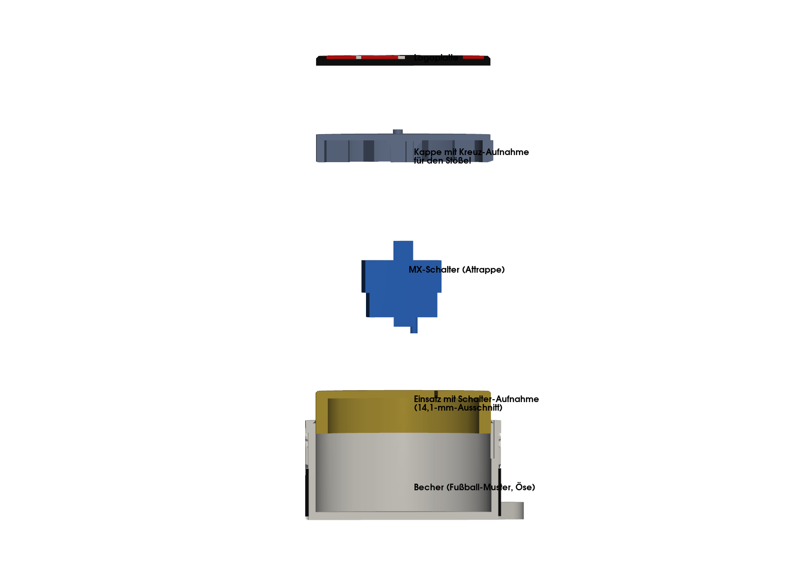
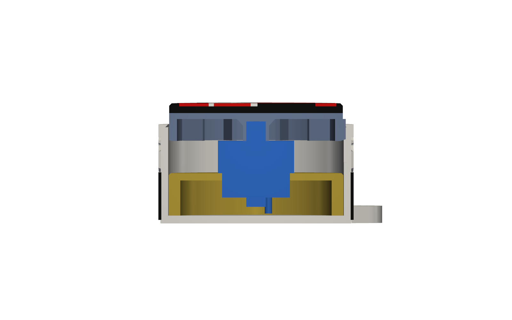
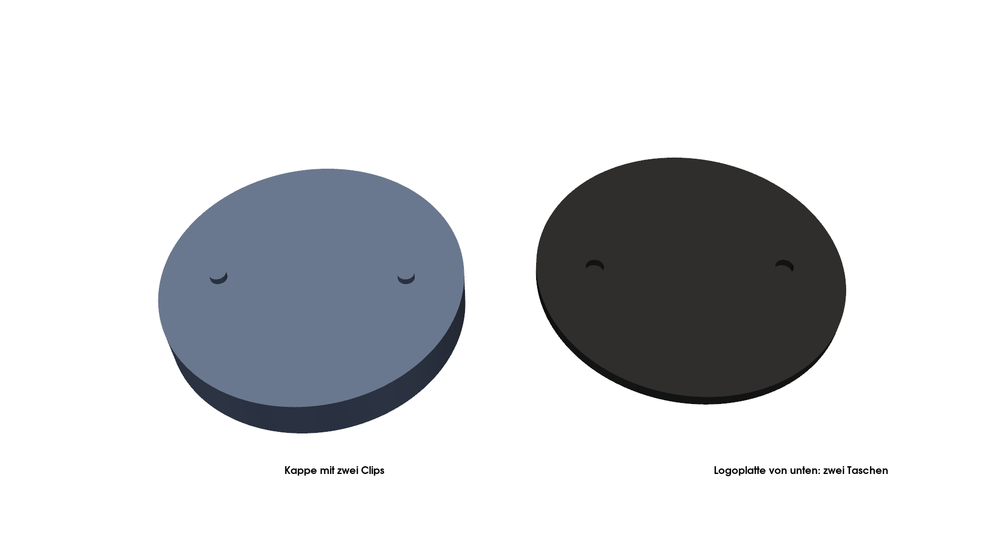
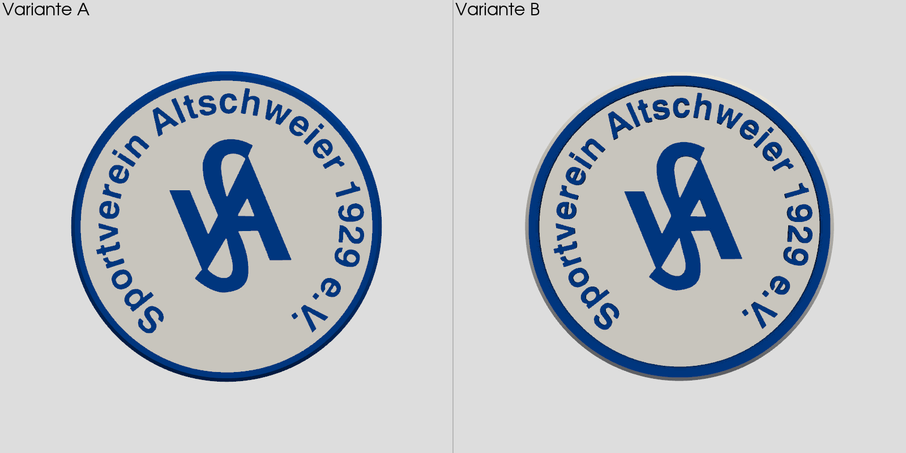

# VfB-Bühl-Clicker (Schlüsselanhänger)

Klicker für den Schlüsselbund auf Basis eines MX-kompatiblen Tastaturschalters. Das Vereinslogo (schwarz/weiß/rot) ist die Kappe. Prinzip: Die Kappe sitzt wie ein Kolben in einem Becher, der Schalter steckt unten im Becher.



| Schnitt mit Schalter | Zapfen und Löcher |
|---|---|
|  |  |

## Eckdaten

| | |
|---|---|
| Außen-Ø | 40 mm |
| Höhe in Ruhe | 24,6 mm (Variante A, bündig) / 26,2 mm (Variante B, erhaben) |
| Hub | 4 mm |
| Logo | Ø 35,6 mm, Variante A bündig eingelegt (0,6 mm), Variante B Buchstaben erhaben und verrundet |
| Becher | Fußballmuster (Sechsecke weiß, 8 Fünfecke schwarz eingelegt), Zylinderform bleibt erhalten, Öse für Schlüsselring bei 11 Uhr |
| Schalter | MX-kompatibel, Plattenloch 14,1 mm, Kreuzaufnahme 4,15 × 1,30/1,40 mm |

## Teile (`druck/`)

| Datei | Inhalt |
|---|---|
| `becher_mit_oese.stl`, `becher_fuenfecke_schwarz.stl`, `becher_fussball_mehrfarbig.3mf` | Becher (weiß) und Fünfecke (schwarz) |
| `einsatz_schalterplatte.stl` | Schalteraufnahme, in den Becher geklebt |
| `kappe_kolben_mit_zapfen.stl` | Kolben (Stempel) mit Kreuzaufnahme für den Stößel und zwei Zapfen für die Logoplatte, Drucklage Logoseite oben |
| `kappe_kolben_ohne_zapfen.stl` | Kolben mit glatter Deckfläche und ohne Stützrippen, die Logoplatte wird geklebt (die Sacklöcher in der Platte bleiben dann leer). Drucklage: Deckfläche auf dem Bett, Skirt oben |
| `logoplatte_A_*`, `logoplatte_B_*` | Logoplatte je Farbe als STL und als Mehrfarb-3MF |
| `clicker_komplett_A/B_..._nur_ansicht.3mf` | Zusammenbau mit Schalter, nur zur Ansicht |

## Zweites Logo: SV Altschweier 1929 e.V.

Blau auf weißem Grund, ebenfalls in beiden Varianten. Die Platten haben dieselben Maße und Sacklöcher und passen auf denselben Kolben.



| Datei | Inhalt |
|---|---|
| `logoplatte_SVA_A_buendig_weiss.stl`, `..._blau.stl`, `..._mehrfarbig.3mf` | Variante A: Logo bündig 0,6 mm eingelegt, Ø 35,6 mm |
| `logoplatte_SVA_B_erhaben_weiss.stl`, `..._blau.stl`, `..._mehrfarbig.3mf` | Variante B: Logo 1,0 mm erhaben und verrundet. Das Logo ist hier auf Ø 34,4 mm verkleinert, damit der blaue Ring vollständig erhaben bleibt und nicht in die Fase der Platte läuft |

Die Schrift hat nur ca. 0,6 mm Strichstärke. Mit 0,4-mm-Düse und 0,12–0,16 mm Schichthöhe drucken.

## Zusammenbau

1. Schalter von oben in den Einsatz klicken.
2. Einsatz mit der Schalterseite nach oben in den Becher schieben, mit Sekundenkleber sichern.
3. Logoplatte (Logo oben, Logo-Oberkante zur Rippe bei 12 Uhr) auf die Zapfen der Kappe drücken.
4. Kappe mit der Rippe in die Nut einsetzen und auf den Stößel drücken.

## Hinweise

- Die Logoplatte sitzt mit zwei starren Zapfen (Ø 2,0 mm, 0,9 mm hoch) in Sacklöchern (Ø 2,1 mm, 1,0 mm tief) auf der Plattenunterseite. Sie hält durch Klemmung, notfalls ein Tropfen Kleber. Sie passt in zwei um 180° gedrehten Lagen.
- Kappe mit Zapfen: Logoseite nach oben drucken, die 8 Stützrippen unter der Deckscheibe verhindern eine Brücke über Ø 32 mm. Die Kappe ohne Zapfen hat keine Rippen und wird mit der Deckfläche nach unten gedruckt. Skirt und Zapfen sind 4,5 mm lang, die Führung im Becher ist in Ruhe ca. 3,4 mm lang.
- Noch nicht gedruckt. Zuerst Kappe, Einsatz und eine Logoplatte als Test drucken (Zapfenpassung, Kreuzaufnahme, Gleitpassung im Becher).

## Neu erzeugen

```
pip install manifold3d trimesh shapely opencv-python pyvista numpy pillow
SIMP=0.003 python3 build_clicker.py modell/logo.png druck
python3 vorschau.py druck
LOGO=sva SIMP=0.01 python3 build_clicker.py modell/logo_sva.jpg druck   # nur die SVA-Platten
```

`build_clicker.py` ist die Quelle für alle Dateien in `druck/` (Parameter am Anfang der Datei). `vorschau.py` baut die Schalterattrappe, prüft Kollisionen und rendert die Bilder. Alle STL-Dateien sind nach dem Neuladen wasserdicht.
